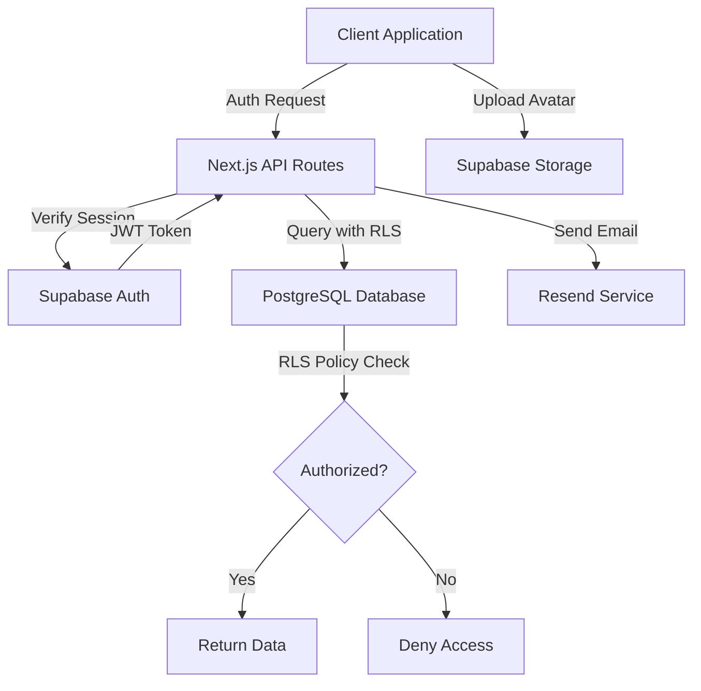
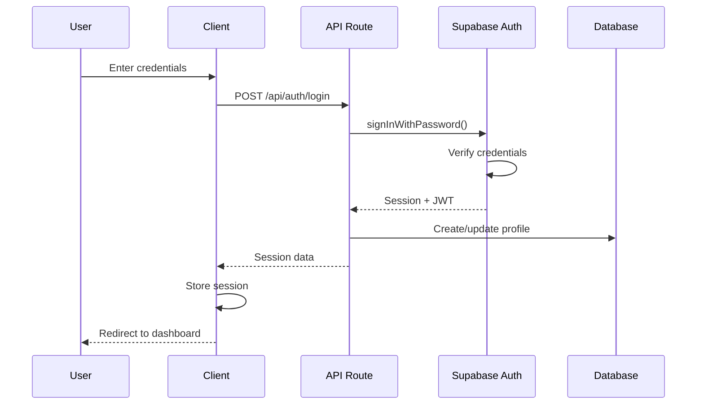
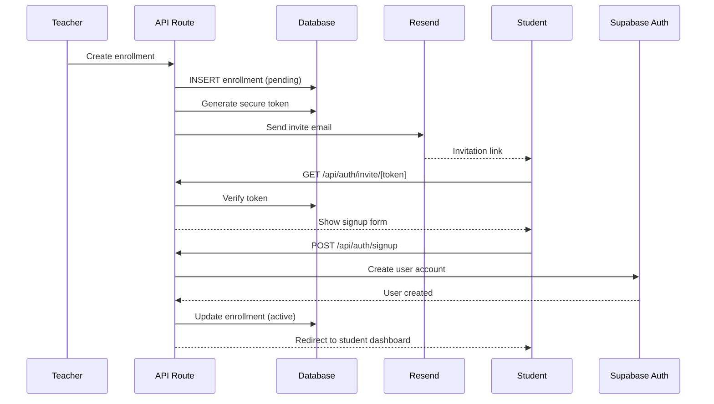

# Design Document: Authentication and Profiles

## Overview

The Authentication and Profiles module provides the security foundation for the Jiu-Jitsu lessons management platform. This module implements user authentication, profile management, and role-based access control using Supabase Auth as the identity provider and PostgreSQL Row Level Security (RLS) policies for authorization enforcement.

### Goals

- Enable secure teacher account creation and authentication
- Facilitate student invitation and account creation workflow
- Manage user profiles with role-specific data (teacher vs student)
- Enforce data isolation between teachers at the database level
- Provide session management with automatic token refresh
- Support password recovery and email confirmation flows
- Handle avatar uploads and timezone preferences

### Non-Goals

- Social authentication providers (Google, Facebook, etc.)
- Two-factor authentication (2FA)
- Account deletion workflows
- Platform administrator role
- Single sign-on (SSO) integration
- Multi-tenancy beyond teacher isolation

### Key Design Decisions

1. **Supabase Auth as Identity Provider**: Leverages managed authentication service to avoid implementing security-sensitive logic from scratch. Supabase Auth handles password hashing, JWT token generation, email verification, and session management.

2. **Row Level Security for Authorization**: Database-level security policies enforce data isolation. This ensures authorization is never bypassed, even if application code has bugs. RLS policies use the authenticated user's ID from the JWT token.

3. **Separate Profile and Teacher Tables**: The `profiles` table contains core user data for all users, while `teachers` table extends profiles with teacher-specific configuration. This allows users to have both teacher and student capabilities.

4. **Invite Token Pattern**: Students are invited via email with secure tokens rather than allowing public registration. This maintains teacher control over student accounts and prevents unauthorized access.

5. **Server-Side Session Verification**: All API routes verify authentication server-side using Supabase server client. Never trust client-provided user information.

## Architecture

### High-Level Flow



### Component Layers

1. **Presentation Layer (Client Components)**
   - Login/Signup forms
   - Profile management UI
   - Avatar upload component
   - Timezone selector

2. **API Layer (Next.js API Routes)**
   - `/api/auth/*` - Authentication endpoints
   - `/api/teachers/[id]` - Teacher profile management
   - `/api/profiles/me` - Current user profile

3. **Service Layer (lib/services)**
   - `auth.service.ts` - Authentication business logic
   - `teacher.service.ts` - Teacher profile operations
   - `enrollment.service.ts` - Student invitation logic

4. **Data Layer (PostgreSQL + RLS)**
   - `profiles` table with RLS policies
   - `teachers` table with RLS policies
   - `enrollments` table (defined in separate spec)

5. **External Services**
   - Supabase Auth - Identity provider
   - Supabase Storage - Avatar storage
   - Resend - Email delivery

### Authentication Flow



### Student Invitation Flow



## Components and Interfaces

### API Endpoints

#### POST /api/auth/signup

Creates a new teacher account with email and password.

**Request:**
```typescript
{
  email: string;          // Valid email format
  password: string;       // Min 8 characters
  fullName: string;       // Required
  displayName: string;    // Required for teachers
  timezone?: string;      // IANA timezone, defaults to America/Sao_Paulo
}
```

**Response:**
```typescript
{
  data: {
    user: {
      id: string;
      email: string;
    };
    session: {
      access_token: string;
      refresh_token: string;
      expires_at: number;
    };
    profile: {
      id: string;
      full_name: string;
      email: string;
      avatar_url: string | null;
    };
    roles: {
      is_teacher: boolean;
      is_student: boolean;
    };
  };
  error: null;
}
```

**Error Responses:**
- 400: Validation failure (invalid email, weak password)
- 409: Email already registered
- 500: Server error

#### POST /api/auth/login

Authenticates a user with email and password.

**Request:**
```typescript
{
  email: string;
  password: string;
}
```

**Response:** Same as signup response

**Error Responses:**
- 400: Missing credentials
- 401: Invalid credentials
- 500: Server error

#### POST /api/auth/logout

Terminates the current user session.

**Request:** None (uses session cookie)

**Response:**
```typescript
{
  data: { success: true };
  error: null;
}
```

#### POST /api/auth/refresh

Refreshes the access token using refresh token.

**Request:**
```typescript
{
  refresh_token: string;
}
```

**Response:**
```typescript
{
  data: {
    session: {
      access_token: string;
      refresh_token: string;
      expires_at: number;
    };
  };
  error: null;
}
```

#### POST /api/auth/recover

Initiates password recovery flow.

**Request:**
```typescript
{
  email: string;
}
```

**Response:**
```typescript
{
  data: { message: "Recovery email sent if account exists" };
  error: null;
}
```

#### GET /api/auth/invite/[token]

Validates an invitation token and returns invitation details.

**Response:**
```typescript
{
  data: {
    valid: boolean;
    teacher_name: string;
    student_email: string;
  };
  error: null;
}
```

**Error Responses:**
- 404: Invalid or expired token

#### POST /api/auth/invite/[token]

Creates a student account using an invitation token.

**Request:**
```typescript
{
  password: string;       // Min 8 characters
  fullName: string;
}
```

**Response:** Same as signup response

#### GET /api/profiles/me

Returns the current user's profile.

**Response:**
```typescript
{
  data: {
    profile: {
      id: string;
      full_name: string;
      email: string;
      avatar_url: string | null;
      created_at: string;
      updated_at: string;
    };
    teacher?: {
      id: string;
      display_name: string;
      timezone: string;
    };
    roles: {
      is_teacher: boolean;
      is_student: boolean;
    };
  };
  error: null;
}
```

#### PATCH /api/profiles/me

Updates the current user's profile.

**Request:**
```typescript
{
  full_name?: string;
  avatar_url?: string;
  display_name?: string;  // Only for teachers
  timezone?: string;      // Only for teachers
}
```

**Response:** Same as GET response

#### GET /api/teachers/[id]

Returns a teacher's public profile information.

**Response:**
```typescript
{
  data: {
    id: string;
    display_name: string;
    avatar_url: string | null;
  };
  error: null;
}
```

**Authorization:** Only the teacher themselves or their enrolled students can access

### Frontend Components

#### LoginForm Component

Located: `components/auth/LoginForm.tsx`

**Props:**
```typescript
interface LoginFormProps {
  onSuccess?: () => void;
  redirectTo?: string;
}
```

**Features:**
- Email and password inputs
- Client-side validation
- Error message display
- Loading state during authentication
- Link to password recovery
- Link to signup page

#### SignupForm Component

Located: `components/auth/SignupForm.tsx`

**Props:**
```typescript
interface SignupFormProps {
  onSuccess?: () => void;
  inviteToken?: string;  // For student invitations
}
```

**Features:**
- Email, password, full name inputs
- Display name and timezone for teachers
- Client-side validation (email format, password strength)
- Error message display
- Loading state
- Link to login page

#### ProfileForm Component

Located: `components/auth/ProfileForm.tsx`

**Props:**
```typescript
interface ProfileFormProps {
  profile: UserProfile;
  teacherProfile?: TeacherProfile;
  onSave: (data: ProfileUpdateData) => Promise<void>;
}
```

**Features:**
- Editable full name
- Avatar upload with preview
- Display name (teachers only)
- Timezone selector (teachers only)
- Save and cancel buttons
- Validation and error handling

#### AvatarUpload Component

Located: `components/auth/AvatarUpload.tsx`

**Props:**
```typescript
interface AvatarUploadProps {
  currentUrl?: string;
  onUpload: (file: File) => Promise<string>;
  maxSizeMB?: number;  // Default: 5
}
```

**Features:**
- Image preview
- Drag and drop support
- File type validation (JPEG, PNG, WebP)
- File size validation
- Upload progress indicator
- Remove current avatar option

### Custom Hooks

#### useAuth Hook

Located: `hooks/useAuth.ts`

**API:**
```typescript
interface UseAuthReturn {
  user: User | null;
  profile: UserProfile | null;
  teacherProfile: TeacherProfile | null;
  roles: { is_teacher: boolean; is_student: boolean };
  loading: boolean;
  login: (email: string, password: string) => Promise<void>;
  signup: (data: SignupData) => Promise<void>;
  logout: () => Promise<void>;
  updateProfile: (data: ProfileUpdateData) => Promise<void>;
  refreshSession: () => Promise<void>;
}
```

**Features:**
- Manages authentication state
- Provides login/logout/signup functions
- Auto-refreshes tokens before expiration
- Loads profile data on mount
- Syncs with Supabase Auth state changes

#### useProfile Hook

Located: `hooks/useProfile.ts`

**API:**
```typescript
interface UseProfileReturn {
  profile: UserProfile | null;
  teacherProfile: TeacherProfile | null;
  loading: boolean;
  error: Error | null;
  updateProfile: (data: ProfileUpdateData) => Promise<void>;
  uploadAvatar: (file: File) => Promise<string>;
}
```

### Service Functions

#### auth.service.ts

Located: `lib/services/auth.service.ts`

**Key Functions:**
```typescript
// Create teacher account
async function createTeacherAccount(
  email: string,
  password: string,
  fullName: string,
  displayName: string,
  timezone: string
): Promise<AuthResult>

// Create student account from invitation
async function createStudentAccount(
  inviteToken: string,
  password: string,
  fullName: string
): Promise<AuthResult>

// Verify invitation token
async function verifyInviteToken(
  token: string
): Promise<InviteTokenData>

// Get user roles
async function getUserRoles(
  userId: string
): Promise<{ is_teacher: boolean; is_student: boolean }>
```

#### teacher.service.ts

Located: `lib/services/teacher.service.ts`

**Key Functions:**
```typescript
// Update teacher profile
async function updateTeacherProfile(
  teacherId: string,
  data: {
    display_name?: string;
    timezone?: string;
  }
): Promise<TeacherProfile>

// Get teacher by ID (public view)
async function getTeacherPublicProfile(
  teacherId: string
): Promise<PublicTeacherProfile>
```

## Data Models

### profiles Table

Stores core user information for all users (teachers and students).

**Schema:**
```sql
CREATE TABLE profiles (
  id UUID PRIMARY KEY REFERENCES auth.users(id) ON DELETE CASCADE,
  full_name TEXT NOT NULL,
  email TEXT NOT NULL UNIQUE,
  avatar_url TEXT,
  created_at TIMESTAMPTZ NOT NULL DEFAULT NOW(),
  updated_at TIMESTAMPTZ NOT NULL DEFAULT NOW()
);

-- Index for email lookups
CREATE INDEX idx_profiles_email ON profiles(email);

-- Trigger to update updated_at
CREATE TRIGGER update_profiles_updated_at
  BEFORE UPDATE ON profiles
  FOR EACH ROW
  EXECUTE FUNCTION update_updated_at_column();
```

**Columns:**
- `id` (UUID): Primary key, references Supabase Auth user ID
- `full_name` (TEXT): User's full name (required)
- `email` (TEXT): Email address (unique, required)
- `avatar_url` (TEXT): URL to avatar image in Supabase Storage (nullable)
- `created_at` (TIMESTAMPTZ): Creation timestamp (UTC, auto-set)
- `updated_at` (TIMESTAMPTZ): Last update timestamp (UTC, auto-updated)

**Row Level Security Policies:**

```sql
-- Users can read their own profile
CREATE POLICY "Users can view own profile"
  ON profiles FOR SELECT
  USING (auth.uid() = id);

-- Users can update their own profile
CREATE POLICY "Users can update own profile"
  ON profiles FOR UPDATE
  USING (auth.uid() = id)
  WITH CHECK (auth.uid() = id);

-- System can insert profiles (triggered by auth signup)
CREATE POLICY "System can insert profiles"
  ON profiles FOR INSERT
  WITH CHECK (auth.uid() = id);
```

### teachers Table

Stores teacher-specific configuration and preferences.

**Schema:**
```sql
CREATE TABLE teachers (
  id UUID PRIMARY KEY REFERENCES profiles(id) ON DELETE CASCADE,
  display_name TEXT NOT NULL,
  timezone TEXT NOT NULL DEFAULT 'America/Sao_Paulo',
  created_at TIMESTAMPTZ NOT NULL DEFAULT NOW(),
  updated_at TIMESTAMPTZ NOT NULL DEFAULT NOW()
);

-- Trigger to update updated_at
CREATE TRIGGER update_teachers_updated_at
  BEFORE UPDATE ON teachers
  FOR EACH ROW
  EXECUTE FUNCTION update_updated_at_column();
```

**Columns:**
- `id` (UUID): Primary key, references profiles.id
- `display_name` (TEXT): Name shown to students (required)
- `timezone` (TEXT): IANA timezone identifier (required, default: America/Sao_Paulo)
- `created_at` (TIMESTAMPTZ): Creation timestamp (UTC, auto-set)
- `updated_at` (TIMESTAMPTZ): Last update timestamp (UTC, auto-updated)

**Row Level Security Policies:**

```sql
-- Teachers can read their own record
CREATE POLICY "Teachers can view own record"
  ON teachers FOR SELECT
  USING (auth.uid() = id);

-- Teachers can update their own record
CREATE POLICY "Teachers can update own record"
  ON teachers FOR UPDATE
  USING (auth.uid() = id)
  WITH CHECK (auth.uid() = id);

-- Teachers can insert their own record
CREATE POLICY "Teachers can insert own record"
  ON teachers FOR INSERT
  WITH CHECK (auth.uid() = id);

-- Students can view their teachers' display info
CREATE POLICY "Students can view enrolled teachers"
  ON teachers FOR SELECT
  USING (
    EXISTS (
      SELECT 1 FROM enrollments
      WHERE enrollments.teacher_id = teachers.id
        AND enrollments.student_id = auth.uid()
        AND enrollments.status = 'active'
    )
  );
```

### enrollments Table (Partial - Full spec in Enrollments module)

Referenced for invitation and role checking logic.

**Key Columns:**
- `id` (UUID): Primary key
- `teacher_id` (UUID): References teachers.id
- `student_id` (UUID): References profiles.id (nullable until activated)
- `student_email` (TEXT): Student email for invitation
- `invite_token` (TEXT): Secure random token for invitation link
- `invite_expires_at` (TIMESTAMPTZ): Token expiration timestamp
- `status` (TEXT): 'pending', 'active', 'archived'

### Database Utility Functions

#### update_updated_at_column()

Trigger function to automatically update the `updated_at` column.

```sql
CREATE OR REPLACE FUNCTION update_updated_at_column()
RETURNS TRIGGER AS $$
BEGIN
  NEW.updated_at = NOW();
  RETURN NEW;
END;
$$ LANGUAGE plpgsql;
```

### TypeScript Interfaces

Located: `types/auth.ts`

```typescript
export interface User {
  id: string;
  email: string;
  email_confirmed_at?: string;
}

export interface UserProfile {
  id: string;
  full_name: string;
  email: string;
  avatar_url: string | null;
  created_at: string;
  updated_at: string;
}

export interface TeacherProfile {
  id: string;
  display_name: string;
  timezone: string;
  created_at: string;
  updated_at: string;
}

export interface UserRoles {
  is_teacher: boolean;
  is_student: boolean;
}

export interface Session {
  access_token: string;
  refresh_token: string;
  expires_at: number;
  user: User;
}

export interface AuthResult {
  user: User;
  session: Session;
  profile: UserProfile;
  teacher_profile?: TeacherProfile;
  roles: UserRoles;
}

export interface SignupData {
  email: string;
  password: string;
  fullName: string;
  displayName?: string;  // Required for teachers
  timezone?: string;     // Optional for teachers
}

export interface ProfileUpdateData {
  full_name?: string;
  avatar_url?: string;
  display_name?: string;  // Teachers only
  timezone?: string;      // Teachers only
}

export interface InviteTokenData {
  valid: boolean;
  teacher_id: string;
  teacher_name: string;
  student_email: string;
  enrollment_id: string;
}
```

## Correctness Properties


*A property is a characteristic or behavior that should hold true across all valid executions of a system—essentially, a formal statement about what the system should do. Properties serve as the bridge between human-readable specifications and machine-verifiable correctness guarantees.*

After analyzing all 105 acceptance criteria across 15 requirements, I identified 58 potentially testable properties. Through property reflection to eliminate redundancy, I consolidated these into the following non-redundant set:

**Property Reflection Notes:**
- Criteria 3.1 duplicates 1.5 (profile creation with account)
- Criteria 8.6 duplicates 3.7 (updated_at timestamp)
- Criteria 9.6 duplicates 3.6 and 3.7 (audit timestamps)
- Criteria 10.1 duplicates 9.4 (teacher isolation)
- Criteria 10.2 duplicates 8.5 (student isolation)
- Criteria 10.3 duplicates 4.6 (authentication middleware)
- Criteria 12.1 duplicates 9.4 and 10.1 (teacher isolation)
- Criteria 15.2 duplicates 9.7 (timezone validation)
- Multiple properties about RLS enforcement can be combined into comprehensive isolation properties
- Timestamp-related properties can be combined into a single round-trip property

### Property 1: Valid Account Creation

*For any* valid email and password (meeting format and strength requirements), creating a teacher account should result in an authenticated user with both a profile record and a teacher profile record in the database.

**Validates: Requirements 1.1, 1.5, 3.1, 3.3**

### Property 2: Email Format Validation

*For any* string that does not match valid email format, attempting to create an account should be rejected with a validation error.

**Validates: Requirements 1.2**

### Property 3: Password Strength Validation

*For any* password with fewer than 8 characters, attempting to create an account or reset a password should be rejected with a validation error.

**Validates: Requirements 1.3, 5.4**

### Property 4: Session Creation on Successful Authentication

*For any* successful account creation or login, the response should include a valid session with access_token, refresh_token, and expires_at fields.

**Validates: Requirements 1.6, 4.1**

### Property 5: Profile Schema Completeness

*For any* profile record in the database, it should contain id, full_name, email, avatar_url (nullable), created_at, and updated_at fields with correct types.

**Validates: Requirements 3.2**

### Property 6: Teacher Profile Schema Completeness

*For any* teacher profile record in the database, it should contain id, display_name, timezone, created_at, and updated_at fields with correct types.

**Validates: Requirements 3.4**

### Property 7: Required Field Validation

*For any* profile creation or update request missing required fields (full_name for all users, display_name for teachers), the API should reject the request with a validation error.

**Validates: Requirements 3.5, 9.3**

### Property 8: Timestamp Update on Modification

*For any* profile or teacher profile record, when it is updated, the updated_at timestamp should be greater than its previous value.

**Validates: Requirements 3.7, 8.6, 9.6**

### Property 9: Authentication Error on Invalid Credentials

*For any* login attempt with credentials that don't match an existing account, the authentication system should return an authentication error without revealing whether the email exists.

**Validates: Requirements 4.2**

### Property 10: Protected Route Authorization

*For any* protected API endpoint request without a valid session, the server should return a 401 Unauthorized status.

**Validates: Requirements 4.6, 6.4, 10.3**

### Property 11: Invite Token Generation

*For any* enrollment created with pending status, a secure invite_token should be generated and stored with the enrollment record.

**Validates: Requirements 7.2**

### Property 12: Invite Token Validation

*For any* invite token that is expired or does not exist in the database, validation should fail and return an error indicating the token is invalid.

**Validates: Requirements 7.4, 7.7**

### Property 13: Enrollment Activation on Student Signup

*For any* student account created using a valid invite token, the corresponding enrollment status should be updated from 'pending' to 'active'.

**Validates: Requirements 7.6**

### Property 14: Profile Data Retrieval for Authenticated Users

*For any* authenticated student, requesting their profile should return their own profile data including full_name, email, and avatar_url.

**Validates: Requirements 8.1**

### Property 15: Student Profile Update Permissions

*For any* authenticated student, they should be able to successfully update their full_name and avatar_url fields.

**Validates: Requirements 8.3**

### Property 16: Profile Data Isolation Between Students

*For any* two different student accounts, neither should be able to query or modify the other's profile data through the API.

**Validates: Requirements 8.5, 10.2**

### Property 17: Profile Input Validation

*For any* profile update request with invalid data (empty full_name, malformed avatar URL), the API should reject the request with appropriate validation errors.

**Validates: Requirements 8.7**

### Property 18: Teacher Profile Data Completeness

*For any* authenticated teacher, requesting their profile should return both profile data and teacher profile data including display_name and timezone.

**Validates: Requirements 9.1**

### Property 19: Teacher Profile Update Permissions

*For any* authenticated teacher, they should be able to successfully update their full_name, avatar_url, display_name, and timezone fields.

**Validates: Requirements 9.2**

### Property 20: Teacher Profile Dual Table Update

*For any* teacher profile update that includes both profile fields (full_name, avatar_url) and teacher fields (display_name, timezone), both the profiles table and teachers table should reflect the changes.

**Validates: Requirements 9.5**

### Property 21: Timezone Validation

*For any* timezone value that is not a valid IANA timezone identifier, the API should reject teacher profile creation or update with a validation error.

**Validates: Requirements 9.7, 15.2**

### Property 22: Profile Data Isolation Between Teachers

*For any* two different teacher accounts, neither should be able to query or modify the other's profile or teacher profile data through the API.

**Validates: Requirements 9.4, 10.1, 12.1**

### Property 23: Unauthorized Access Returns 403

*For any* API request attempting to access resources not owned by the authenticated user, the server should return a 403 Forbidden status.

**Validates: Requirements 10.4**

### Property 24: RLS Policy Enforcement

*For any* direct database query (bypassing API) attempting to access rows not owned by the authenticated user, the database should return zero rows due to RLS policy enforcement.

**Validates: Requirements 10.7, 12.6**

### Property 25: Role Detection for Teachers

*For any* user with a record in the teachers table, the authentication response should include is_teacher: true in the roles object.

**Validates: Requirements 11.1**

### Property 26: Role Detection for Students

*For any* user with at least one active enrollment record as a student, the authentication response should include is_student: true in the roles object.

**Validates: Requirements 11.2**

### Property 27: Role Information in Auth Response

*For any* successful authentication, the response should include a roles object with boolean is_teacher and is_student flags.

**Validates: Requirements 11.3**

### Property 28: RLS Based on Actual Relationships

*For any* user attempting to access data, the RLS policies should check actual database relationships (teacher records, enrollment records) rather than any user-provided role claims.

**Validates: Requirements 11.7**

### Property 29: Teacher Configuration Hidden from Students

*For any* student API request, the response should never include internal teacher configuration fields (timezone settings, internal notes, etc.) even for their enrolled teachers.

**Validates: Requirements 12.2, 12.5**

### Property 30: Enrollment Filtering by Teacher Ownership

*For any* teacher querying enrollments, only enrollments where teacher_id matches the authenticated teacher's ID should be returned.

**Validates: Requirements 12.3**

### Property 31: Avatar File Type Validation

*For any* file upload to the avatar endpoint, files that are not image types (JPEG, PNG, WebP) should be rejected with a validation error.

**Validates: Requirements 13.2**

### Property 32: Avatar File Size Validation

*For any* file upload to the avatar endpoint, files exceeding 5MB in size should be rejected with a validation error.

**Validates: Requirements 13.3**

### Property 33: Avatar Upload Returns URL

*For any* successful avatar upload, the response should include a valid URL string pointing to the uploaded avatar in Supabase Storage.

**Validates: Requirements 13.4**

### Property 34: Avatar URL Persistence

*For any* avatar upload followed by profile retrieval, the profile's avatar_url field should match the URL returned from the upload.

**Validates: Requirements 13.5**

### Property 35: Old Avatar Cleanup

*For any* user who updates their avatar when they already have an existing avatar, the previous avatar file should be deleted from storage to prevent accumulation of unused files.

**Validates: Requirements 13.7**

### Property 36: Password Hash Never Exposed

*For any* API response (authentication, profile retrieval, error responses), the response should never contain password hashes or password-related data.

**Validates: Requirements 14.2**

### Property 37: Timezone IANA Format Storage

*For any* teacher profile record in the database, the timezone field should contain a valid IANA timezone identifier string.

**Validates: Requirements 15.1**

### Property 38: Timezone in Teacher Profile Response

*For any* authenticated teacher requesting their profile, the response should include the timezone field from their teacher profile.

**Validates: Requirements 15.5**

### Property 39: UTC Timestamp Storage

*For any* timestamp column (created_at, updated_at) in the profiles or teachers tables, the stored value should be in UTC regardless of the user's configured timezone.

**Validates: Requirements 15.7**

## Error Handling

### Error Response Format

All API errors follow a consistent format:

```typescript
{
  data: null;
  error: {
    code: string;        // Machine-readable error code
    message: string;     // Human-readable error message
    details?: unknown;   // Optional additional context
  };
  meta?: {
    timestamp: string;
    request_id: string;
  };
}
```

### Error Categories

#### Validation Errors (400 Bad Request)

**Triggered when:**
- Email format is invalid
- Password is too short (< 8 characters)
- Required fields are missing (full_name, display_name for teachers)
- Timezone is not a valid IANA identifier
- Avatar file type is not supported
- Avatar file size exceeds 5MB

**Example:**
```typescript
{
  error: {
    code: "VALIDATION_ERROR",
    message: "Invalid input data",
    details: {
      fields: {
        email: "Invalid email format",
        password: "Password must be at least 8 characters"
      }
    }
  }
}
```

#### Authentication Errors (401 Unauthorized)

**Triggered when:**
- No session token provided
- Session token is invalid or expired
- Refresh token is invalid
- Credentials don't match any account

**Example:**
```typescript
{
  error: {
    code: "UNAUTHORIZED",
    message: "Authentication required"
  }
}
```

**Security Note:** Authentication errors should not reveal whether an email exists in the system to prevent user enumeration attacks.

#### Authorization Errors (403 Forbidden)

**Triggered when:**
- User attempts to access another user's profile
- Student attempts to access teacher configuration
- User attempts to modify resources they don't own

**Example:**
```typescript
{
  error: {
    code: "FORBIDDEN",
    message: "Insufficient permissions to access this resource"
  }
}
```

#### Not Found Errors (404 Not Found)

**Triggered when:**
- Invite token doesn't exist
- Requested teacher profile doesn't exist
- Resource ID is invalid

**Example:**
```typescript
{
  error: {
    code: "NOT_FOUND",
    message: "Invitation not found or expired"
  }
}
```

#### Conflict Errors (409 Conflict)

**Triggered when:**
- Email is already registered
- Enrollment already exists for student

**Example:**
```typescript
{
  error: {
    code: "CONFLICT",
    message: "An account with this email already exists"
  }
}
```

#### Server Errors (500 Internal Server Error)

**Triggered when:**
- Database connection fails
- External service (Supabase Auth, Storage, Resend) is unavailable
- Unexpected runtime errors

**Example:**
```typescript
{
  error: {
    code: "INTERNAL_ERROR",
    message: "An unexpected error occurred. Please try again later.",
    details: {
      request_id: "req_abc123"  // For support debugging
    }
  }
}
```

### Error Handling Strategies

#### Client-Side Error Handling

1. **Network Errors**: Retry with exponential backoff for transient failures
2. **Validation Errors**: Display field-specific errors inline in forms
3. **Authentication Errors**: Clear local session and redirect to login
4. **Authorization Errors**: Show access denied message, don't retry
5. **Server Errors**: Show generic error message with request ID for support

#### Server-Side Error Handling

1. **Log all errors** with context (user ID, request ID, stack trace)
2. **Never expose sensitive information** in error messages
3. **Use appropriate HTTP status codes** for error categorization
4. **Sanitize database errors** before sending to client
5. **Rate limit error responses** to prevent abuse

#### RLS Policy Errors

When RLS policies block access:
- API routes receive empty result sets from database
- API should return 403 Forbidden (not 404) to indicate authorization failure
- Never reveal the existence of resources the user cannot access

#### Avatar Upload Errors

1. **File Type Validation**: Check MIME type and file extension
2. **File Size Validation**: Check size before upload to save bandwidth
3. **Storage Errors**: Handle Supabase Storage API errors gracefully
4. **Cleanup on Failure**: Don't leave orphaned files in storage

#### Email Delivery Errors

1. **Invitation Emails**: Log failures but don't block enrollment creation
2. **Recovery Emails**: Return success even if email send fails (security)
3. **Retry Logic**: Implement retry mechanism for transient email failures
4. **Monitoring**: Alert on high email failure rates

#### Session Expiration Handling

1. **Token Refresh**: Attempt automatic token refresh before expiration
2. **Refresh Failure**: Clear session and redirect to login
3. **Concurrent Requests**: Handle race conditions during token refresh
4. **Logout**: Always invalidate server-side session, even if client has errors

## Testing Strategy

### Testing Approach

This module requires a dual testing approach combining unit tests and property-based tests:

**Unit Tests** focus on:
- Specific examples demonstrating correct behavior
- Edge cases (empty strings, boundary values, special characters)
- Error conditions and error message content
- Integration points with Supabase Auth and Storage

**Property-Based Tests** focus on:
- Universal properties that hold for all inputs
- Comprehensive input coverage through randomization
- Invariants (timestamps, RLS enforcement, data isolation)

### Property-Based Testing Configuration

**Library:** [fast-check](https://github.com/dubzzz/fast-check) for TypeScript/JavaScript

**Minimum Iterations:** 100 runs per property test (to ensure comprehensive random input coverage)

**Test Organization:** Each correctness property from the design document maps to one property-based test

**Test Tagging Format:**
```typescript
test('Property 1: Valid Account Creation', async () => {
  // Feature: authentication-and-profiles, Property 1: For any valid email and password (meeting format and strength requirements), creating a teacher account should result in an authenticated user with both a profile record and a teacher profile record in the database.
  
  await fc.assert(
    fc.asyncProperty(
      fc.emailAddress(),
      fc.string({ minLength: 8, maxLength: 50 }),
      fc.string({ minLength: 1, maxLength: 100 }),
      fc.string({ minLength: 1, maxLength: 50 }),
      async (email, password, fullName, displayName) => {
        // Test implementation
      }
    ),
    { numRuns: 100 }
  );
});
```

### Test Coverage Goals

- **Unit Test Coverage**: Minimum 80% line coverage for service and API route files
- **Property Test Coverage**: All 39 correctness properties implemented as property tests
- **Integration Test Coverage**: Key user flows (signup, login, invite, profile update)
- **RLS Policy Testing**: Verification that unauthorized access returns no data

### Key Test Scenarios

#### Authentication Flow Tests

**Unit Tests:**
1. Teacher signup with valid data creates account
2. Duplicate email returns conflict error
3. Invalid email format rejected
4. Weak password rejected
5. Login with valid credentials returns session
6. Login with invalid credentials returns error
7. Logout invalidates session

**Property Tests:**
1. Any valid email/password combination can create account
2. Any invalid email format is rejected
3. Any password under 8 characters is rejected
4. Any successful authentication returns valid session

#### Profile Management Tests

**Unit Tests:**
1. Authenticated user can retrieve own profile
2. User can update own full_name
3. User can update own avatar_url
4. User cannot access other user's profile
5. Teacher can update display_name and timezone
6. Invalid timezone is rejected

**Property Tests:**
1. Any authenticated user can retrieve their own profile
2. Any profile update with valid data succeeds
3. Any profile query for different user ID is blocked by RLS
4. Any teacher profile includes both profile and teacher data
5. Any timezone update with invalid IANA ID is rejected

#### Invitation Flow Tests

**Unit Tests:**
1. Creating enrollment generates invite token
2. Valid invite token allows account creation
3. Expired invite token is rejected
4. Invalid invite token is rejected
5. Student signup activates enrollment

**Property Tests:**
1. Any enrollment creation generates a secure token
2. Any valid token allows student account creation
3. Any expired or invalid token is rejected
4. Any successful student signup updates enrollment to active

#### Data Isolation Tests

**Unit Tests:**
1. Teacher A cannot access Teacher B's profile
2. Student A cannot access Student B's profile
3. Student cannot see teacher configuration fields
4. RLS policies block unauthorized direct database queries

**Property Tests:**
1. Any query by User A for User B's profile returns 403 or empty result
2. Any teacher query returns only their own enrollments
3. Any student query returns only their own data
4. Any API response to students excludes teacher configuration

#### Avatar Upload Tests

**Unit Tests:**
1. Valid image file uploads successfully
2. Non-image file is rejected
3. File over 5MB is rejected
4. Successful upload returns URL
5. Avatar URL is stored in profile
6. Updating avatar deletes old file

**Property Tests:**
1. Any file upload of valid image type succeeds
2. Any file upload of invalid type is rejected
3. Any file upload over size limit is rejected
4. Any successful upload persists URL to profile
5. Any avatar update removes previous file from storage

#### Timestamp and Audit Tests

**Unit Tests:**
1. Profile creation sets created_at
2. Profile creation sets updated_at
3. Profile update changes updated_at
4. Timestamps are in UTC
5. updated_at is greater than created_at after update

**Property Tests:**
1. Any profile creation sets both timestamps
2. Any profile update increases updated_at
3. Any timestamp stored is in UTC format

### Test Data Generation

**fast-check Arbitraries for Domain Types:**

```typescript
// Email addresses (valid format)
fc.emailAddress()

// Passwords (various lengths)
fc.string({ minLength: 8, maxLength: 50 })  // Valid
fc.string({ minLength: 1, maxLength: 7 })   // Invalid (too short)

// Names
fc.string({ minLength: 1, maxLength: 100 })

// IANA Timezones
fc.constantFrom('America/Sao_Paulo', 'America/New_York', 'Europe/London', 'Asia/Tokyo', 'UTC')

// Invalid timezones
fc.string({ minLength: 1, maxLength: 50 }).filter(s => !isValidTimezone(s))

// UUIDs
fc.uuid()

// URLs
fc.webUrl()

// Image MIME types (valid)
fc.constantFrom('image/jpeg', 'image/png', 'image/webp')

// Non-image MIME types (invalid)
fc.constantFrom('text/plain', 'application/pdf', 'video/mp4')
```

### Testing Database Interactions

**Approach:**
- Use Supabase local instance for testing (via supabase start)
- Reset database state between test runs
- Run migrations before test suite
- Use service role key for setup/teardown, but test with regular auth

**Test Database Setup:**
```typescript
beforeAll(async () => {
  // Start local Supabase instance
  // Run migrations
  // Seed test data if needed
});

beforeEach(async () => {
  // Reset relevant tables
  // Clear auth users
});

afterAll(async () => {
  // Stop local Supabase instance
});
```

### Testing RLS Policies

**Direct Database Testing:**
```typescript
test('RLS blocks cross-teacher profile access', async () => {
  // Create Teacher A and Teacher B
  const teacherA = await createTestTeacher('a@example.com');
  const teacherB = await createTestTeacher('b@example.com');
  
  // Try to query Teacher B's profile as Teacher A
  const supabaseAsTeacherA = createClient({
    token: teacherA.session.access_token
  });
  
  const { data, error } = await supabaseAsTeacherA
    .from('teachers')
    .select('*')
    .eq('id', teacherB.id)
    .single();
  
  // Should return no data due to RLS
  expect(data).toBeNull();
});
```

### Integration Testing

**Key User Flows:**
1. Complete teacher signup flow (signup → email confirm → profile setup)
2. Complete student invitation flow (invite → email → signup → enrollment active)
3. Login → profile update → logout flow
4. Password recovery flow (request → email → reset)
5. Avatar upload and update flow

### Mocking Strategy

**Mock External Services:**
- Resend email API (use nock or msw to mock HTTP requests)
- Supabase Storage upload (mock in tests, use real in integration tests)

**Don't Mock:**
- Supabase Auth (use local instance)
- Database queries (use local PostgreSQL instance)
- RLS policies (must test actual enforcement)

### Performance Testing

**Not in MVP scope**, but consider for post-MVP:
- Load testing for concurrent auth requests
- Database query performance under load
- Token refresh performance with many concurrent users
- Avatar upload performance with large files

### Security Testing

**Critical Security Tests:**
1. **User Enumeration**: Verify signup/login/recovery don't reveal email existence
2. **SQL Injection**: Test with malicious input in all text fields
3. **XSS**: Test with script tags in profile fields
4. **CSRF**: Verify session cookies have appropriate flags
5. **Rate Limiting**: Verify rate limits on auth endpoints (manual test)
6. **Session Fixation**: Verify new session created on login
7. **Token Expiration**: Verify expired tokens are rejected

### CI/CD Integration

**GitHub Actions Workflow:**
```yaml
test:
  runs-on: ubuntu-latest
  steps:
    - uses: actions/checkout@v2
    - uses: actions/setup-node@v2
    - name: Install dependencies
      run: npm install
    - name: Start Supabase
      run: npm run supabase:start
    - name: Run migrations
      run: npm run migrate
    - name: Run tests
      run: npm run test:coverage
    - name: Upload coverage
      run: npm run coverage:upload
```

**Required Checks:**
- All unit tests pass
- All property tests pass
- Test coverage ≥ 80%
- No TypeScript errors
- Linting passes

