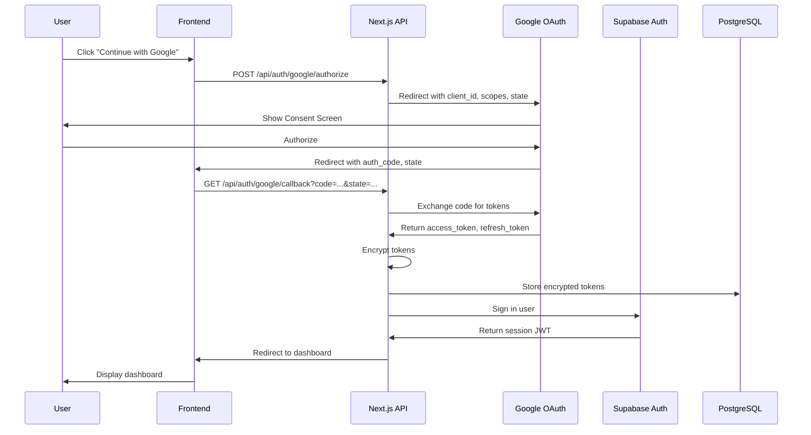

# Design: Google Social Authentication

## Overview

This feature integrates Google OAuth authentication into the existing Supabase Auth system, enabling users to authenticate via Google accounts and providing secure access to Google Drive for future video storage operations.

The design establishes a secure OAuth flow with encrypted token management, automatic token refresh, and seamless integration between Google identity and the existing email/password authentication system.

## Architecture

### High-Level Flow Diagram



### OAuth Security Implementation

The implementation uses industry-standard OAuth 2.0 security practices:

1. **State Parameter**: Random token generated for each authorization request, validated on callback to prevent CSRF attacks
2. **PKCE (Proof Key for Code Exchange)**: Code verifier generated and stored in session, code challenge sent to Google
3. **One-Time Authorization Code**: Code is exchanged for tokens immediately and cannot be reused
4. **HTTPS Only**: All OAuth-related communication over encrypted connections
5. **Rate Limiting**: Endpoints protected with rate limiting to prevent brute-force attempts

### Token Management Architecture

```
┌─────────────────────────────────────────┐
│  User authenticates via Google OAuth    │
│  Authorization code obtained            │
└──────────────┬──────────────────────────┘
               │
               ▼
┌─────────────────────────────────────────┐
│  Backend exchanges code for tokens      │
│  - Access Token (short-lived: ~1h)      │
│  - Refresh Token (long-lived: 6 months) │
└──────────────┬──────────────────────────┘
               │
               ▼
┌─────────────────────────────────────────┐
│  Tokens encrypted (AES-256-GCM)         │
│  IV (random) + encrypted payload stored │
└──────────────┬──────────────────────────┘
               │
               ▼
┌─────────────────────────────────────────┐
│  Stored in user_google_oauth table      │
│  - encrypted_access_token               │
│  - encrypted_refresh_token              │
│  - token_expiry_at                      │
│  - iv (for decryption)                  │
└──────────────┬──────────────────────────┘
               │
               ▼
        ┌──────┴──────┐
        │   Usage     │
        └──────┬──────┘
               │
        ┌──────┴─────────────────────────┐
        │                                 │
        ▼                                 ▼
┌──────────────────────────┐   ┌──────────────────────┐
│  Token within 5min of    │   │  Token expired or    │
│  expiry?                 │   │  refresh token error?│
│                          │   │                      │
│  NO → Use directly       │   │  YES → Mark          │
│       for API call       │   │  disconnected,       │
│                          │   │  prompt reconnect    │
└──────────────────────────┘   └──────────────────────┘
```

## Components and Interfaces

### Database Schema

#### Table: `user_google_oauth`

Stores encrypted Google OAuth tokens and metadata for each authenticated user.

```typescript
interface UserGoogleOAuth {
  id: string;                          // UUID primary key
  user_id: string;                     // Foreign key to auth.users
  google_id: string;                   // Google's unique user identifier
  email: string;                       // Google account email
  name: string;                        // User's name from Google profile
  picture_url?: string;                // Profile picture URL from Google
  encrypted_access_token: string;      // AES-256-GCM encrypted access token
  encrypted_refresh_token: string;     // AES-256-GCM encrypted refresh token
  token_iv: string;                    // Initialization vector for decryption
  token_expiry_at: datetime;           // When access token expires
  is_connected: boolean;               // Connection status (true = active, false = revoked)
  scopes_granted: string[];            // Array of granted OAuth scopes
  consent_timestamp: datetime;         // When user gave consent
  last_token_refresh_at?: datetime;    // Last successful refresh timestamp
  created_at: datetime;                // Record creation time
  updated_at: datetime;                // Last update time
}
```

**Indexes:**
- Primary: `user_id` (one record per user)
- Foreign: `user_id` (references `auth.users`)
- Partial: `is_connected = true` (for active connections query)

**Row Level Security (RLS):**
- Users can only read/update their own record
- Service role can read all (for admin operations)

### API Endpoints

#### 1. POST `/api/auth/google/authorize`

Initiates the Google OAuth flow by generating authorization parameters and redirecting user to Google Consent Screen.

**Request:**
```typescript
{
  // No request body required
  // Query params (optional):
  // - redirect_path: string (where to redirect after auth, default: '/dashboard')
  // - connect_mode: boolean (true if connecting to existing account)
}
```

**Response:**
```typescript
// Redirects to Google OAuth endpoint with:
// - client_id
// - redirect_uri
// - scope (openid profile email https://www.googleapis.com/auth/drive)
// - state (CSRF protection)
// - code_challenge (PKCE)
// - code_challenge_method: 'S256'
```

**Error Handling:**
- 400: Invalid redirect_path or connect_mode
- 500: Failed to generate state/PKCE parameters

#### 2. GET `/api/auth/google/callback`

Handles the OAuth callback from Google after user authorization.

**Request:**
```typescript
{
  // Query parameters from Google:
  code: string;        // Authorization code
  state: string;       // CSRF token (must match stored value)
  error?: string;      // Error code if user denied
  error_description?: string;
}
```

**Response (Success):**
```typescript
// Redirects to dashboard with session cookie set
// Browser contains:
// - Session JWT in secure HttpOnly cookie
// - User can now access protected resources
```

**Response (Failure):**
```typescript
{
  error: string;        // Error code (access_denied, server_error, etc.)
  message: string;      // User-friendly message
  redirect_url: string; // URL to return to login page
}
```

**Error Cases:**
- 400: Missing code or state parameter
- 400: State parameter doesn't match (CSRF attack detected)
- 401: Authorization code exchange failed with Google
- 409: Email mismatch on connect mode (existing account email ≠ Google email)
- 500: Failed to store tokens or create session

#### 3. POST `/api/auth/google/disconnect`

Revokes Google authorization and removes stored tokens.

**Request (Authenticated):**
```typescript
{
  // No body required - uses current user from session
}
```

**Response:**
```typescript
{
  success: boolean;
  message: string;      // "Google account disconnected"
  // OR in case of error:
  error: string;
  details: string;
}
```

**Process:**
1. Verify user is authenticated
2. Retrieve user's Google OAuth record
3. Call Google revoke endpoint: `POST https://oauth.googleapis.com/revoke?token=<refresh_token>`
4. Delete tokens from database
5. Mark as_connected = false
6. Create audit log entry
7. Return success response

**Error Handling:**
- 401: User not authenticated
- 404: User has no Google account connected
- 500: Revocation failed (but tokens still deleted for safety)

#### 4. POST `/api/auth/google/token/refresh`

Manually refreshes the Google access token (called by other services as needed).

**Request (Authenticated):**
```typescript
{
  // No body required - uses current user from session
}
```

**Response:**
```typescript
{
  success: boolean;
  token_refreshed: boolean;
  // If refresh was needed:
  expires_at: datetime;
  // If refresh skipped (token still valid):
  expires_at: datetime;
}
```

**Logic:**
1. Get current user's Google OAuth record
2. Check if token expires within 5 minutes
3. If not: return current expiry time
4. If yes: use refresh_token to get new access_token from Google
5. Decrypt refresh token → call Google → encrypt new access token
6. Update database with new token and expiry
7. Return success

**Error Handling:**
- 401: User not authenticated
- 404: User not connected to Google
- 401: Refresh token invalid (user revoked in Google Account) → mark disconnected
- 500: Database update failed

### Frontend Components

#### 1. GoogleAuthButton

Renders "Continue with Google" button for login/signup flows. Initiates OAuth flow.

**Props:**
```typescript
interface GoogleAuthButtonProps {
  mode: 'login' | 'signup' | 'connect';      // Determines behavior and text
  isLoading?: boolean;                        // Loading state
  connectMode?: boolean;                      // True if connecting existing account
  redirectPath?: string;                      // Optional redirect after auth
  className?: string;                         // Tailwind classes
  onSuccess?: (user: User) => void;          // Callback on success
  onError?: (error: string) => void;         // Callback on error
}
```

**Behavior:**
- **login mode**: Text "Continue with Google", redirects to `/api/auth/google/authorize?mode=login`
- **signup mode**: Text "Sign up with Google", same redirect
- **connect mode**: Text "Connect Google Account", same redirect with `connect_mode=true`
- Shows loading spinner during OAuth process
- Displays error toast if OAuth fails
- On success, redirects to dashboard or specified path

**Location:**
- `/app/(auth)/login/page.tsx` - Login page
- `/app/(auth)/signup/page.tsx` - Signup page
- `/app/(student)/portal/profile/page.tsx` - Settings (connect mode)
- `/app/(teacher)/settings/page.tsx` - Settings (connect mode)

#### 2. GoogleAccountStatus

Displays current Google connection status and provides connect/disconnect actions.

**Props:**
```typescript
interface GoogleAccountStatusProps {
  connected: boolean;
  googleEmail?: string;
  googleName?: string;
  picture?: string;
  onConnectClick: () => void;
  onDisconnectClick: () => void;
  isLoading?: boolean;
}
```

**Display:**
- **Connected:** Shows Google email, name, profile picture, "Disconnect" button
- **Not connected:** Shows "Connect Google" button
- Shows last refresh timestamp (if connected)

**Location:**
- `/app/(student)/portal/profile/page.tsx`
- `/app/(teacher)/settings/page.tsx`

#### 3. GoogleDisconnectDialog

Confirmation dialog before revoking Google authorization.

**Props:**
```typescript
interface GoogleDisconnectDialogProps {
  open: boolean;
  onConfirm: () => void;
  onCancel: () => void;
  isLoading?: boolean;
  googleEmail: string;
}
```

**Behavior:**
- Shows warning that Google Drive access will be revoked
- Lists any operations that depend on Google connectivity
- Requires explicit confirmation
- Disables action for 2 seconds after showing (prevent accidental click)

**Location:**
- Used by GoogleAccountStatus component

#### 4. GoogleErrorAlert

Displays user-friendly error messages for Google-related failures.

**Props:**
```typescript
interface GoogleErrorAlertProps {
  error: string;           // Error code or message
  onRetry?: () => void;    // Optional retry handler
  onDismiss?: () => void;
}
```

**Error Messages:**
- `access_denied`: "You declined Google authorization. Please try again if you'd like to continue with Google."
- `server_error`: "Google encountered an error. Please try again later."
- `network_error`: "Connection error. Please check your internet and try again."
- `token_refresh_failed`: "Your Google connection expired. Please reconnect your Google account."
- Generic: "An error occurred during authentication. Please try again."

## Data Models

### User Google OAuth Model

```typescript
// types/google-oauth.ts

export interface GoogleOAuthCredential {
  access_token: string;
  refresh_token: string;
  expires_in: number;  // Seconds until expiration
  token_type: 'Bearer';
  scope: string;
}

export interface GoogleOAuthRecord {
  id: string;
  user_id: string;
  google_id: string;
  email: string;
  name: string;
  picture_url?: string;
  encrypted_access_token: string;
  encrypted_refresh_token: string;
  token_iv: string;
  token_expiry_at: Date;
  is_connected: boolean;
  scopes_granted: string[];
  consent_timestamp: Date;
  last_token_refresh_at?: Date;
  created_at: Date;
  updated_at: Date;
}

export interface GoogleUserProfile {
  id: string;
  email: string;
  name: string;
  picture?: string;
}
```

### Service Functions

```typescript
// lib/services/google-auth.service.ts

export interface GoogleAuthService {
  // Generate authorization parameters
  generateAuthorizationUrl(options: {
    redirectPath?: string;
    connectMode?: boolean;
  }): { url: string; state: string; codeVerifier: string };

  // Exchange authorization code for tokens
  exchangeCodeForTokens(code: string): Promise<GoogleOAuthCredential>;

  // Encrypt tokens for storage
  encryptTokens(credential: GoogleOAuthCredential): Promise<{
    encrypted_access_token: string;
    encrypted_refresh_token: string;
    iv: string;
  }>;

  // Decrypt tokens from storage
  decryptTokens(record: Pick<GoogleOAuthRecord, 'encrypted_access_token' | 'token_iv'>): Promise<{
    access_token: string;
  }>;

  // Store user's Google OAuth record
  storeGoogleOAuth(userId: string, data: {
    googleProfile: GoogleUserProfile;
    credential: GoogleOAuthCredential;
    scopes: string[];
  }): Promise<GoogleOAuthRecord>;

  // Get user's Google OAuth record
  getUserGoogleOAuth(userId: string): Promise<GoogleOAuthRecord | null>;

  // Check if token needs refresh
  shouldRefreshToken(expiryAt: Date): boolean;

  // Refresh access token
  refreshAccessToken(refreshToken: string): Promise<{
    access_token: string;
    expires_in: number;
  }>;

  // Revoke Google authorization
  revokeGoogleAuth(refreshToken: string): Promise<boolean>;

  // Disconnect Google account
  disconnectGoogleAccount(userId: string): Promise<void>;
}
```

### Encryption Implementation

```typescript
// lib/services/token-encryption.service.ts

export interface TokenEncryptionService {
  // Encrypt a token string
  encrypt(token: string): Promise<{
    encrypted: string;
    iv: string;  // Base64 encoded
  }>;

  // Decrypt an encrypted token
  decrypt(encrypted: string, iv: string): Promise<string>;
}

// Implementation details:
// - Algorithm: AES-256-GCM
// - Key: Derived from environment variable via PBKDF2
// - IV: Random 12 bytes per encryption
// - Auth tag: Included in encrypted output (GCM)
// - Output: Base64 encoded for storage
```

### OAuth State Management

```typescript
// lib/oauth-state.ts

export interface OAuthState {
  state: string;              // Random CSRF token
  codeVerifier: string;       // PKCE code verifier
  redirectPath?: string;      // Where to redirect after auth
  connectMode: boolean;       // Whether connecting to existing account
  created_at: number;         // Timestamp for expiry check
}

// Storage: Secure session cookie (HttpOnly, Secure, SameSite=Strict)
// Expiry: 10 minutes
// Validation on callback: state matches + not expired
```

---

## Correctness Properties

*A property is a characteristic or behavior that should hold true across all valid executions of a system—essentially, a formal statement about what the system should do. Properties serve as the bridge between human-readable specifications and machine-verifiable correctness guarantees.*

### Acceptance Criteria Testing Prework

1.1 WHEN a user non-authenticated accesses the login page, the system SHALL display "Continue with Google" button
- **Thoughts:** This is about UI rendering on a specific page. We can test this by checking the presence of the button element on the login page.
- **Testable:** yes - example

1.2 WHEN user clicks "Continue with Google", the system SHALL redirect to Google OAuth Consent Screen
- **Thoughts:** This isn't specific to one user/flow, it's a general behavior that should happen every time. We can generate random redirect paths and verify that clicking the button always redirects to a URL with the correct OAuth parameters (client_id, scope, state).
- **Testable:** yes - property

1.3 WHEN user authorizes access and returns with authorization code, the system SHALL validate the code with Google
- **Thoughts:** This is testing a critical security step. We can test this by mocking Google's response and ensuring our system correctly exchanges a code for tokens or rejects an invalid code.
- **Testable:** yes - property

1.4 WHEN Google returns a valid credential, the system SHALL store Access Token encrypted
- **Thoughts:** This is a round-trip property: we can generate a random token, encrypt it, store it, then decrypt it and verify we get the same token back. This ensures the encryption/decryption process is correct.
- **Testable:** yes - property

1.5 WHEN Access Token is stored, the system SHALL register the timestamp of expiration
- **Thoughts:** This is testing that expiry data is captured. We can verify that every stored token has an expiry timestamp and that it's a valid future timestamp.
- **Testable:** yes - property

2.1 WHEN user Google returns and account doesn't exist, the system SHALL create new user automatically
- **Thoughts:** This is testing the auto-signup flow. We can generate random Google credentials and verify that calling the signup endpoint creates exactly one new user with the Google email.
- **Testable:** yes - property

2.2 WHEN new user is created, the system SHALL store tokens encrypted
- **Thoughts:** Same as 1.4 - round-trip encryption test.
- **Testable:** yes - property

2.3 WHEN new user completes signup, the system SHALL redirect to onboarding/dashboard
- **Thoughts:** This is a UI flow test. We can verify that after signup, the user is redirected to the correct destination.
- **Testable:** yes - example

3.1 WHEN user accesses settings and Google isn't connected, the system SHALL show "Connect Google" button
- **Thoughts:** This is checking UI state based on connection status. Similar to 1.1.
- **Testable:** yes - example

3.2 WHEN user clicks "Connect Google", the system SHALL verify email matches the existing account
- **Thoughts:** This is testing the email validation logic. We can create a user, attempt to connect a Google account with a different email, and verify it fails. Then connect with the matching email and verify it succeeds.
- **Testable:** yes - property

3.3 WHEN connection succeeds, the system SHALL update status in UI
- **Thoughts:** This is a UI state update test.
- **Testable:** yes - example

4.1 The system SHALL encrypt Access Tokens before storing in database
- **Thoughts:** Round-trip encryption test - same as 1.4.
- **Testable:** yes - property

4.2 The system SHALL encrypt Refresh Tokens before storing in database
- **Thoughts:** Same as 4.1, just for refresh tokens.
- **Testable:** yes - property

4.3 The system SHALL never expose tokens in logs
- **Thoughts:** This is a code review / logging behavior test. We can verify that token strings don't appear in log output.
- **Testable:** yes - property

5.1 WHEN Access Token expires within 5 minutes, the system SHALL automatically use Refresh Token to get new token
- **Thoughts:** This is testing the auto-refresh logic. We can set a fake expiry time within 5 minutes, attempt an operation, and verify the refresh is triggered.
- **Testable:** yes - property

5.2 WHEN Refresh Token exchange succeeds, the system SHALL update Access Token in database
- **Thoughts:** Round-trip test: set up a record with expired token, call refresh, verify new token is stored.
- **Testable:** yes - property

5.3 WHEN Refresh Token fails with 401, the system SHALL mark integration disconnected
- **Thoughts:** We can mock Google to return 401, attempt refresh, and verify is_connected is set to false.
- **Testable:** yes - property

6.1 WHEN user confirms disconnect, the system SHALL call Google revoke endpoint
- **Thoughts:** We can mock the Google revoke endpoint, call disconnect, and verify the call was made with the correct token.
- **Testable:** yes - property

6.2 WHEN revocation succeeds, the system SHALL delete tokens from database
- **Thoughts:** After disconnect, verify that querying the database returns no tokens (or is_connected = false).
- **Testable:** yes - property

6.3 WHEN user tries to use Google Drive after disconnection, the system SHALL show reconnection message
- **Thoughts:** This is checking the UI/error handling behavior when Google is disconnected but an operation requires it.
- **Testable:** yes - example

7.1 WHEN user does login with Google, the system SHALL use Supabase's built-in OAuth provider
- **Thoughts:** This is testing that we're using the Supabase API correctly. We can verify that the auth method chains through Supabase.
- **Testable:** yes - property

7.2 WHEN Supabase OAuth returns success, the system SHALL create valid session
- **Thoughts:** After successful auth, verify that the user has a valid JWT session.
- **Testable:** yes - property

7.3 WHEN user has both email and Google authentication, the system SHALL maintain both
- **Thoughts:** Create a user with email auth, connect Google, verify both login methods work.
- **Testable:** yes - property

8.1 WHEN Google returns authorization error, the system SHALL display amicable message
- **Thoughts:** Mock various Google errors, verify appropriate user messages are shown.
- **Testable:** yes - property

8.2 WHEN user denies authorization, the system SHALL redirect to login with explanation
- **Thoughts:** Simulate user denial, verify appropriate redirect and message.
- **Testable:** yes - example

8.3 WHEN there's network error during auth, the system SHALL display error message and allow retry
- **Thoughts:** Mock network failure, verify error display and retry button.
- **Testable:** yes - example

9.1 The system SHALL use HTTPS for all OAuth communication
- **Thoughts:** This is an infrastructure/configuration test, not directly testable as a property. Configuration review.
- **Testable:** no

9.2 The system SHALL never hardcode encryption keys
- **Thoughts:** Code review / lint rule - verify no string literals match expected key patterns.
- **Testable:** no

9.3 The system SHALL use rate limiting on auth endpoints
- **Thoughts:** We can make multiple rapid requests and verify 429 responses after limit is hit.
- **Testable:** yes - property

9.4 The system SHALL validate State parameter to prevent CSRF
- **Thoughts:** Generate authorization with state, then attempt callback with wrong state, verify rejection.
- **Testable:** yes - property

9.5 WHEN user logs out, the system SHALL keep tokens stored for future login
- **Thoughts:** After logout, verify that tokens still exist in the database for re-login.
- **Testable:** yes - property

10.1 The system SHALL solicit only necessary scopes: openid, profile, email, drive
- **Thoughts:** Verify the authorization URL contains exactly these scopes, no more, no less.
- **Testable:** yes - property

10.2 WHEN user sees Consent Screen, the system SHALL explain why each permission is needed
- **Thoughts:** This is UI content display - we can test the presence of explanation text.
- **Testable:** yes - example

### Property Reflection

After reviewing all testable criteria above:

- Properties 1.2, 1.3, 1.4, 1.5 → Property 1.3 (validate code) implies 1.4 (tokens obtained) which implies storage and encryption. 1.4 and 4.1/4.2 are the same round-trip encryption test. **Consolidate into single "Token Encryption Round Trip" property.**

- Properties 2.1, 2.2 → 2.2 is the same encryption round-trip (already consolidated). **Keep 2.1 separate as it's about user creation logic.**

- Properties 5.1, 5.2 → These form a round-trip: token expires, refresh is triggered, new token stored. **Combine into single "Refresh Token Round Trip" property.**

- Properties 6.1, 6.2 → Both are about the disconnect process: revoke call + token deletion. **Combine into "Disconnect Token Cleanup" property.**

- Properties 7.1, 7.2, 7.3 → Test different aspects of session management. **Property 7.2 and 7.3 can be combined as "Multi-Auth Session Consistency" - both test that session works after auth.**

- Properties 8.1, 8.2 → Different error scenarios. **Keep separate: one is generic error handling, one is specific to user denial.**

- Properties 9.4, 9.3 → Security validations. **Keep separate as they test different attack vectors.**

---

## Correctness Properties

### Property 1: OAuth Authorization URL Generation

For any Google OAuth initiation, the generated authorization URL SHALL contain all required parameters (client_id, redirect_uri, scope, state, code_challenge) with correct values matching the current environment configuration.

**Validates: Requirements 1.2, 10.1**

### Property 2: Token Encryption Round Trip

For any Google credential (access token or refresh token), encrypting then decrypting SHALL produce the identical token string back.

**Validates: Requirements 4.1, 4.2**

### Property 3: Authorization Code Validation

For any authorization code from Google callback, exchanging a valid code SHALL return a credential with access_token, refresh_token, and expires_in; exchanging an invalid or expired code SHALL fail with appropriate error.

**Validates: Requirements 1.3**

### Property 4: Automatic Signup for New Google Users

For any valid Google profile (with email and name), when that email doesn't exist in Supabase Auth, calling the signup endpoint SHALL create exactly one new user with that email, name, and picture from Google.

**Validates: Requirements 2.1, 2.2**

### Property 5: Email Matching for Connect Mode

For any existing Supabase user with email X, attempting to connect a Google account with email Y (where Y ≠ X) SHALL fail; attempting to connect with email X SHALL succeed.

**Validates: Requirements 3.2**

### Property 6: Refresh Token Round Trip

For any stored Google credential with access_token near expiration, calling refresh SHALL update the stored access_token to a new value; the new token SHALL be stored encrypted, and the expiry timestamp SHALL be updated to a future time.

**Validates: Requirements 5.1, 5.2**

### Property 7: Disconnect Token Cleanup

For any connected Google account, after calling disconnect and confirming the revocation call to Google, the encrypted tokens in the database SHALL be deleted, and is_connected SHALL be set to false.

**Validates: Requirements 6.1, 6.2**

### Property 8: CSRF State Parameter Validation

For any OAuth authorization request with state parameter S, the callback handler SHALL reject any callback with a different state parameter; SHALL accept callback with matching state parameter.

**Validates: Requirements 9.4**

### Property 9: Rate Limiting on Authentication Endpoints

For any IP address, making more than N requests per minute to `/api/auth/google/authorize` or `/api/auth/google/callback` SHALL result in HTTP 429 (Too Many Requests) responses until the rate limit window resets.

**Validates: Requirements 9.3, 9.5**

### Property 10: Multi-Auth Session Consistency

For any user authenticated via email/password with a later-connected Google account, both login methods SHALL create valid Supabase sessions; logging out via one method SHALL not affect the ability to login via the other method.

**Validates: Requirements 7.1, 7.2, 7.3**

### Property 11: Refresh Failure Disconnects Account

For any connected Google account where the refresh_token is invalid (e.g., user revoked in Google Account settings), attempting to refresh the access token SHALL mark is_connected = false and require the user to reconnect.

**Validates: Requirements 5.3**

### Property 12: Token Not Exposed in Logs

For any operation involving Google tokens (encryption, storage, retrieval, refresh), the actual token string values SHALL NOT appear in any log output, error messages, or API responses.

**Validates: Requirements 4.3, 9.2**

---

## Error Handling

### Error Categories

#### 1. Google OAuth Errors

**access_denied**
- User declined authorization on Google Consent Screen
- Action: Display "Authorization declined. Please try again if you'd like to continue with Google."
- Recovery: Retry button to restart flow

**server_error**
- Google server encountered error (rare)
- Action: Display "Google encountered an error. Please try again later."
- Recovery: Retry button or fall back to email auth

**invalid_scope**
- Requested scope doesn't exist or app is not authorized for it
- Action: Log error, display generic message to user
- Cause: Configuration error in Google Cloud Console
- Resolution: Verify scopes in .env and Google Cloud project

**invalid_client**
- Client ID doesn't match or is invalid
- Action: Log error, display generic message
- Cause: Invalid NEXT_PUBLIC_GOOGLE_CLIENT_ID
- Resolution: Verify .env configuration

#### 2. Token Exchange Errors

**invalid_code**
- Authorization code is invalid, expired, or already used
- Action: Display "Authorization code invalid. Please start over."
- Recovery: Restart OAuth flow

**invalid_grant**
- Code wasn't generated for the request parameters (redirect_uri mismatch)
- Action: Log detailed error, display generic message
- Cause: Redirect URI configuration mismatch
- Resolution: Verify NEXT_PUBLIC_GOOGLE_REDIRECT_URI

**network_error**
- Cannot reach Google servers
- Action: Display "Connection error. Please check your internet and try again."
- Recovery: Retry button

#### 3. Token Refresh Errors

**invalid_grant (refresh)**
- Refresh token is invalid or user revoked access
- Action: Mark is_connected = false, prompt user to reconnect
- Display: "Your Google connection expired. Please reconnect your Google account."

**token_refresh_timeout**
- Network timeout during refresh
- Action: Log error, retry with backoff
- If repeated failure: Mark disconnected after 3 retries

#### 4. Database Errors

**duplicate_key_violation**
- User already has Google account connected (shouldn't happen with UPDATE)
- Action: Log error, display "Google account already connected"

**encryption_error**
- Failed to encrypt/decrypt tokens
- Action: Log detailed error, display "Security error. Please try again."
- Cause: Missing or invalid encryption key in environment

**connection_error**
- Database unavailable
- Action: Display "Service temporarily unavailable. Please try again later."

#### 5. State Validation Errors

**state_mismatch**
- CSRF token doesn't match
- Action: Log security alert, reject request
- Display: "Invalid request. Please start over."
- Severity: HIGH (possible CSRF/XSS attack)

**state_expired**
- OAuth state parameter older than 10 minutes
- Action: Reject request, prompt restart
- Display: "Session expired. Please start over."

**state_not_found**
- State parameter has no matching session
- Action: Log security alert, reject
- Display: "Invalid request. Please start over."
- Severity: HIGH

#### 6. Email Conflict Errors

**email_mismatch_on_connect**
- Connecting Google account with different email than current Supabase user
- Action: Reject operation
- Display: "Google email doesn't match account email. Sign in with the correct account on Google."
- Recovery: Suggest disconnecting current account and reconnecting with correct email

**email_already_exists**
- Google email already connected to different Supabase user
- Action: Reject signup
- Display: "Email already in use. Please sign in instead."

### Error Response Format

All error responses follow this format:

```typescript
{
  error: string;           // Error code (access_denied, server_error, etc.)
  message: string;         // User-friendly message
  code: number;            // HTTP status code (duplicated in response header)
  timestamp: ISO8601;      // When error occurred
  request_id?: string;     // For debugging (logged server-side)
}
```

### Error Logging Strategy

**What to log:**
- Error code and message
- User ID (if authenticated)
- Request ID and timestamp
- Request metadata (IP, user agent)
- Stack trace (for debugging)

**What NOT to log:**
- Authorization codes
- Access tokens or refresh tokens
- User passwords
- Encryption keys
- Full request/response bodies

**Log Levels:**
- ERROR: Security errors (CSRF, invalid grants, encryption failures)
- WARN: Transient errors (network timeout, rate limit)
- INFO: Normal flow events (user connected, disconnected)
- DEBUG: Detailed operation info (token refresh triggered, etc.)

---

## Testing Strategy

### Unit Testing

**Components:**
- GoogleAuthButton: Render with different modes (login, signup, connect); verify button text, click handlers, error display
- GoogleAccountStatus: Connected/disconnected states; verify UI elements shown/hidden correctly
- GoogleDisconnectDialog: Confirmation dialog rendering; verify confirm/cancel handlers
- GoogleErrorAlert: Various error messages; verify correct text displayed for each error code

**Services (Mocked Google API):**
- generateAuthorizationUrl: Verify state generation, code_challenge creation, URL format
- exchangeCodeForTokens: Mock Google endpoint, test valid/invalid code handling
- encryptTokens/decryptTokens: Verify round-trip encryption (no token mangling)
- storeGoogleOAuth: Verify database write with correct schema
- getUserGoogleOAuth: Verify database read returns correct record
- shouldRefreshToken: Test with tokens at various expirations (expired, within 5min, >5min)
- refreshAccessToken: Mock Google refresh endpoint, verify token update
- revokeGoogleAuth: Mock Google revoke endpoint, verify call made with correct token
- disconnectGoogleAccount: Verify tokens deleted and is_connected set to false

**Utilities:**
- Token encryption: Encrypt random tokens, decrypt, verify identity (round-trip)
- CSRF state generation: Verify uniqueness, sufficient entropy, expiry validation
- PKCE code verifier/challenge: Verify verifier length, challenge encoding

### Property-Based Testing

**Setup:**
- Use fast-check (JavaScript/TypeScript PBT library)
- Configure 100+ iterations per property
- Tag each test with property reference from design

**Property 1: OAuth Authorization URL Generation**
- Generate: random redirect paths, environments (dev/prod)
- For each: call generateAuthorizationUrl
- Verify: URL contains all required params, state != state from other calls, scopes match config
- Tag: Feature: google-social-auth, Property 1: OAuth Authorization URL Generation

**Property 2: Token Encryption Round Trip**
- Generate: random access tokens (strings 50-2000 chars), random refresh tokens
- For each: encrypt, decrypt
- Verify: decrypted == original
- Tag: Feature: google-social-auth, Property 2: Token Encryption Round Trip

**Property 3: Authorization Code Validation**
- Generate: valid authorization codes (mock), invalid codes (random strings)
- For each: call exchangeCodeForTokens
- Verify: valid codes return credential with access_token, refresh_token, expires_in; invalid codes throw error
- Tag: Feature: google-social-auth, Property 3: Authorization Code Validation

**Property 4: Automatic Signup for New Google Users**
- Generate: random Google profiles (email, name, picture)
- For each: call signup endpoint with new email
- Verify: exactly one user created with matching email, name, picture in database
- Tag: Feature: google-social-auth, Property 4: Automatic Signup for New Google Users

**Property 5: Email Matching for Connect Mode**
- Generate: existing user with email X, random Google profiles with email Y
- For each Y: call connect endpoint
- Verify: Y == X → success, Y ≠ X → fail with email_mismatch error
- Tag: Feature: google-social-auth, Property 5: Email Matching for Connect Mode

**Property 6: Refresh Token Round Trip**
- Generate: expired tokens (set expiry to past time), valid refresh tokens
- For each: call refreshAccessToken
- Verify: new access_token returned, stored in DB, expiry timestamp updated to future
- Tag: Feature: google-social-auth, Property 6: Refresh Token Round Trip

**Property 7: Disconnect Token Cleanup**
- Generate: connected Google accounts
- For each: call disconnect, mock revocation success
- Verify: tokens deleted from DB, is_connected = false
- Tag: Feature: google-social-auth, Property 7: Disconnect Token Cleanup

**Property 8: CSRF State Parameter Validation**
- Generate: authorization requests (create state), callback requests with matching and mismatched states
- For each: call callback handler
- Verify: matching state accepted, mismatched state rejected
- Tag: Feature: google-social-auth, Property 8: CSRF State Parameter Validation

**Property 9: Rate Limiting on Authentication Endpoints**
- Generate: rapid sequences of requests from same IP (100+ per minute)
- For each: send request to /api/auth/google/authorize
- Verify: first N requests succeed (200), remaining get 429 until window resets
- Tag: Feature: google-social-auth, Property 9: Rate Limiting on Authentication Endpoints

**Property 10: Multi-Auth Session Consistency**
- Generate: users with email auth, connect Google, create sessions
- For each: login via email, verify session; logout; login via Google, verify new session
- Verify: both methods work independently
- Tag: Feature: google-social-auth, Property 10: Multi-Auth Session Consistency

**Property 11: Refresh Failure Disconnects Account**
- Generate: connected accounts, mock invalid refresh token scenario
- For each: call refresh with revoked token (mock 401 from Google)
- Verify: is_connected = false, user prompted to reconnect
- Tag: Feature: google-social-auth, Property 11: Refresh Failure Disconnects Account

**Property 12: Token Not Exposed in Logs**
- Generate: operations with real tokens (encrypt, store, refresh, decrypt)
- For each: capture all log output
- Verify: token strings do NOT appear in any log line
- Tag: Feature: google-social-auth, Property 12: Token Not Exposed in Logs

### Integration Testing

**OAuth Flow End-to-End:**
1. Navigate to login page → verify "Continue with Google" button present
2. Click button → verify redirected to Google Consent Screen (mock)
3. Authorize → verify callback received with auth code
4. Callback processed → verify tokens stored encrypted in DB
5. Verify session created and user redirected to dashboard

**Signup with Google:**
1. New user clicks "Continue with Google"
2. Authorize new Google account
3. Verify new Supabase user created
4. Verify tokens stored
5. Verify user redirected to onboarding

**Connect Google to Existing Account:**
1. Login via email/password
2. Navigate to settings
3. Click "Connect Google"
4. Authorize with same email
5. Verify connection shown in UI
6. Verify tokens stored

**Disconnect Google:**
1. Connected user navigates to settings
2. Click "Disconnect Google"
3. Confirm disconnect
4. Verify revocation call to Google made
5. Verify tokens deleted
6. Verify UI updated

### Security Testing

**CSRF Protection:**
- Generate request with mismatched state → verify rejected

**Encryption Verification:**
- Decrypt stored tokens → verify not plain-text

**Rate Limiting:**
- Rapid requests from same IP → verify 429 after threshold

**Token Exposure:**
- Parse logs → verify tokens not present

**Email Validation:**
- Connect Google with different email → verify rejected

---

