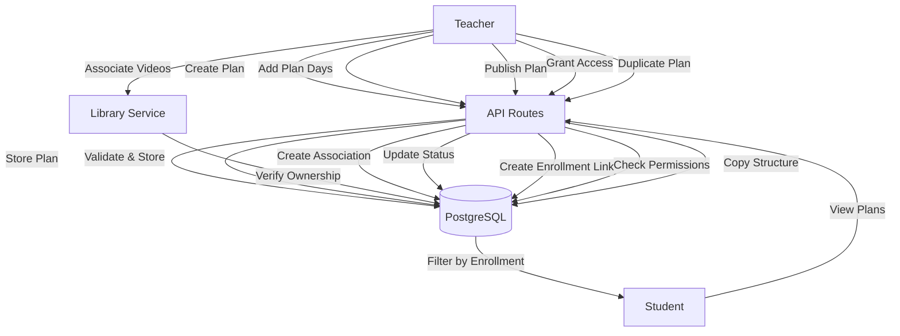
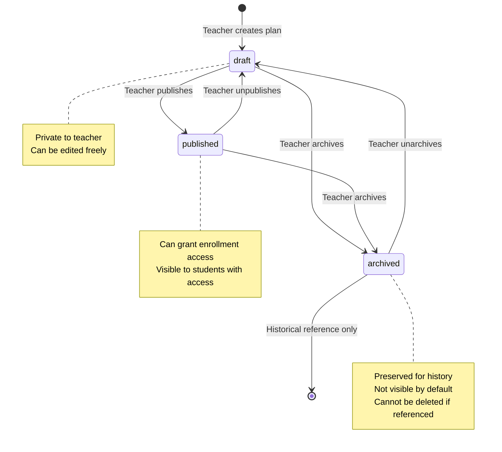
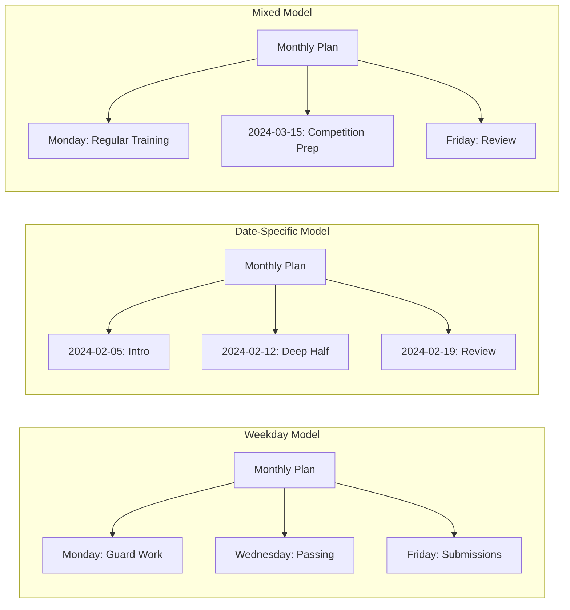
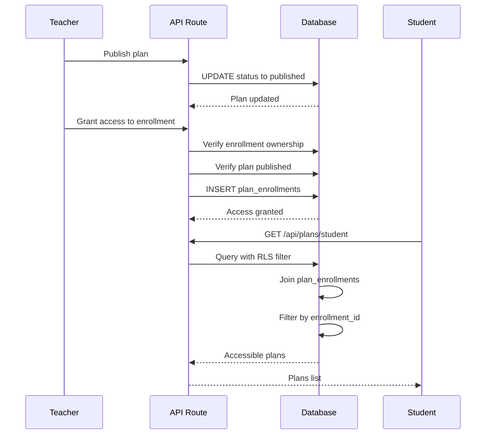

# Design Document: Monthly Plans (Planos Mensais)

## Overview

The Monthly Plans module enables teachers to create pedagogical planning documents that define intended content for specific periods, organizing training content by day/week with associated videos. This module represents a critical distinction in the platform: **plans are intent, not reality**. Plans define what the teacher intends to teach, separate from actual lessons executed. This separation allows teachers to maintain structured curriculum planning while adapting to the dynamic reality of private instruction.

Plans serve as reusable templates and organizational tools for structuring curriculum content. Teachers can publish plans to specific students for visibility, duplicate successful plans as starting points for future periods, and maintain a library of pedagogical approaches across different training cycles.

### Goals

- Enable teachers to create structured monthly planning documents with defined periods
- Support flexible day organization models (weekday-based or date-specific)
- Allow video association from technique library to plan days
- Provide plan lifecycle management (draft, published, archived)
- Enable explicit access control through plan enrollments
- Support plan duplication for reusability across periods
- Maintain data integrity through archive-instead-of-delete pattern
- Preserve historical references when plans change
- Enforce strict teacher-based data isolation via RLS policies

### Non-Goals

- Automatic plan generation based on student progress or AI
- Plan templates marketplace or sharing between teachers
- Collaborative plan editing between multiple teachers
- Plan version control with diff tracking
- Automatic scheduling of lessons from plans
- Progress tracking against plan completion
- Plan recommendations or suggestions
- Integration with external curriculum standards
- Plan analytics or usage statistics
- Bulk plan operations across multiple plans

### Key Design Decisions

1. **Plans as Intent, Separate from Reality**: Plans represent pedagogical planning and intended curriculum structure. They do not automatically create lessons, and changes to plans never retroactively modify completed lesson history. This separation preserves historical accuracy while allowing flexible planning.

2. **Dual Day Organization Models**: Plan days support both weekday-based (recurring patterns like "every Monday") and date-specific organization (specific calendar dates). Teachers can use either model or mix both within the same plan, providing flexibility for different teaching approaches.

3. **Explicit Enrollment-Based Access**: Published plans require explicit enrollment associations to grant student visibility. This prevents accidental exposure and gives teachers fine-grained control over which students see which plans.

4. **Video Reference, Not Copy**: Plan days reference videos from the technique library rather than copying video records. This enables video reusability across multiple plans and plan days without duplication, and ensures updates to video metadata propagate naturally.

5. **Status-Based Publication Workflow**: Plans progress through draft → published → archived states. Only published plans can be shared with students, and publication status is separate from enrollment access grants, allowing teachers to prepare content before sharing.

6. **Archive Instead of Delete**: Plans referenced by lessons cannot be deleted, only archived. This preserves data integrity and prevents broken references in historical lesson records.

7. **Three-Tier Isolation Boundary**: Authorization enforced at database level (RLS) → service level (validation) → API level (route handlers). Database is ultimate security boundary using teacher_id from JWT token.

## Architecture

### High-Level Flow



### Component Layers

1. **Presentation Layer (Client Components)**
   - Plan list with status filters and search
   - Plan form (create/edit metadata)
   - Plan day editor with drag-drop reordering
   - Video selector integrated with library
   - Publication workflow UI
   - Enrollment access management
   - Student plan viewer (read-only)

2. **API Layer (Next.js API Routes)**
   - `/api/plans` - List and create plans
   - `/api/plans/[id]` - Get, update, delete plan
   - `/api/plans/[id]/publish` - Publish plan
   - `/api/plans/[id]/unpublish` - Unpublish plan
   - `/api/plans/[id]/archive` - Archive plan
   - `/api/plans/[id]/unarchive` - Unarchive plan
   - `/api/plans/[id]/duplicate` - Duplicate plan
   - `/api/plans/[id]/days` - List and create plan days
   - `/api/plans/days/[dayId]` - Update, delete plan day
   - `/api/plans/days/reorder` - Batch reorder plan days
   - `/api/plans/days/[dayId]/videos` - Associate/list videos
   - `/api/plans/days/videos/[assocId]` - Remove video association
   - `/api/plans/days/videos/reorder` - Batch reorder videos
   - `/api/plans/[id]/enrollments` - Grant/list access
   - `/api/plans/enrollments/[assocId]` - Revoke access
   - `/api/plans/student` - Student view of accessible plans

3. **Service Layer (lib/services)**
   - `plan.service.ts` - Plan CRUD and lifecycle management
   - `plan-day.service.ts` - Plan day operations
   - `plan-video.service.ts` - Video association logic
   - `plan-enrollment.service.ts` - Access control management
   - `plan-validation.service.ts` - Validation rules
   - `plan-duplication.service.ts` - Plan copying logic

4. **Data Layer (PostgreSQL + RLS)**
   - `monthly_plans` table with comprehensive RLS policies
   - `plan_days` table with parent relationship policies
   - `plan_day_videos` table with association policies
   - `plan_enrollments` table with access control policies
   - Foreign key constraints for referential integrity
   - Indexes for performance on common queries
   - Check constraints for data validation

5. **External Services**
   - Integration with Technique Library module for video references
   - Integration with Student Management module for enrollment associations
   - Integration with Lessons module for lesson references (read-only)

### Plan Lifecycle Flow



### Plan Day Organization Models



### Access Control Flow



## Components and Interfaces

### API Endpoints

#### POST /api/plans

Creates a new monthly plan for the authenticated teacher.

**Request:**
```typescript
{
  title: string;              // Required, min 3 chars, max 200
  description?: string;       // Optional, max 2000 chars
  period_start: string;       // Required, ISO 8601 date
  period_end: string;         // Required, ISO 8601 date (>= period_start)
}
```

**Response:**
```typescript
{
  data: {
    id: string;
    teacher_id: string;
    title: string;
    description: string | null;
    period_start: string;     // ISO 8601
    period_end: string;       // ISO 8601
    status: 'draft';
    published_at: null;
    archived_at: null;
    created_at: string;       // ISO 8601
    updated_at: string;       // ISO 8601
  };
  error: null;
}
```

**Error Responses:**
- 400: Validation failure (title empty, period_end before period_start)
- 401: Not authenticated
- 500: Server error

#### GET /api/plans

Returns paginated list of plans for the authenticated teacher with optional filtering.

**Query Parameters:**
```typescript
{
  status?: string[];          // Filter by status: draft, published, archived
  from_date?: string;         // Filter plans starting on/after date (ISO 8601)
  to_date?: string;          // Filter plans ending on/before date (ISO 8601)
  search?: string;           // Search by title (case-insensitive partial match)
  page?: number;             // Page number (default: 1)
  pageSize?: number;         // Items per page (default: 20, max: 100)
}
```

**Response:**
```typescript
{
  data: {
    plans: [
      {
        id: string;
        title: string;
        description: string | null;
        period_start: string;
        period_end: string;
        status: 'draft' | 'published' | 'archived';
        published_at: string | null;
        plan_day_count: number;
        enrollment_count: number;  // How many students have access
        created_at: string;
        updated_at: string;
      }
    ];
  };
  meta: {
    total: number;
    page: number;
    pageSize: number;
    totalPages: number;
    hasNext: boolean;
    hasPrevious: boolean;
  };
  error: null;
}
```

**Default Behavior:**
- Excludes archived plans unless explicitly included in status filter
- Sorts by period_start descending (most recent first)
- Empty array if no plans match

#### GET /api/plans/[id]

Returns complete plan details including plan day summary.

**Response:**
```typescript
{
  data: {
    id: string;
    teacher_id: string;
    title: string;
    description: string | null;
    period_start: string;
    period_end: string;
    status: 'draft' | 'published' | 'archived';
    published_at: string | null;
    archived_at: string | null;
    created_at: string;
    updated_at: string;
    plan_days: [
      {
        id: string;
        weekday: number | null;    // 0-6 if weekday-based
        planned_date: string | null; // ISO 8601 if date-specific
        title: string;
        objective: string | null;
        video_count: number;
        sort_order: number;
      }
    ];
    enrollments: [
      {
        enrollment_id: string;
        student_name: string;
        published_at: string;
      }
    ];
  };
  error: null;
}
```

**Error Responses:**
- 404: Plan not found
- 403: Plan belongs to different teacher
- 401: Not authenticated

#### PATCH /api/plans/[id]

Updates plan metadata (title, description, period dates).

**Request:**
```typescript
{
  title?: string;            // Min 3 chars, max 200
  description?: string | null;  // Max 2000 chars
  period_start?: string;     // ISO 8601 date
  period_end?: string;       // ISO 8601 date (>= period_start if both provided)
}
```

**Response:**
```typescript
{
  data: {
    // Updated plan object
  };
  error: null;
}
```

**Error Responses:**
- 400: Validation failure
- 404: Plan not found
- 403: Plan belongs to different teacher

#### POST /api/plans/[id]/publish

Publishes a draft plan making it eligible for student access grants.

**Request:** None

**Response:**
```typescript
{
  data: {
    // Updated plan with status: 'published' and published_at set
  };
  error: null;
}
```

**Error Responses:**
- 409: Plan is not in draft status
- 404: Plan not found
- 403: Plan belongs to different teacher

#### POST /api/plans/[id]/unpublish

Returns a published plan to draft status for further editing.

**Request:** None

**Response:**
```typescript
{
  data: {
    // Updated plan with status: 'draft' (published_at preserved)
  };
  error: null;
}
```

**Error Responses:**
- 409: Plan is not in published status
- 404: Plan not found
- 403: Plan belongs to different teacher

#### POST /api/plans/[id]/archive

Archives a plan (soft delete).

**Request:** None

**Response:**
```typescript
{
  data: {
    // Updated plan with status: 'archived' and archived_at set
  };
  error: null;
}
```

**Error Responses:**
- 409: Plan already archived
- 404: Plan not found
- 403: Plan belongs to different teacher

#### POST /api/plans/[id]/unarchive

Reactivates an archived plan to draft status.

**Request:** None

**Response:**
```typescript
{
  data: {
    // Updated plan with status: 'draft' (archived_at preserved)
  };
  error: null;
}
```

**Error Responses:**
- 409: Plan is not archived
- 404: Plan not found
- 403: Plan belongs to different teacher

#### POST /api/plans/[id]/duplicate

Creates a copy of an existing plan with all structure preserved.

**Request:**
```typescript
{
  new_title?: string;        // Optional, defaults to "[Original Title] (Copy)"
  new_period_start?: string; // Optional, ISO 8601 date
  new_period_end?: string;   // Optional, ISO 8601 date
}
```

**Response:**
```typescript
{
  data: {
    // New plan object with status: 'draft'
    // Contains copied plan days and video associations
    // Does NOT contain enrollment associations
  };
  error: null;
}
```

**Error Responses:**
- 404: Plan not found
- 403: Plan belongs to different teacher

#### DELETE /api/plans/[id]

Deletes a plan (only allowed if no lesson references exist).

**Request:** None

**Response:**
```typescript
{
  data: {
    success: true;
  };
  error: null;
}
```

**Error Responses:**
- 409: Plan has lesson references (must archive instead)
- 404: Plan not found
- 403: Plan belongs to different teacher

#### POST /api/plans/[id]/days

Creates a new plan day within a plan.

**Request:**
```typescript
{
  weekday?: number;          // Optional, 0-6 (Sunday-Saturday)
  planned_date?: string;     // Optional, ISO 8601 date
  title: string;             // Required, min 2 chars, max 200
  objective?: string;        // Optional, max 1000 chars
  notes?: string;            // Optional, max 2000 chars
  sort_order?: number;       // Optional, positive integer (auto-assigned if not provided)
}
```

**Validation:**
- At least one of weekday or planned_date must be provided
- If planned_date provided, must fall within plan's period
- If weekday provided, must be 0-6

**Response:**
```typescript
{
  data: {
    id: string;
    monthly_plan_id: string;
    weekday: number | null;
    planned_date: string | null;
    title: string;
    objective: string | null;
    notes: string | null;
    sort_order: number;
    created_at: string;
    updated_at: string;
  };
  error: null;
}
```

**Error Responses:**
- 400: Validation failure
- 404: Plan not found
- 403: Plan belongs to different teacher

#### GET /api/plans/[id]/days

Returns all plan days for a specific plan.

**Response:**
```typescript
{
  data: {
    plan_days: [
      {
        id: string;
        monthly_plan_id: string;
        weekday: number | null;
        planned_date: string | null;
        title: string;
        objective: string | null;
        notes: string | null;
        sort_order: number;
        created_at: string;
        updated_at: string;
        videos: [
          {
            id: string;
            video_id: string;
            video_title: string;
            video_status: 'ready' | 'processing' | 'archived';
            sort_order: number;
          }
        ];
      }
    ];
  };
  error: null;
}
```

**Default Behavior:**
- Sorted by sort_order ascending, then by weekday/planned_date
- Includes video associations with video metadata
- Empty array if no plan days

#### PATCH /api/plans/days/[dayId]

Updates plan day information.

**Request:**
```typescript
{
  weekday?: number | null;
  planned_date?: string | null;
  title?: string;            // Min 2 chars, max 200
  objective?: string | null; // Max 1000 chars
  notes?: string | null;     // Max 2000 chars
  sort_order?: number;       // Positive integer
}
```

**Response:**
```typescript
{
  data: {
    // Updated plan day object
  };
  error: null;
}
```

**Error Responses:**
- 400: Validation failure
- 404: Plan day not found
- 403: Parent plan belongs to different teacher

#### POST /api/plans/days/reorder

Updates sort_order for multiple plan days in a single transaction.

**Request:**
```typescript
{
  reorders: [
    {
      plan_day_id: string;
      sort_order: number;    // Positive integer
    }
  ];
}
```

**Response:**
```typescript
{
  data: {
    updated_count: number;
  };
  error: null;
}
```

**Error Responses:**
- 400: Invalid sort_order values
- 403: One or more plan days belong to different teacher's plans

#### DELETE /api/plans/days/[dayId]

Deletes a plan day and all associated video references.

**Request:** None

**Response:**
```typescript
{
  data: {
    success: true;
  };
  error: null;
}
```

**Behavior:**
- Deletes plan day record
- Cascades to delete all plan_day_videos associations
- Does NOT delete lesson records that reference this plan day
- Lessons preserve plan_day_id reference for historical integrity

**Error Responses:**
- 404: Plan day not found
- 403: Parent plan belongs to different teacher

#### POST /api/plans/days/[dayId]/videos

Associates a video from the library with a plan day.

**Request:**
```typescript
{
  video_id: string;          // Required, must exist and belong to teacher
  sort_order?: number;       // Optional, positive integer (auto-assigned if not provided)
}
```

**Response:**
```typescript
{
  data: {
    id: string;              // Association ID
    plan_day_id: string;
    video_id: string;
    sort_order: number;
    created_at: string;
  };
  error: null;
}
```

**Error Responses:**
- 400: Video is archived
- 409: Video already associated with this plan day
- 404: Plan day or video not found
- 403: Plan day or video belongs to different teacher

#### GET /api/plans/days/[dayId]/videos

Returns all video associations for a plan day with video metadata.

**Response:**
```typescript
{
  data: {
    videos: [
      {
        association_id: string;
        video_id: string;
        video_title: string;
        video_mux_asset_id: string;
        video_status: 'ready' | 'processing' | 'archived';
        video_duration: number | null;
        sort_order: number;
        created_at: string;
      }
    ];
  };
  error: null;
}
```

**Default Behavior:**
- Sorted by sort_order ascending
- Includes archived videos with indicator
- Empty array if no videos associated

#### DELETE /api/plans/days/videos/[assocId]

Removes a video association from a plan day.

**Request:** None

**Response:**
```typescript
{
  data: {
    success: true;
  };
  error: null;
}
```

**Behavior:**
- Deletes association record only
- Does NOT delete video from library
- Does NOT affect lessons that used this plan day

**Error Responses:**
- 404: Association not found
- 403: Plan day belongs to different teacher

#### POST /api/plans/days/videos/reorder

Updates sort_order for videos within a plan day.

**Request:**
```typescript
{
  reorders: [
    {
      association_id: string;
      sort_order: number;    // Positive integer
    }
  ];
}
```

**Validation:**
- All associations must belong to the same plan_day_id

**Response:**
```typescript
{
  data: {
    updated_count: number;
  };
  error: null;
}
```

**Error Responses:**
- 400: Associations belong to different plan days
- 403: Plan day belongs to different teacher

#### POST /api/plans/[id]/enrollments

Grants plan access to a specific enrollment.

**Request:**
```typescript
{
  enrollment_id: string;     // Required, must exist and belong to teacher
}
```

**Response:**
```typescript
{
  data: {
    id: string;              // Association ID
    monthly_plan_id: string;
    enrollment_id: string;
    published_at: string;    // ISO 8601
  };
  error: null;
}
```

**Error Responses:**
- 400: Plan is not published
- 409: Enrollment already has access to this plan
- 404: Plan or enrollment not found
- 403: Plan or enrollment belongs to different teacher

#### GET /api/plans/[id]/enrollments

Returns all enrollments with access to a plan.

**Query Parameters:**
```typescript
{
  include_archived?: boolean;  // Default: false
}
```

**Response:**
```typescript
{
  data: {
    enrollments: [
      {
        association_id: string;
        enrollment_id: string;
        student_name: string;
        student_email: string;
        enrollment_status: 'pending' | 'active' | 'paused' | 'archived';
        published_at: string;
      }
    ];
  };
  error: null;
}
```

**Default Behavior:**
- Excludes archived enrollments unless include_archived=true
- Empty array if no enrollments have access

#### DELETE /api/plans/enrollments/[assocId]

Revokes plan access from an enrollment.

**Request:** None

**Response:**
```typescript
{
  data: {
    success: true;
  };
  error: null;
}
```

**Behavior:**
- Deletes plan_enrollments association
- Does NOT affect plan or enrollment records
- Does NOT affect lessons that referenced this plan
- Student immediately loses access to plan

**Error Responses:**
- 404: Association not found
- 403: Plan or enrollment belongs to different teacher

#### GET /api/plans/student

Returns all plans accessible to the authenticated student.

**Query Parameters:**
```typescript
{
  teacher_id?: string;       // Optional filter by specific teacher
}
```

**Response:**
```typescript
{
  data: {
    plans: [
      {
        id: string;
        title: string;
        description: string | null;
        period_start: string;
        period_end: string;
        teacher_name: string;
        teacher_id: string;
        published_at: string;
        plan_days: [
          {
            id: string;
            weekday: number | null;
            planned_date: string | null;
            title: string;
            objective: string | null;
            // notes excluded (teacher private)
            videos: [
              {
                id: string;
                title: string;
                duration: number | null;
              }
            ];
          }
        ];
      }
    ];
  };
  error: null;
}
```

**Authorization:**
- Only returns plans where plan_enrollments association exists
- Only returns published plans
- Only returns for active enrollments
- Filters out teacher private_notes

### Frontend Components

#### PlanList Component

Located: `components/plans/PlanList.tsx`

**Props:**
```typescript
interface PlanListProps {
  plans: MonthlyPlan[];
  onSearch: (query: string) => void;
  onFilterStatus: (statuses: PlanStatus[]) => void;
  onFilterDateRange: (from?: string, to?: string) => void;
  onPaginate: (page: number) => void;
  pagination: PaginationMeta;
  loading?: boolean;
}
```

**Features:**
- Search input with debounce for title search
- Status filter chips (draft, published, archived)
- Date range picker for period filtering
- Card grid view showing plan summary
- Quick actions (view, edit, publish, archive, duplicate)
- Empty state when no plans
- Skeleton loading state

#### PlanForm Component

Located: `components/plans/PlanForm.tsx`

**Props:**
```typescript
interface PlanFormProps {
  plan?: MonthlyPlan;        // For editing, undefined for creating
  onSave: (data: PlanFormData) => Promise<void>;
  onCancel: () => void;
}
```

**Features:**
- Title input with validation
- Description textarea (optional)
- Period start date picker
- Period end date picker with validation (must be >= start)
- Client-side validation
- Error display per field
- Save and cancel buttons
- Loading state during save

#### PlanDayEditor Component

Located: `components/plans/PlanDayEditor.tsx`

**Props:**
```typescript
interface PlanDayEditorProps {
  planId: string;
  planDays: PlanDay[];
  onAddDay: (data: PlanDayFormData) => Promise<void>;
  onUpdateDay: (dayId: string, data: PlanDayFormData) => Promise<void>;
  onDeleteDay: (dayId: string) => Promise<void>;
  onReorder: (reorders: Array<{id: string; sort_order: number}>) => Promise<void>;
}
```

**Features:**
- List of plan days with drag-drop reordering
- Add new day button with inline form
- Organization model toggle (weekday vs date-specific)
- Weekday selector (0-6 with day names)
- Date picker for specific dates
- Title, objective, notes inputs
- Video associations display per day
- Expand/collapse day details
- Delete confirmation dialog

#### VideoSelector Component

Located: `components/plans/VideoSelector.tsx`

**Props:**
```typescript
interface VideoSelectorProps {
  planDayId: string;
  currentVideos: PlanDayVideo[];
  onAddVideo: (videoId: string) => Promise<void>;
  onRemoveVideo: (assocId: string) => Promise<void>;
  onReorderVideos: (reorders: Array<{id: string; sort_order: number}>) => Promise<void>;
}
```

**Features:**
- Browse technique library hierarchy
- Search videos by title
- Filter by module/technique
- Video thumbnail preview
- Already associated indicator
- Drag-drop reordering of associated videos
- Remove video button
- Video status indicator (ready, processing, archived)

#### PlanEnrollmentManager Component

Located: `components/plans/PlanEnrollmentManager.tsx`

**Props:**
```typescript
interface PlanEnrollmentManagerProps {
  planId: string;
  planStatus: PlanStatus;
  currentEnrollments: PlanEnrollmentAssociation[];
  availableEnrollments: Enrollment[];
  onGrantAccess: (enrollmentId: string) => Promise<void>;
  onRevokeAccess: (assocId: string) => Promise<void>;
}
```

**Features:**
- List of students with access
- Add student selector (dropdown of teacher's enrollments)
- Remove access button with confirmation
- Publication status indicator
- Disabled state when plan not published
- Empty state when no students have access
- Student enrollment status display

#### StudentPlanViewer Component

Located: `components/plans/StudentPlanViewer.tsx`

**Props:**
```typescript
interface StudentPlanViewerProps {
  plans: StudentAccessiblePlan[];
  loading?: boolean;
}
```

**Features:**
- Read-only plan display
- Plan period dates prominent
- Plan days organized by weekday/date
- Video list per day (with playback links)
- Teacher name display
- Filter by teacher (if multiple)
- No edit capabilities
- Excludes teacher private notes

### Custom Hooks

#### usePlans Hook

Located: `hooks/usePlans.ts`

**API:**
```typescript
interface UsePlansReturn {
  plans: MonthlyPlan[];
  loading: boolean;
  error: Error | null;
  pagination: PaginationMeta;
  filters: PlanFilters;
  createPlan: (data: CreatePlanData) => Promise<MonthlyPlan>;
  updatePlan: (id: string, data: UpdatePlanData) => Promise<MonthlyPlan>;
  deletePlan: (id: string) => Promise<void>;
  publishPlan: (id: string) => Promise<MonthlyPlan>;
  unpublishPlan: (id: string) => Promise<MonthlyPlan>;
  archivePlan: (id: string) => Promise<MonthlyPlan>;
  unarchivePlan: (id: string) => Promise<MonthlyPlan>;
  duplicatePlan: (id: string, options?: DuplicateOptions) => Promise<MonthlyPlan>;
  setSearch: (query: string) => void;
  setStatusFilter: (statuses: PlanStatus[]) => void;
  setDateRangeFilter: (from?: string, to?: string) => void;
  setPage: (page: number) => void;
  refetch: () => Promise<void>;
}
```

#### usePlanDays Hook

Located: `hooks/usePlanDays.ts`

**API:**
```typescript
interface UsePlanDaysReturn {
  planDays: PlanDay[];
  loading: boolean;
  error: Error | null;
  addPlanDay: (data: CreatePlanDayData) => Promise<PlanDay>;
  updatePlanDay: (id: string, data: UpdatePlanDayData) => Promise<PlanDay>;
  deletePlanDay: (id: string) => Promise<void>;
  reorderPlanDays: (reorders: Array<{id: string; sort_order: number}>) => Promise<void>;
  addVideo: (dayId: string, videoId: string) => Promise<void>;
  removeVideo: (assocId: string) => Promise<void>;
  reorderVideos: (dayId: string, reorders: Array<{id: string; sort_order: number}>) => Promise<void>;
  refetch: () => Promise<void>;
}
```

#### usePlanEnrollments Hook

Located: `hooks/usePlanEnrollments.ts`

**API:**
```typescript
interface UsePlanEnrollmentsReturn {
  enrollments: PlanEnrollmentAssociation[];
  availableEnrollments: Enrollment[];
  loading: boolean;
  error: Error | null;
  grantAccess: (enrollmentId: string) => Promise<void>;
  revokeAccess: (assocId: string) => Promise<void>;
  refetch: () => Promise<void>;
}
```

### Service Functions

#### plan.service.ts

Located: `lib/services/plan.service.ts`

**Key Functions:**
```typescript
// Create new plan
async function createPlan(
  teacherId: string,
  data: CreatePlanData
): Promise<MonthlyPlan>

// Update plan metadata
async function updatePlan(
  planId: string,
  teacherId: string,
  data: UpdatePlanData
): Promise<MonthlyPlan>

// Change plan status
async function publishPlan(
  planId: string,
  teacherId: string
): Promise<MonthlyPlan>

async function unpublishPlan(
  planId: string,
  teacherId: string
): Promise<MonthlyPlan>

async function archivePlan(
  planId: string,
  teacherId: string
): Promise<MonthlyPlan>

async function unarchivePlan(
  planId: string,
  teacherId: string
): Promise<MonthlyPlan>

// Delete plan (with lesson reference check)
async function deletePlan(
  planId: string,
  teacherId: string
): Promise<void>

// Duplicate plan
async function duplicatePlan(
  planId: string,
  teacherId: string,
  options?: DuplicateOptions
): Promise<MonthlyPlan>

// List plans with filters
async function listPlans(
  teacherId: string,
  filters: PlanFilters,
  pagination: PaginationOptions
): Promise<PaginatedResult<MonthlyPlan>>

// Check if plan has lesson references
async function hasLessonReferences(
  planId: string
): Promise<boolean>
```

#### plan-day.service.ts

Located: `lib/services/plan-day.service.ts`

**Key Functions:**
```typescript
// Create plan day
async function createPlanDay(
  planId: string,
  teacherId: string,
  data: CreatePlanDayData
): Promise<PlanDay>

// Update plan day
async function updatePlanDay(
  dayId: string,
  teacherId: string,
  data: UpdatePlanDayData
): Promise<PlanDay>

// Delete plan day
async function deletePlanDay(
  dayId: string,
  teacherId: string
): Promise<void>

// Batch reorder
async function reorderPlanDays(
  reorders: Array<{id: string; sort_order: number}>,
  teacherId: string
): Promise<number>

// List plan days for a plan
async function listPlanDays(
  planId: string,
  teacherId: string
): Promise<PlanDay[]>

// Validate date within plan period
async function validatePlannedDate(
  planId: string,
  date: string
): Promise<boolean>
```

#### plan-video.service.ts

Located: `lib/services/plan-video.service.ts`

**Key Functions:**
```typescript
// Associate video with plan day
async function associateVideo(
  dayId: string,
  videoId: string,
  teacherId: string,
  sortOrder?: number
): Promise<PlanDayVideoAssociation>

// Remove video association
async function removeVideoAssociation(
  assocId: string,
  teacherId: string
): Promise<void>

// Batch reorder videos
async function reorderVideos(
  reorders: Array<{id: string; sort_order: number}>,
  teacherId: string
): Promise<number>

// List videos for plan day
async function listPlanDayVideos(
  dayId: string,
  teacherId: string
): Promise<PlanDayVideoWithMetadata[]>

// Check if video already associated
async function isVideoAssociated(
  dayId: string,
  videoId: string
): Promise<boolean>

// Verify video ownership and status
async function validateVideoForAssociation(
  videoId: string,
  teacherId: string
): Promise<boolean>
```

## Data Models

### Database Schema

#### monthly_plans Table

```sql
CREATE TABLE monthly_plans (
  id UUID PRIMARY KEY DEFAULT uuid_generate_v4(),
  teacher_id UUID NOT NULL REFERENCES profiles(id),
  title VARCHAR(200) NOT NULL,
  description TEXT,
  period_start DATE NOT NULL,
  period_end DATE NOT NULL,
  status VARCHAR(20) NOT NULL DEFAULT 'draft' CHECK (status IN ('draft', 'published', 'archived')),
  published_at TIMESTAMPTZ,
  archived_at TIMESTAMPTZ,
  created_at TIMESTAMPTZ NOT NULL DEFAULT NOW(),
  updated_at TIMESTAMPTZ NOT NULL DEFAULT NOW(),
  CONSTRAINT period_valid CHECK (period_end >= period_start),
  CONSTRAINT title_not_empty CHECK (LENGTH(TRIM(title)) >= 3)
);

CREATE INDEX idx_monthly_plans_teacher_id ON monthly_plans(teacher_id);
CREATE INDEX idx_monthly_plans_status ON monthly_plans(status);
CREATE INDEX idx_monthly_plans_period ON monthly_plans(period_start, period_end);
```

#### plan_days Table

```sql
CREATE TABLE plan_days (
  id UUID PRIMARY KEY DEFAULT uuid_generate_v4(),
  monthly_plan_id UUID NOT NULL REFERENCES monthly_plans(id) ON DELETE CASCADE,
  weekday INTEGER CHECK (weekday >= 0 AND weekday <= 6),
  planned_date DATE,
  title VARCHAR(200) NOT NULL,
  objective TEXT,
  notes TEXT,
  sort_order INTEGER NOT NULL DEFAULT 0,
  created_at TIMESTAMPTZ NOT NULL DEFAULT NOW(),
  updated_at TIMESTAMPTZ NOT NULL DEFAULT NOW(),
  CONSTRAINT weekday_or_date CHECK (weekday IS NOT NULL OR planned_date IS NOT NULL),
  CONSTRAINT title_not_empty CHECK (LENGTH(TRIM(title)) >= 2)
);

CREATE INDEX idx_plan_days_monthly_plan_id ON plan_days(monthly_plan_id);
CREATE INDEX idx_plan_days_sort_order ON plan_days(monthly_plan_id, sort_order);
CREATE INDEX idx_plan_days_weekday ON plan_days(weekday) WHERE weekday IS NOT NULL;
CREATE INDEX idx_plan_days_planned_date ON plan_days(planned_date) WHERE planned_date IS NOT NULL;
```

#### plan_day_videos Table

```sql
CREATE TABLE plan_day_videos (
  id UUID PRIMARY KEY DEFAULT uuid_generate_v4(),
  plan_day_id UUID NOT NULL REFERENCES plan_days(id) ON DELETE CASCADE,
  video_id UUID NOT NULL REFERENCES videos(id),
  sort_order INTEGER NOT NULL DEFAULT 0,
  created_at TIMESTAMPTZ NOT NULL DEFAULT NOW(),
  UNIQUE(plan_day_id, video_id)
);

CREATE INDEX idx_plan_day_videos_plan_day_id ON plan_day_videos(plan_day_id);
CREATE INDEX idx_plan_day_videos_video_id ON plan_day_videos(video_id);
CREATE INDEX idx_plan_day_videos_sort_order ON plan_day_videos(plan_day_id, sort_order);
```

#### plan_enrollments Table

```sql
CREATE TABLE plan_enrollments (
  id UUID PRIMARY KEY DEFAULT uuid_generate_v4(),
  monthly_plan_id UUID NOT NULL REFERENCES monthly_plans(id) ON DELETE CASCADE,
  enrollment_id UUID NOT NULL REFERENCES enrollments(id) ON DELETE CASCADE,
  published_at TIMESTAMPTZ NOT NULL DEFAULT NOW(),
  UNIQUE(monthly_plan_id, enrollment_id)
);

CREATE INDEX idx_plan_enrollments_monthly_plan_id ON plan_enrollments(monthly_plan_id);
CREATE INDEX idx_plan_enrollments_enrollment_id ON plan_enrollments(enrollment_id);
```

### Row Level Security Policies

#### monthly_plans RLS

```sql
-- Teachers can view their own plans
CREATE POLICY "Teachers can view own plans"
  ON monthly_plans FOR SELECT
  USING (teacher_id = auth.uid());

-- Teachers can create plans
CREATE POLICY "Teachers can create plans"
  ON monthly_plans FOR INSERT
  WITH CHECK (teacher_id = auth.uid());

-- Teachers can update their own plans
CREATE POLICY "Teachers can update own plans"
  ON monthly_plans FOR UPDATE
  USING (teacher_id = auth.uid())
  WITH CHECK (teacher_id = auth.uid());

-- Teachers can delete their own plans
CREATE POLICY "Teachers can delete own plans"
  ON monthly_plans FOR DELETE
  USING (teacher_id = auth.uid());

-- Students can view plans they have access to (published only)
CREATE POLICY "Students can view accessible plans"
  ON monthly_plans FOR SELECT
  USING (
    status = 'published' AND
    EXISTS (
      SELECT 1 FROM plan_enrollments pe
      JOIN enrollments e ON e.id = pe.enrollment_id
      WHERE pe.monthly_plan_id = monthly_plans.id
      AND e.student_profile_id = auth.uid()
      AND e.status = 'active'
    )
  );
```

#### plan_days RLS

```sql
-- Teachers can view plan days for their own plans
CREATE POLICY "Teachers can view own plan days"
  ON plan_days FOR SELECT
  USING (
    EXISTS (
      SELECT 1 FROM monthly_plans
      WHERE monthly_plans.id = plan_days.monthly_plan_id
      AND monthly_plans.teacher_id = auth.uid()
    )
  );

-- Teachers can create plan days for their own plans
CREATE POLICY "Teachers can create plan days"
  ON plan_days FOR INSERT
  WITH CHECK (
    EXISTS (
      SELECT 1 FROM monthly_plans
      WHERE monthly_plans.id = plan_days.monthly_plan_id
      AND monthly_plans.teacher_id = auth.uid()
    )
  );

-- Teachers can update their own plan days
CREATE POLICY "Teachers can update own plan days"
  ON plan_days FOR UPDATE
  USING (
    EXISTS (
      SELECT 1 FROM monthly_plans
      WHERE monthly_plans.id = plan_days.monthly_plan_id
      AND monthly_plans.teacher_id = auth.uid()
    )
  )
  WITH CHECK (
    EXISTS (
      SELECT 1 FROM monthly_plans
      WHERE monthly_plans.id = plan_days.monthly_plan_id
      AND monthly_plans.teacher_id = auth.uid()
    )
  );

-- Teachers can delete their own plan days
CREATE POLICY "Teachers can delete own plan days"
  ON plan_days FOR DELETE
  USING (
    EXISTS (
      SELECT 1 FROM monthly_plans
      WHERE monthly_plans.id = plan_days.monthly_plan_id
      AND monthly_plans.teacher_id = auth.uid()
    )
  );

-- Students can view plan days for accessible plans
CREATE POLICY "Students can view accessible plan days"
  ON plan_days FOR SELECT
  USING (
    EXISTS (
      SELECT 1 FROM monthly_plans mp
      JOIN plan_enrollments pe ON pe.monthly_plan_id = mp.id
      JOIN enrollments e ON e.id = pe.enrollment_id
      WHERE mp.id = plan_days.monthly_plan_id
      AND mp.status = 'published'
      AND e.student_profile_id = auth.uid()
      AND e.status = 'active'
    )
  );
```

#### plan_day_videos RLS

```sql
-- Teachers can view video associations for their own plans
CREATE POLICY "Teachers can view own video associations"
  ON plan_day_videos FOR SELECT
  USING (
    EXISTS (
      SELECT 1 FROM plan_days pd
      JOIN monthly_plans mp ON mp.id = pd.monthly_plan_id
      WHERE pd.id = plan_day_videos.plan_day_id
      AND mp.teacher_id = auth.uid()
    )
  );

-- Teachers can create video associations for their own plans
CREATE POLICY "Teachers can create video associations"
  ON plan_day_videos FOR INSERT
  WITH CHECK (
    EXISTS (
      SELECT 1 FROM plan_days pd
      JOIN monthly_plans mp ON mp.id = pd.monthly_plan_id
      WHERE pd.id = plan_day_videos.plan_day_id
      AND mp.teacher_id = auth.uid()
    )
  );

-- Teachers can delete their own video associations
CREATE POLICY "Teachers can delete video associations"
  ON plan_day_videos FOR DELETE
  USING (
    EXISTS (
      SELECT 1 FROM plan_days pd
      JOIN monthly_plans mp ON mp.id = pd.monthly_plan_id
      WHERE pd.id = plan_day_videos.plan_day_id
      AND mp.teacher_id = auth.uid()
    )
  );

-- Students can view video associations for accessible plans
CREATE POLICY "Students can view accessible video associations"
  ON plan_day_videos FOR SELECT
  USING (
    EXISTS (
      SELECT 1 FROM plan_days pd
      JOIN monthly_plans mp ON mp.id = pd.monthly_plan_id
      JOIN plan_enrollments pe ON pe.monthly_plan_id = mp.id
      JOIN enrollments e ON e.id = pe.enrollment_id
      WHERE pd.id = plan_day_videos.plan_day_id
      AND mp.status = 'published'
      AND e.student_profile_id = auth.uid()
      AND e.status = 'active'
    )
  );
```

#### plan_enrollments RLS

```sql
-- Teachers can view enrollment associations for their own plans
CREATE POLICY "Teachers can view own plan enrollments"
  ON plan_enrollments FOR SELECT
  USING (
    EXISTS (
      SELECT 1 FROM monthly_plans
      WHERE monthly_plans.id = plan_enrollments.monthly_plan_id
      AND monthly_plans.teacher_id = auth.uid()
    ) OR
    EXISTS (
      SELECT 1 FROM enrollments
      WHERE enrollments.id = plan_enrollments.enrollment_id
      AND enrollments.teacher_id = auth.uid()
    )
  );

-- Teachers can create enrollment associations for their own plans and enrollments
CREATE POLICY "Teachers can create plan enrollments"
  ON plan_enrollments FOR INSERT
  WITH CHECK (
    EXISTS (
      SELECT 1 FROM monthly_plans
      WHERE monthly_plans.id = plan_enrollments.monthly_plan_id
      AND monthly_plans.teacher_id = auth.uid()
    ) AND
    EXISTS (
      SELECT 1 FROM enrollments
      WHERE enrollments.id = plan_enrollments.enrollment_id
      AND enrollments.teacher_id = auth.uid()
    )
  );

-- Teachers can delete their own plan enrollment associations
CREATE POLICY "Teachers can delete plan enrollments"
  ON plan_enrollments FOR DELETE
  USING (
    EXISTS (
      SELECT 1 FROM monthly_plans
      WHERE monthly_plans.id = plan_enrollments.monthly_plan_id
      AND monthly_plans.teacher_id = auth.uid()
    ) AND
    EXISTS (
      SELECT 1 FROM enrollments
      WHERE enrollments.id = plan_enrollments.enrollment_id
      AND enrollments.teacher_id = auth.uid()
    )
  );
```

### TypeScript Interfaces

Located: `types/plan.ts`

```typescript
export type PlanStatus = 'draft' | 'published' | 'archived';

export interface MonthlyPlan {
  id: string;
  teacher_id: string;
  title: string;
  description: string | null;
  period_start: string;       // ISO 8601 date
  period_end: string;         // ISO 8601 date
  status: PlanStatus;
  published_at: string | null; // ISO 8601
  archived_at: string | null;  // ISO 8601
  created_at: string;         // ISO 8601
  updated_at: string;         // ISO 8601
}

export interface PlanDay {
  id: string;
  monthly_plan_id: string;
  weekday: number | null;     // 0-6 (Sunday-Saturday)
  planned_date: string | null; // ISO 8601 date
  title: string;
  objective: string | null;
  notes: string | null;
  sort_order: number;
  created_at: string;
  updated_at: string;
}

export interface PlanDayVideoAssociation {
  id: string;
  plan_day_id: string;
  video_id: string;
  sort_order: number;
  created_at: string;
}

export interface PlanEnrollmentAssociation {
  id: string;
  monthly_plan_id: string;
  enrollment_id: string;
  published_at: string;
}

export interface PlanWithDetails extends MonthlyPlan {
  plan_day_count: number;
  enrollment_count: number;
}

export interface PlanDayWithVideos extends PlanDay {
  videos: Array<{
    association_id: string;
    video_id: string;
    video_title: string;
    video_status: VideoStatus;
    video_duration: number | null;
    sort_order: number;
  }>;
}

export interface CreatePlanData {
  title: string;
  description?: string;
  period_start: string;
  period_end: string;
}

export interface UpdatePlanData {
  title?: string;
  description?: string | null;
  period_start?: string;
  period_end?: string;
}

export interface CreatePlanDayData {
  weekday?: number;
  planned_date?: string;
  title: string;
  objective?: string;
  notes?: string;
  sort_order?: number;
}

export interface UpdatePlanDayData {
  weekday?: number | null;
  planned_date?: string | null;
  title?: string;
  objective?: string | null;
  notes?: string | null;
  sort_order?: number;
}

export interface PlanFilters {
  search?: string;
  status?: PlanStatus[];
  from_date?: string;
  to_date?: string;
}

export interface DuplicateOptions {
  new_title?: string;
  new_period_start?: string;
  new_period_end?: string;
}
```

## Error Handling

### Validation Errors

**Plan Validation:**
- Title must be 3-200 characters after trimming
- Description max 2000 characters if provided
- period_end must be >= period_start
- Dates must be valid ISO 8601 format

**Plan Day Validation:**
- Title must be 2-200 characters after trimming
- Objective max 1000 characters if provided
- Notes max 2000 characters if provided
- weekday must be 0-6 if provided
- At least one of weekday or planned_date required
- planned_date must fall within plan period if provided

**Video Association Validation:**
- Video must exist and belong to teacher
- Video must not be archived
- Video cannot be associated twice to same plan day

**Status Transition Validation:**
- Can only publish from draft status
- Can only unpublish from published status
- Can only unarchive from archived status
- Can only grant enrollment access to published plans

### Business Rule Errors

**409 Conflict:**
- Plan has lesson references (cannot delete, must archive)
- Email already has active enrollment with teacher
- Video already associated with plan day
- Enrollment already has access to plan
- Invalid status transition

**403 Forbidden:**
- Plan belongs to different teacher
- Plan day belongs to different teacher's plan
- Video belongs to different teacher
- Enrollment belongs to different teacher

**404 Not Found:**
- Plan not found
- Plan day not found
- Video not found
- Enrollment not found
- Association not found

### Error Response Format

All API errors follow consistent format:

```typescript
{
  data: null;
  error: {
    code: string;           // Error code (e.g., 'VALIDATION_ERROR')
    message: string;        // Human-readable message
    details?: {             // Optional field-specific errors
      [field: string]: string;
    };
  };
  meta?: {
    timestamp: string;
    requestId: string;
  };
}
```

### Error Handling Patterns

**Service Layer:**
```typescript
// Validation errors
throw new ValidationError('Title must be at least 3 characters', {
  field: 'title',
  constraint: 'minLength'
});

// Business rule errors
throw new ConflictError('Plan has lesson references and cannot be deleted');

// Authorization errors
throw new ForbiddenError('Plan belongs to different teacher');
```

**API Routes:**
```typescript
try {
  const result = await planService.createPlan(teacherId, data);
  return Response.json({ data: result, error: null });
} catch (error) {
  if (error instanceof ValidationError) {
    return Response.json(
      { data: null, error: formatError(error) },
      { status: 400 }
    );
  }
  if (error instanceof ConflictError) {
    return Response.json(
      { data: null, error: formatError(error) },
      { status: 409 }
    );
  }
  // ... other error types
}
```


## Testing Strategy

The Monthly Plans module requires comprehensive testing coverage using both unit tests and property-based tests to ensure correctness across all plan lifecycle operations, data isolation, and business rules.

### Testing Approach

**Dual Testing Strategy:**
- **Unit tests**: Verify specific examples, edge cases, status transitions, and error conditions
- **Property-based tests**: Verify universal properties across all inputs using fast-check library
- Both approaches are complementary and necessary for comprehensive coverage

**Testing Priorities:**
1. Data isolation between teachers (critical security boundary)
2. Status transition validation (draft ↔ published ↔ archived)
3. Plan-lesson reference integrity (prevent deletion of referenced plans)
4. Video association reusability (same video in multiple plan days)
5. Enrollment-based access control (students only see authorized plans)
6. Date validation (period_end >= period_start, planned_date within period)
7. Sort order integrity (reordering operations maintain consistency)

### Property-Based Testing Configuration

- **Library**: fast-check
- **Minimum iterations**: 100 per property test
- **Tag format**: `Feature: monthly-plans, Property {number}: {property_text}`
- Each correctness property must be implemented by a single property-based test

### Test Organization

```
tests/
├── unit/
│   ├── services/
│   │   ├── plan.service.test.ts
│   │   ├── plan-day.service.test.ts
│   │   ├── plan-video.service.test.ts
│   │   ├── plan-enrollment.service.test.ts
│   │   └── plan-validation.service.test.ts
│   ├── api/
│   │   ├── plans.route.test.ts
│   │   ├── plan-days.route.test.ts
│   │   ├── plan-videos.route.test.ts
│   │   └── plan-enrollments.route.test.ts
│   └── components/
│       ├── PlanList.test.tsx
│       ├── PlanForm.test.tsx
│       ├── PlanDayEditor.test.tsx
│       └── VideoSelector.test.tsx
├── integration/
│   ├── plan-lifecycle.test.ts
│   ├── plan-duplication.test.ts
│   ├── plan-access-control.test.ts
│   └── plan-video-associations.test.ts
└── properties/
    ├── plan-status-transitions.property.test.ts
    ├── plan-day-ordering.property.test.ts
    ├── video-associations.property.test.ts
    └── enrollment-access.property.test.ts
```

### Unit Test Coverage

**Plan Service Tests:**
- Create plan with valid data
- Reject plan with empty title
- Reject plan with period_end before period_start
- Update plan metadata
- Publish plan changes status to published and sets timestamp
- Unpublish plan changes status to draft and preserves published_at
- Archive plan sets archived status and timestamp
- Delete plan fails when lesson references exist
- Delete plan succeeds when no lesson references
- Duplicate plan copies structure without enrollments
- Search plans by title (case-insensitive partial match)
- Filter plans by status (draft, published, archived)
- Filter plans by date range
- Pagination returns correct page and total count

**Plan Day Service Tests:**
- Create plan day with weekday model
- Create plan day with date-specific model
- Reject plan day without weekday or date
- Reject plan day with invalid weekday (< 0 or > 6)
- Reject plan day with date outside plan period
- Update plan day fields
- Delete plan day cascades to video associations
- Delete plan day preserves lesson references
- Reorder plan days updates sort_order values
- List plan days sorted by sort_order

**Plan Video Service Tests:**
- Associate video with plan day
- Reject archived video association
- Reject duplicate video association to same plan day
- Remove video association deletes record only
- Reorder videos within plan day
- Reject reorder with videos from different plan days
- Video appears in multiple plan days independently

**Plan Enrollment Service Tests:**
- Grant access creates association
- Reject access grant for non-published plan
- Reject access grant for archived enrollment
- Reject duplicate access grant
- Revoke access deletes association
- List enrollments with access excludes archived by default
- Student queries filtered by enrollment associations

**API Route Tests:**
- Authentication required for all endpoints
- Teacher authorization enforced via RLS
- Request validation returns 400 with field errors
- Status transition validation returns 409 on invalid transition
- Plan deletion with references returns 409 with message
- Pagination metadata included in list responses
- Error responses follow standard format

**Component Tests:**
- PlanForm validates inputs before submission
- PlanList filters and search update query parameters
- PlanDayEditor drag-drop updates sort order
- VideoSelector prevents duplicate associations
- Status badges display correct colors
- Empty states render when no data

### Integration Test Coverage

**Plan Lifecycle Integration:**
1. Create plan → Add days → Associate videos → Publish → Grant access → Student views
2. Create plan → Archive → Unarchive → Publish workflow
3. Create plan → Associate with lesson → Attempt delete → Verify prevented
4. Create plan → Duplicate → Verify structure copied → Verify enrollments not copied

**Access Control Integration:**
1. Teacher A creates plan → Teacher B cannot view (RLS enforcement)
2. Publish plan → Grant to Enrollment 1 → Student 1 sees, Student 2 does not
3. Unpublish plan → Student no longer sees plan
4. Archive enrollment → Student loses access to associated plans

**Video Association Integration:**
1. Associate video to Day 1 → Associate same video to Day 2 → Both retain reference
2. Archive video → Plan day associations preserved with archived indicator
3. Delete plan day → Video associations deleted → Video record preserved
4. Reorder videos → Sort order updated correctly

### Property-Based Test Examples

**Property: Status Transitions Maintain Validity**
```typescript
// Feature: monthly-plans, Property 1: Status transitions maintain validity
fc.assert(
  fc.property(
    fc.constantFrom('draft', 'published', 'archived'),
    fc.constantFrom('publish', 'unpublish', 'archive', 'unarchive'),
    (initialStatus, action) => {
      const result = applyStatusTransition(initialStatus, action);
      // Verify only valid transitions succeed
      return isValidTransition(initialStatus, action) ? 
        result.success : !result.success;
    }
  ),
  { numRuns: 100 }
);
```

**Property: Reordering Preserves All Items**
```typescript
// Feature: monthly-plans, Property 2: Reordering preserves all items
fc.assert(
  fc.property(
    fc.array(fc.record({ id: fc.uuid(), sort_order: fc.nat() })),
    (planDays) => {
      const reordered = reorderPlanDays(planDays);
      // All original IDs present in reordered result
      return planDays.every(pd => 
        reordered.find(r => r.id === pd.id)
      );
    }
  ),
  { numRuns: 100 }
);
```

**Property: Video Associations Are Independent**
```typescript
// Feature: monthly-plans, Property 3: Video associations are independent
fc.assert(
  fc.property(
    fc.uuid(), // videoId
    fc.array(fc.uuid(), { minLength: 2 }), // planDayIds
    (videoId, planDayIds) => {
      // Associate same video with multiple plan days
      planDayIds.forEach(dayId => associateVideo(dayId, videoId));
      
      // Remove from one day
      removeVideoFromDay(planDayIds[0], videoId);
      
      // Video still associated with other days
      return planDayIds.slice(1).every(dayId =>
        isVideoAssociated(dayId, videoId)
      );
    }
  ),
  { numRuns: 100 }
);
```

### Test Data Management

**Fixtures:**
- Use factories for creating test plans with varied configurations
- Shared fixtures for common scenarios (draft plan, published plan, plan with days)
- Isolation between tests (each test creates own data or uses transaction rollback)

**Database State:**
- Use test database separate from development
- Reset state between test runs
- Use transactions for unit tests (rollback after each test)
- Use seeded data for integration tests

**Mock Services:**
- Mock Mux service in video tests (no actual uploads)
- Mock email service in enrollment tests
- Use real database for service layer tests (with test DB)
- Mock external services at service boundary, not in service layer

### Performance Testing Considerations

While not part of MVP testing, consider future performance tests:
- Plan list query performance with 1000+ plans
- Plan day list performance with 100+ days per plan
- Video association queries with complex joins
- Student plan access queries with multiple teachers/enrollments

### Accessibility Testing

Component tests should verify:
- Form inputs have proper labels
- Buttons have descriptive text or aria-labels
- Status indicators have aria-live regions for screen readers
- Keyboard navigation works for drag-drop reordering
- Color is not the only indicator of status

### Test Execution

**Local Development:**
```bash
npm test                    # Run all tests
npm test:watch             # Watch mode during development
npm test:coverage          # Generate coverage report
npm test:properties        # Run only property-based tests
```

**CI/CD Pipeline:**
- Run unit tests on every commit
- Run integration tests on pull requests
- Run property-based tests (100+ iterations) before merge
- Fail build on test failures
- Generate and store coverage reports
- Minimum 80% code coverage threshold


## Correctness Properties

*A property is a characteristic or behavior that should hold true across all valid executions of a system—essentially, a formal statement about what the system should do. Properties serve as the bridge between human-readable specifications and machine-verifiable correctness guarantees.*

### Property Reflection

After analyzing all 224 acceptance criteria, I identified patterns of redundancy:

- **Validation properties** appear repeatedly (title validation, date validation, status validation) across create, update, and various entity types
- **Authorization properties** repeat the same pattern (teacher ownership, RLS enforcement) across all entities
- **Timestamp properties** are duplicated across plans, plan days, and associations
- **Status transition properties** can be unified into a single comprehensive state machine property
- **Cascading behavior properties** (delete, archive) share common patterns
- **Reordering properties** have identical logic for plan days and videos

I've consolidated these into comprehensive properties that eliminate redundancy while maintaining complete coverage.

### Property 1: Plan Creation Stores All Required Fields

*For any* valid plan data (title with 3-200 chars, description ≤2000 chars if provided, period_end >= period_start), creating a plan should result in a record with status='draft', non-null created_at and updated_at, and teacher_id matching the authenticated user.

**Validates: Requirements 1.1, 1.2, 1.3, 1.4, 1.5, 1.6, 1.7**

### Property 2: Input Validation Rejects Invalid Plans

*For any* plan data where title is empty/whitespace-only OR title exceeds 200 chars OR description exceeds 2000 chars OR period_end < period_start OR dates are not ISO 8601 format, the system should reject creation with a validation error.

**Validates: Requirements 1.2, 1.3, 28.1, 28.2, 28.3, 28.4, 28.5**

### Property 3: Input Normalization Before Validation

*For any* plan or plan day with leading/trailing whitespace in title or description fields, the system should trim whitespace before validation and storage.

**Validates: Requirements 28.6, 32.6**

### Property 4: Teachers See Only Own Plans

*For any* teacher querying plans (with any filters), the result set should contain only plans where teacher_id matches the authenticated user's ID.

**Validates: Requirements 1.7, 2.1, 2.5, 27.1**

### Property 5: Default Plan List Excludes Archived

*For any* plan query without explicit status filter, the result should not include plans with status='archived'.

**Validates: Requirements 2.2, 32.4**

### Property 6: Plan List Sorted by Period Descending

*For any* non-empty set of plans returned by list query, the plans should be ordered by period_start in descending order (most recent first).

**Validates: Requirements 2.3**

### Property 7: Status Filter Returns Exact Matches

*For any* status filter value (draft, published, archived) or combination thereof, the result should contain only plans matching one of the specified statuses.

**Validates: Requirements 3.1, 3.3**

### Property 8: Status Filter Independent of Date Filter

*For any* plan query with both status and date range filters, applying both filters should return the intersection of plans matching status AND date criteria.

**Validates: Requirements 3.7, 4.7**

### Property 9: Date Range Filter Overlaps

*For any* date range (from_date, to_date), the result should include plans where period_start <= to_date AND period_end >= from_date (inclusive overlap).

**Validates: Requirements 4.1, 4.3, 4.4**

### Property 10: Plan Updates Preserve Identity

*For any* valid plan update (title, description, period dates), the updated plan should have the same id and teacher_id, different updated_at, and the new field values.

**Validates: Requirements 5.1, 5.2, 5.3, 5.4, 5.5**

### Property 11: Status Transitions Are Valid

*For any* plan with status S and action A (publish, unpublish, archive, unarchive), the transition should succeed only if (S, A) is a valid pair: (draft→publish), (published→unpublish), (any→archive), (archived→unarchive).

**Validates: Requirements 15.4, 16.4, 22.7, 23.3**

### Property 12: Publish Sets Timestamp and Status

*For any* draft plan, publishing should set status='published' and published_at to current timestamp, while updating updated_at.

**Validates: Requirements 15.1, 15.2, 15.6**

### Property 13: Unpublish Preserves Published Timestamp

*For any* published plan, unpublishing should set status='draft' while preserving the original published_at value (not null and unchanged).

**Validates: Requirements 16.1, 16.2**

### Property 14: Publishing Does Not Auto-Grant Access

*For any* plan that transitions from draft to published, no plan_enrollments records should be created automatically.

**Validates: Requirements 15.7**

### Property 15: Unpublished Plans Invisible to Students

*For any* plan with status='draft' or status='archived', student queries should not return that plan regardless of plan_enrollments associations.

**Validates: Requirements 16.6, 20.2**

### Property 16: Unpublish Preserves Enrollment Associations

*For any* published plan with N plan_enrollments associations, unpublishing should result in the same N associations still existing in the database.

**Validates: Requirements 16.7**

### Property 17: Archive Sets Timestamp and Status

*For any* plan (regardless of current status), archiving should set status='archived' and archived_at to current timestamp if not already set.

**Validates: Requirements 22.1, 22.2**

### Property 18: Archive Preserves Plan Structure

*For any* plan with M plan days and N total video associations, archiving should result in all M plan days and N associations remaining in the database.

**Validates: Requirements 22.5, 22.6**

### Property 19: Archived Plans Excluded from Default Lists

*For any* plan query without status filter or with non-archived status filter, plans with status='archived' should not appear in results.

**Validates: Requirements 22.4**

### Property 20: Unarchive Returns to Draft

*For any* archived plan, unarchiving should set status='draft' while preserving archived_at timestamp (not null and unchanged).

**Validates: Requirements 23.1, 23.5**

### Property 21: Unarchived Plans Require Re-Publishing

*For any* plan that is unarchived, the plan should have status='draft' and should not appear in student queries until explicitly published again.

**Validates: Requirements 23.6, 23.7**

### Property 22: Plan Deletion Requires No Lesson References

*For any* plan with at least one plan_day that is referenced by any lesson (regardless of lesson status), attempting to delete the plan should fail with a 409 conflict error.

**Validates: Requirements 24.1, 24.2, 24.4**

### Property 23: Plan Deletion Cascades to Children

*For any* plan with M plan days and N video associations where no lessons reference any plan_day_id, deleting the plan should result in the plan, all M plan days, and all N associations being removed from the database.

**Validates: Requirements 24.3, 24.7**

### Property 24: Plan Day Creation Stores All Fields

*For any* valid plan day data (title 2-200 chars, objective ≤1000 chars, notes ≤2000 chars, at least one of weekday or planned_date), creating a plan day should result in a record with all provided fields stored and non-null created_at/updated_at.

**Validates: Requirements 6.1, 6.3, 6.4, 6.5, 6.6, 6.7**

### Property 25: Plan Day Requires Weekday or Date

*For any* plan day data where both weekday AND planned_date are null, the system should reject creation with a validation error.

**Validates: Requirements 7.4**

### Property 26: Weekday Range Validation

*For any* plan day with weekday value outside [0, 6], the system should reject creation/update with a validation error.

**Validates: Requirements 6.4, 7.5, 9.3, 29.5**

### Property 27: Planned Date Within Plan Period

*For any* plan day with planned_date outside the parent plan's [period_start, period_end] range, the system should reject creation with a validation error.

**Validates: Requirements 7.6**

### Property 28: Plan Days Support Dual Organization Models

*For any* plan, the plan can contain plan days with weekday-only (weekday set, planned_date null), date-only (planned_date set, weekday null), or a mix of both models.

**Validates: Requirements 7.1, 7.7**

### Property 29: Plan Day List Filtered by Parent Plan

*For any* teacher querying plan days for plan_id P, the result should contain only plan days where monthly_plan_id=P and the parent plan belongs to that teacher.

**Validates: Requirements 8.1, 8.2**

### Property 30: Plan Day List Sorted by Sort Order

*For any* non-empty set of plan days for a plan, the results should be ordered by sort_order ascending, with ties broken by weekday or planned_date.

**Validates: Requirements 8.3**

### Property 31: Plan Day Updates Preserve Identity

*For any* valid plan day update, the updated plan day should have the same id and monthly_plan_id, different updated_at, and the new field values.

**Validates: Requirements 9.1, 9.2, 9.4, 9.5**

### Property 32: Reorder Updates All Sort Orders Atomically

*For any* array of (id, sort_order) pairs for plan days or videos, either all sort_order values are updated successfully, or none are updated (atomic transaction).

**Validates: Requirements 10.6, 10.7, 14.6, 14.7**

### Property 33: Reorder Preserves Item Set

*For any* reorder operation on plan days or videos, the set of item IDs after reordering should be identical to the set before reordering (no items added or removed).

**Validates: Requirements 10.1, 10.2, 14.1, 14.2**

### Property 34: Sort Order Values Are Non-Negative

*For any* reorder operation with at least one negative sort_order value, the system should reject the operation with a validation error.

**Validates: Requirements 10.4, 14.5**

### Property 35: Plan Day Deletion Cascades to Videos

*For any* plan day with N video associations, deleting the plan day should result in all N plan_day_videos records being removed from the database.

**Validates: Requirements 11.1, 11.2**

### Property 36: Plan Day Deletion Preserves Lesson References

*For any* lesson L with plan_day_id=D, deleting plan day D should result in lesson L still having plan_day_id=D (reference preserved, not nulled).

**Validates: Requirements 11.4, 11.5**

### Property 37: Video Association Creation Stores All Fields

*For any* valid plan_day_id and video_id (both owned by teacher, video not archived), creating an association should result in a plan_day_videos record with plan_day_id, video_id, sort_order, and created_at.

**Validates: Requirements 12.1, 12.5, 12.7**

### Property 38: Video Association Requires Teacher Ownership

*For any* video association attempt where either the plan day's parent plan OR the video belongs to a different teacher, the system should reject the operation with a 403 error.

**Validates: Requirements 12.2, 12.3**

### Property 39: Archived Videos Cannot Be Associated

*For any* video with status='archived', attempting to create a plan_day_videos association should fail with a validation error.

**Validates: Requirements 12.4**

### Property 40: Video Association Uniqueness

*For any* (plan_day_id, video_id) pair where an association already exists, attempting to create another association with the same pair should fail with a 409 conflict error.

**Validates: Requirements 12.6**

### Property 41: Video Association Deletion Preserves Video

*For any* video V associated with plan day D, removing the association should result in the plan_day_videos record being deleted while video V still exists in the videos table.

**Validates: Requirements 13.1, 13.3**

### Property 42: Video Association Deletion Preserves Lessons

*For any* lesson L that used plan day D, removing a video association from plan day D should not affect lesson L or its video associations.

**Validates: Requirements 13.4**

### Property 43: Video Reorder Constrained to Same Plan Day

*For any* video reorder operation where associations belong to different plan_day_id values, the system should reject the operation with a validation error.

**Validates: Requirements 14.4**

### Property 44: Videos Are Reusable Across Plan Days

*For any* video V, the system should allow creating associations between V and multiple distinct plan days (no restriction based on existing associations).

**Validates: Requirements 25.1, 25.2, 25.3**

### Property 45: Video Archival Preserves Associations

*For any* video V with N plan_day_videos associations, archiving video V should result in all N associations still existing in the database.

**Validates: Requirements 25.4, 25.7**

### Property 46: Archived Videos Indicated in Plan Days

*For any* plan day query result, if an associated video has status='archived', that status should be included in the response metadata.

**Validates: Requirements 25.5**

### Property 47: Plan Enrollment Association Creation

*For any* published plan P and active enrollment E (both owned by teacher), creating a plan_enrollments association should result in a record with monthly_plan_id=P, enrollment_id=E, and published_at set to current timestamp.

**Validates: Requirements 17.1, 17.2, 17.3, 17.5**

### Property 48: Plan Enrollment Requires Published Status

*For any* plan with status != 'published', attempting to create a plan_enrollments association should fail with a validation error.

**Validates: Requirements 17.4**

### Property 49: Plan Enrollment Association Uniqueness

*For any* (monthly_plan_id, enrollment_id) pair where an association already exists, attempting to create another association with the same pair should fail with a 409 conflict error.

**Validates: Requirements 17.6**

### Property 50: Plan Enrollment Revocation Deletes Association Only

*For any* plan_enrollments association between plan P and enrollment E, revoking access should result in the association being deleted while plan P and enrollment E still exist in their respective tables.

**Validates: Requirements 18.1, 18.3**

### Property 51: Plan Enrollment Revocation Preserves Lessons

*For any* lesson L that referenced plan P, revoking enrollment E's access to plan P should not affect lesson L or its references.

**Validates: Requirements 18.4**

### Property 52: Revoked Access Hides Plan from Student

*For any* student S with enrollment E, if plan_enrollments association between plan P and E is deleted, then S querying their plans should not return P.

**Validates: Requirements 18.7**

### Property 53: Enrollment List Filtered by Plan

*For any* teacher querying enrollments for plan_id P, the result should contain only plan_enrollments where monthly_plan_id=P and both plan and enrollment belong to that teacher.

**Validates: Requirements 19.1, 19.3**

### Property 54: Enrollment List Excludes Archived by Default

*For any* plan enrollment query without include_archived flag, enrollments with status='archived' should not appear in results.

**Validates: Requirements 19.4, 19.5**

### Property 55: Student Plans Filtered by Enrollment and Status

*For any* student S, querying plans should return only plans where: (1) a plan_enrollments record exists with enrollment.student_profile_id=S, (2) plan.status='published', (3) enrollment.status='active'.

**Validates: Requirements 20.1, 20.2, 20.6**

### Property 56: Student Plans Exclude Private Notes

*For any* student query result for plans, the plan_days.notes field should not be included in the response (filtered out for privacy).

**Validates: Requirements 20.5**

### Property 57: Student Plans Include Teacher Identification

*For any* plan in student query results, the response should include the teacher's name and ID to distinguish plans from multiple teachers.

**Validates: Requirements 20.7**

### Property 58: Plan Duplication Creates New Draft

*For any* plan P with title T, duplicating P should create a new plan with: (1) new unique ID, (2) title = T + " (Copy)", (3) status='draft', (4) published_at=null, (5) same teacher_id as P.

**Validates: Requirements 21.1, 21.2, 21.3, 21.7**

### Property 59: Plan Duplication Copies Structure

*For any* plan P with M plan days and N total video associations, duplicating P should create a new plan with M new plan days (preserving titles, objectives, notes, sort_order) and N new video associations (preserving video_id and sort_order).

**Validates: Requirements 21.4, 21.5**

### Property 60: Plan Duplication Excludes Enrollments

*For any* plan P with K plan_enrollments associations, duplicating P should create a new plan with zero plan_enrollments associations.

**Validates: Requirements 21.6**

### Property 61: Plan Changes Do Not Modify Lessons

*For any* lesson L with plan_day_id=D, if plan day D is updated (title, objective, videos changed), lesson L should retain its original recorded data unchanged.

**Validates: Requirements 26.1, 26.5**

### Property 62: Plan Day Deletion Preserves Lesson Reference

*For any* lesson L with plan_day_id=D, deleting plan day D should result in lesson L still having plan_day_id=D (not nulled, preserved for history).

**Validates: Requirements 26.2**

### Property 63: Lesson Videos Independent of Plan Videos

*For any* lesson L that was created from plan day D, if plan day D's video associations are modified (added/removed/reordered), lesson L's video associations should remain unchanged.

**Validates: Requirements 26.3, 26.7**

### Property 64: Authorization Through Parent Chain

*For any* plan day query or video association query, RLS policies should verify that the user is the teacher who owns the parent plan (traversing through plan_days → monthly_plans for video associations).

**Validates: Requirements 27.2, 27.3**

### Property 65: Unauthorized Access Returns Zero Rows

*For any* user querying plans, plan days, or associations that belong to a different teacher, the RLS policy should return zero rows (not an error, empty result set).

**Validates: Requirements 27.5, 27.7**

### Property 66: Student Authorization Through Enrollments

*For any* student S querying plans, RLS policy should return only plans where plan_enrollments.enrollment_id references an enrollment with student_profile_id=S.

**Validates: Requirements 27.4**

### Property 67: Plan Day Input Validation

*For any* plan day data where title is empty/whitespace OR title exceeds 200 chars OR objective exceeds 1000 chars OR notes exceed 2000 chars, the system should reject creation/update with validation error.

**Validates: Requirements 29.1, 29.2, 29.3, 29.4**

### Property 68: Pagination Metadata Completeness

*For any* paginated plan list query, the response should include metadata with: total count, current page, page size, total pages, hasNext boolean, hasPrevious boolean.

**Validates: Requirements 30.3, 30.4**

### Property 69: Pagination Works with Filters

*For any* plan query with pagination AND (status filter OR date filter OR search), pagination should apply to the filtered result set.

**Validates: Requirements 30.5**

### Property 70: Page Size Limit Enforcement

*For any* plan query with pageSize > 100, the system should reject the query with a validation error.

**Validates: Requirements 30.7**

### Property 71: Automatic Timestamp on Creation

*For any* newly created plan, plan day, or video association, the record should have created_at and updated_at set to the current UTC timestamp (within 1 second of creation time).

**Validates: Requirements 31.1**

### Property 72: Automatic Timestamp on Update

*For any* update to a plan or plan day, the updated_at timestamp should be changed to the current UTC timestamp, while created_at remains unchanged.

**Validates: Requirements 31.2**

### Property 73: State Timestamps on Transitions

*For any* plan that transitions to published status, published_at should be set; for any plan that transitions to archived status, archived_at should be set (if not already set).

**Validates: Requirements 31.3, 31.4**

### Property 74: Timestamp Format in Responses

*For any* API response containing timestamp fields, all timestamps should be serialized in ISO 8601 format with UTC timezone indicator.

**Validates: Requirements 31.5**

### Property 75: Title Search Case-Insensitive Substring Match

*For any* search query Q, plans should be included in results if their title contains Q as a substring (case-insensitive comparison).

**Validates: Requirements 32.1, 32.2**

### Property 76: Search Respects Authorization

*For any* teacher T performing a search, results should only include plans where teacher_id=T (search does not bypass authorization).

**Validates: Requirements 32.3**

