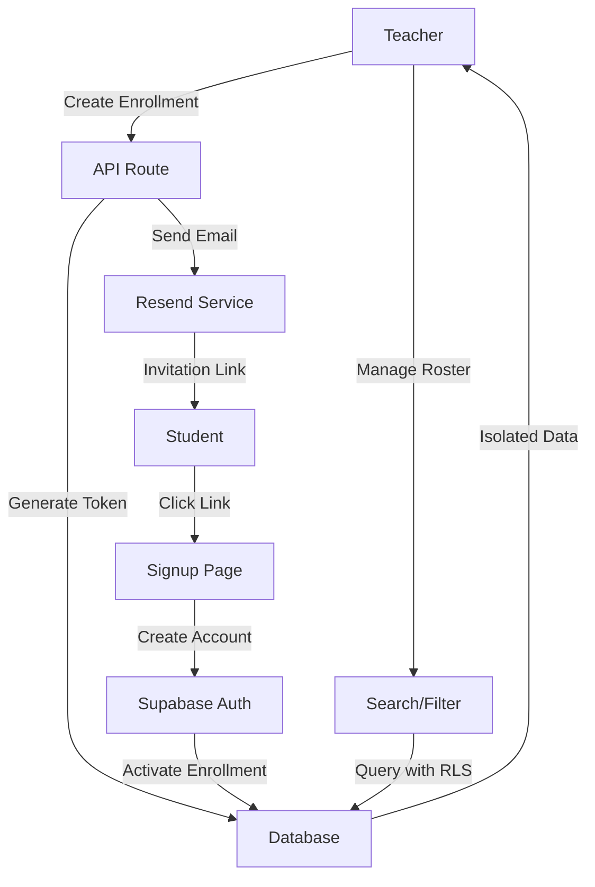
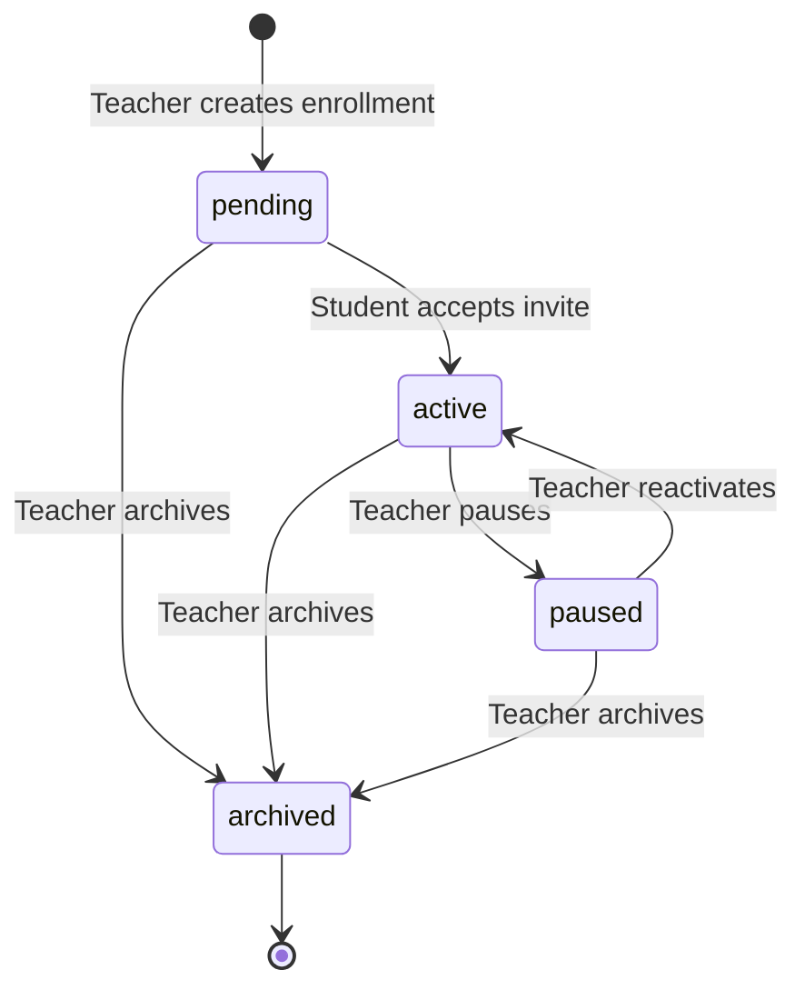
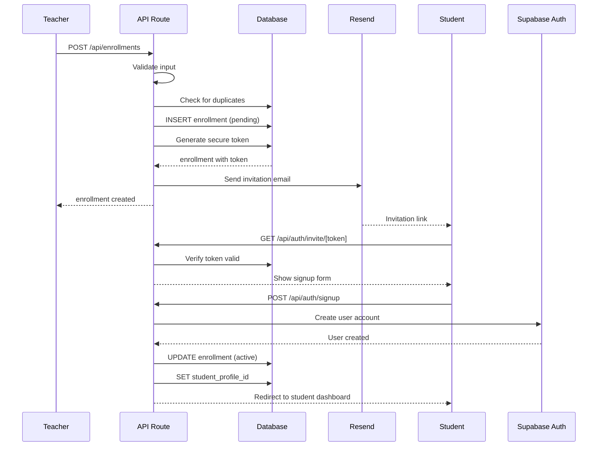

# Design Document: Student Management (Gestão de Alunos)

## Overview

The Student Management module manages the teacher-student relationship through "enrollments" (vínculos), serving as the central data isolation mechanism for the entire platform. Each enrollment represents an independent relationship between one teacher and one student, with its own status, notes, and history. This module enables teachers to invite students via email, manage their roster, and maintain private observations about each student's training.

### Goals

- Enable teachers to invite students by email with secure token-based account creation
- Provide comprehensive enrollment management (create, read, update, pause, reactivate, archive)
- Support search and filtering of student rosters by name and status
- Maintain strict data isolation between teachers using Row Level Security (RLS)
- Allow students to have multiple independent enrollments with different teachers
- Preserve enrollment history and prevent data loss through archive-instead-of-delete pattern
- Ensure private notes remain confidential and never visible to students

### Non-Goals

- Bulk student import from CSV or external systems
- Student self-registration (all students must be invited by teachers)
- Direct messaging between teachers and students
- Student-initiated enrollment requests
- Enrollment transfer between teachers
- Payment or billing integration with enrollments
- Automated enrollment expiration or renewal

### Key Design Decisions

1. **Enrollment as Central Isolation Boundary**: All platform features (lessons, plans, access control) reference enrollments as the primary data isolation entity. This ensures that a student's data with one teacher is completely separate from their data with another teacher.

2. **Invitation-Based Student Onboarding**: Students cannot self-register; they must be invited by a teacher. This maintains teacher control over their roster and prevents unauthorized access. Invitations use secure random tokens with 7-day expiration.

3. **Archive Instead of Delete**: Enrollments with lesson history cannot be deleted, only archived. This preserves historical data integrity and prevents accidental data loss.

4. **Status-Based Lifecycle Management**: Enrollments progress through well-defined states (pending → active → paused/archived). Status transitions are validated to prevent invalid state changes.

5. **Email as Pre-Account Identifier**: Before a student creates their account, the enrollment stores their email as the primary identifier. This allows teachers to manage invitations independently of profile creation.

6. **RLS-First Authorization**: All data isolation is enforced at the database level through RLS policies. API routes verify ownership, but the database is the ultimate security boundary.

## Architecture

### High-Level Flow



### Component Layers

1. **Presentation Layer (Client Components)**
   - Student list with search and filters
   - Enrollment detail view
   - Student form (create/edit)
   - Invitation management UI
   - Status action buttons (pause/reactivate/archive)

2. **API Layer (Next.js API Routes)**
   - `/api/enrollments` - List and create enrollments
   - `/api/enrollments/[id]` - Get, update, delete single enrollment
   - `/api/enrollments/[id]/pause` - Pause enrollment
   - `/api/enrollments/[id]/reactivate` - Reactivate enrollment
   - `/api/enrollments/[id]/archive` - Archive enrollment
   - `/api/enrollments/[id]/resend-invite` - Resend invitation

3. **Service Layer (lib/services)**
   - `enrollment.service.ts` - Enrollment business logic
   - `invitation.service.ts` - Token generation and email sending
   - `enrollment-validation.service.ts` - Validation rules

4. **Data Layer (PostgreSQL + RLS)**
   - `enrollments` table with comprehensive RLS policies
   - Teacher and student view policies
   - Private notes column restrictions

5. **External Services**
   - Resend - Invitation email delivery
   - Supabase Auth - Student account creation
   - Supabase Database - Data storage with RLS

### Enrollment Lifecycle Flow



### Invitation Flow



## Components and Interfaces

### API Endpoints

#### POST /api/enrollments

Creates a new enrollment and sends invitation email to the student.

**Request:**
```typescript
{
  student_name: string;      // Min 2 characters, required
  student_email: string;     // Valid email format, required
  student_phone?: string;    // Optional, valid phone format if provided
  private_notes?: string;    // Optional, max 5000 characters
}
```

**Response:**
```typescript
{
  data: {
    id: string;
    teacher_id: string;
    student_name: string;
    student_email: string;
    student_phone: string | null;
    status: 'pending';
    started_at: string;       // ISO 8601
    archived_at: null;
    private_notes: string | null;
    created_at: string;       // ISO 8601
    updated_at: string;       // ISO 8601
  };
  error: null;
}
```

**Error Responses:**
- 400: Validation failure (invalid email, name too short, notes too long)
- 409: Email already has active/pending enrollment with this teacher
- 401: Not authenticated
- 500: Server error

#### GET /api/enrollments

Returns paginated list of enrollments for the authenticated teacher with optional search and filtering.

**Query Parameters:**
```typescript
{
  search?: string;           // Search by student name (case-insensitive partial match)
  status?: string[];         // Filter by status: pending, active, paused, archived
  page?: number;             // Page number (default: 1)
  pageSize?: number;         // Items per page (default: 20, max: 100)
}
```

**Response:**
```typescript
{
  data: {
    enrollments: [
      {
        id: string;
        student_name: string;
        student_email: string;
        status: 'pending' | 'active' | 'paused' | 'archived';
        started_at: string;
        next_lesson: {
          id: string;
          scheduled_at: string;
        } | null;
      }
    ];
  };
  meta: {
    total: number;
    page: number;
    pageSize: number;
    totalPages: number;
    hasNext: boolean;
    hasPrevious: boolean;
  };
  error: null;
}
```

**Default Behavior:**
- Sorts by `student_name` alphabetically
- Excludes archived enrollments unless explicitly included in status filter
- Returns empty array if no enrollments match

#### GET /api/enrollments/[id]

Returns complete enrollment details including lesson statistics.

**Response:**
```typescript
{
  data: {
    id: string;
    teacher_id: string;
    student_profile_id: string | null;
    student_name: string;
    student_email: string;
    student_phone: string | null;
    status: 'pending' | 'active' | 'paused' | 'archived';
    started_at: string;
    archived_at: string | null;
    private_notes: string | null;
    created_at: string;
    updated_at: string;
    completed_lessons_count: number;
    next_lesson: {
      id: string;
      scheduled_at: string;
    } | null;
  };
  error: null;
}
```

**Error Responses:**
- 404: Enrollment not found
- 403: Enrollment belongs to another teacher
- 401: Not authenticated

#### PATCH /api/enrollments/[id]

Updates enrollment information (contact details and private notes).

**Request:**
```typescript
{
  student_name?: string;     // Min 2 characters if provided
  student_email?: string;    // Valid email if provided
  student_phone?: string | null;
  private_notes?: string | null;  // Max 5000 characters
}
```

**Response:**
```typescript
{
  data: {
    // Same as GET /api/enrollments/[id]
  };
  error: null;
}
```

**Error Responses:**
- 400: Validation failure
- 409: Email already in use by another active/pending enrollment
- 404: Enrollment not found
- 403: Enrollment belongs to another teacher

#### POST /api/enrollments/[id]/pause

Pauses an active enrollment.

**Request:** None

**Response:**
```typescript
{
  data: {
    // Updated enrollment with status: 'paused'
  };
  error: null;
}
```

**Error Responses:**
- 400: Enrollment is not active
- 409: Invalid status transition (already paused or archived)
- 404: Enrollment not found
- 403: Enrollment belongs to another teacher

#### POST /api/enrollments/[id]/reactivate

Reactivates a paused enrollment.

**Request:** None

**Response:**
```typescript
{
  data: {
    // Updated enrollment with status: 'active'
  };
  error: null;
}
```

**Error Responses:**
- 400: Enrollment is not paused
- 409: Invalid status transition
- 404: Enrollment not found
- 403: Enrollment belongs to another teacher

#### POST /api/enrollments/[id]/archive

Archives an enrollment (soft delete).

**Request:** None

**Response:**
```typescript
{
  data: {
    // Updated enrollment with status: 'archived' and archived_at set
  };
  error: null;
}
```

**Error Responses:**
- 409: Enrollment already archived
- 404: Enrollment not found
- 403: Enrollment belongs to another teacher

#### DELETE /api/enrollments/[id]

Deletes an enrollment (only allowed if no lesson history exists).

**Request:** None

**Response:**
```typescript
{
  data: {
    success: true;
  };
  error: null;
}
```

**Error Responses:**
- 409: Enrollment has lesson history (must archive instead)
- 404: Enrollment not found
- 403: Enrollment belongs to another teacher

#### POST /api/enrollments/[id]/resend-invite

Resends invitation email with new token for pending enrollments.

**Request:** None

**Response:**
```typescript
{
  data: {
    success: true;
    expires_at: string;  // New token expiration
  };
  error: null;
}
```

**Error Responses:**
- 400: Enrollment is not pending
- 404: Enrollment not found
- 403: Enrollment belongs to another teacher

### Frontend Components

#### StudentList Component

Located: `components/students/StudentList.tsx`

**Props:**
```typescript
interface StudentListProps {
  enrollments: Enrollment[];
  onSearch: (query: string) => void;
  onFilterStatus: (statuses: EnrollmentStatus[]) => void;
  onPaginate: (page: number) => void;
  pagination: PaginationMeta;
  loading?: boolean;
}
```

**Features:**
- Search input with debounce
- Status filter chips (active, paused, pending, archived)
- Table view with sortable columns
- Action buttons (view, pause, reactivate, archive)
- Empty state when no students
- Skeleton loading state

#### StudentCard Component

Located: `components/students/StudentCard.tsx`

**Props:**
```typescript
interface StudentCardProps {
  enrollment: EnrollmentDetail;
  onEdit: () => void;
  onPause?: () => void;
  onReactivate?: () => void;
  onArchive?: () => void;
  onDelete?: () => void;
}
```

**Features:**
- Student name and contact info
- Status badge with color coding
- Enrollment date and duration
- Completed lessons count
- Next lesson indicator
- Action menu with contextual options
- Private notes display (teacher only)

#### StudentForm Component

Located: `components/students/StudentForm.tsx`

**Props:**
```typescript
interface StudentFormProps {
  enrollment?: EnrollmentDetail;  // For editing, undefined for creating
  onSave: (data: EnrollmentFormData) => Promise<void>;
  onCancel: () => void;
}
```

**Features:**
- Name, email, phone inputs
- Email format validation
- Phone format validation
- Private notes textarea (5000 char limit)
- Client-side validation
- Error display per field
- Save and cancel buttons
- Loading state during save

#### InvitationStatus Component

Located: `components/students/InvitationStatus.tsx`

**Props:**
```typescript
interface InvitationStatusProps {
  enrollment: Enrollment;
  onResend: () => Promise<void>;
}
```

**Features:**
- Shows pending invitation status
- Displays email address and invitation date
- Token expiration countdown
- Resend invitation button
- Cooldown period indicator
- Success/error toast on resend

### Custom Hooks

#### useEnrollments Hook

Located: `hooks/useEnrollments.ts`

**API:**
```typescript
interface UseEnrollmentsReturn {
  enrollments: Enrollment[];
  loading: boolean;
  error: Error | null;
  pagination: PaginationMeta;
  search: (query: string) => void;
  filterByStatus: (statuses: EnrollmentStatus[]) => void;
  goToPage: (page: number) => void;
  refresh: () => Promise<void>;
}
```

#### useEnrollment Hook

Located: `hooks/useEnrollment.ts`

**API:**
```typescript
interface UseEnrollmentReturn {
  enrollment: EnrollmentDetail | null;
  loading: boolean;
  error: Error | null;
  update: (data: Partial<EnrollmentFormData>) => Promise<void>;
  pause: () => Promise<void>;
  reactivate: () => Promise<void>;
  archive: () => Promise<void>;
  delete: () => Promise<void>;
  resendInvite: () => Promise<void>;
}
```

### Service Functions

#### enrollment.service.ts

Located: `lib/services/enrollment.service.ts`

**Key Functions:**
```typescript
// Create enrollment with invitation
async function createEnrollment(
  teacherId: string,
  data: {
    student_name: string;
    student_email: string;
    student_phone?: string;
    private_notes?: string;
  }
): Promise<Enrollment>

// Get enrollments for teacher
async function getEnrollments(
  teacherId: string,
  options: {
    search?: string;
    status?: EnrollmentStatus[];
    page?: number;
    pageSize?: number;
  }
): Promise<{ enrollments: Enrollment[]; meta: PaginationMeta }>

// Get single enrollment with statistics
async function getEnrollmentDetail(
  enrollmentId: string,
  teacherId: string
): Promise<EnrollmentDetail>

// Update enrollment
async function updateEnrollment(
  enrollmentId: string,
  teacherId: string,
  data: Partial<EnrollmentUpdateData>
): Promise<Enrollment>

// Change enrollment status
async function pauseEnrollment(
  enrollmentId: string,
  teacherId: string
): Promise<Enrollment>

async function reactivateEnrollment(
  enrollmentId: string,
  teacherId: string
): Promise<Enrollment>

async function archiveEnrollment(
  enrollmentId: string,
  teacherId: string
): Promise<Enrollment>

// Delete enrollment (only if no lessons)
async function deleteEnrollment(
  enrollmentId: string,
  teacherId: string
): Promise<void>

// Check if enrollment can be deleted
async function canDeleteEnrollment(
  enrollmentId: string
): Promise<boolean>
```

#### invitation.service.ts

Located: `lib/services/invitation.service.ts`

**Key Functions:**
```typescript
// Generate secure invitation token
function generateInviteToken(): string

// Send invitation email
async function sendInvitationEmail(
  enrollment: Enrollment,
  inviteToken: string
): Promise<void>

// Resend invitation with new token
async function resendInvitation(
  enrollmentId: string,
  teacherId: string
): Promise<{ token: string; expiresAt: Date }>

// Verify and validate token
async function verifyInviteToken(
  token: string
): Promise<{
  valid: boolean;
  enrollment: Enrollment | null;
  error?: string;
}>

// Activate enrollment after student signup
async function activateEnrollment(
  token: string,
  studentProfileId: string
): Promise<Enrollment>
```

## Data Models

### enrollments Table

Stores teacher-student relationships and serves as central data isolation boundary.

**Schema:**
```sql
CREATE TABLE enrollments (
  id UUID PRIMARY KEY DEFAULT gen_random_uuid(),
  teacher_id UUID NOT NULL REFERENCES teachers(id) ON DELETE CASCADE,
  student_profile_id UUID REFERENCES profiles(id) ON DELETE SET NULL,
  student_name TEXT NOT NULL,
  student_email TEXT NOT NULL,
  student_phone TEXT,
  status TEXT NOT NULL DEFAULT 'pending' 
    CHECK (status IN ('pending', 'active', 'paused', 'archived')),
  started_at TIMESTAMPTZ NOT NULL DEFAULT NOW(),
  archived_at TIMESTAMPTZ,
  private_notes TEXT CHECK (LENGTH(private_notes) <= 5000),
  invite_token TEXT,
  invite_expires_at TIMESTAMPTZ,
  created_at TIMESTAMPTZ NOT NULL DEFAULT NOW(),
  updated_at TIMESTAMPTZ NOT NULL DEFAULT NOW(),
  
  -- Unique constraint: one active/pending enrollment per teacher-email combo
  CONSTRAINT unique_teacher_student_email 
    UNIQUE (teacher_id, student_email) 
    WHERE (status IN ('active', 'pending'))
);

-- Indexes for common queries
CREATE INDEX idx_enrollments_teacher_id ON enrollments(teacher_id);
CREATE INDEX idx_enrollments_student_profile_id ON enrollments(student_profile_id);
CREATE INDEX idx_enrollments_status ON enrollments(status);
CREATE INDEX idx_enrollments_student_email ON enrollments(student_email);
CREATE INDEX idx_enrollments_invite_token ON enrollments(invite_token) 
  WHERE invite_token IS NOT NULL;

-- Trigger to update updated_at
CREATE TRIGGER update_enrollments_updated_at
  BEFORE UPDATE ON enrollments
  FOR EACH ROW
  EXECUTE FUNCTION update_updated_at_column();
```

**Columns:**
- `id` (UUID): Primary key
- `teacher_id` (UUID): References teachers.id, required
- `student_profile_id` (UUID): References profiles.id, nullable until student accepts invite
- `student_name` (TEXT): Student's name, required, min 2 characters
- `student_email` (TEXT): Student's email, required for invitation
- `student_phone` (TEXT): Optional phone number
- `status` (TEXT): Enrollment lifecycle state (pending, active, paused, archived)
- `started_at` (TIMESTAMPTZ): When enrollment relationship began
- `archived_at` (TIMESTAMPTZ): When enrollment was archived (null if not archived)
- `private_notes` (TEXT): Teacher's private observations, max 5000 characters, never shown to students
- `invite_token` (TEXT): Secure token for invitation link (null after activation)
- `invite_expires_at` (TIMESTAMPTZ): Token expiration (7 days from generation)
- `created_at` (TIMESTAMPTZ): Record creation timestamp (UTC)
- `updated_at` (TIMESTAMPTZ): Last update timestamp (UTC, auto-updated)

**Row Level Security Policies:**

```sql
-- Enable RLS
ALTER TABLE enrollments ENABLE ROW LEVEL SECURITY;

-- Teachers can view their own enrollments
CREATE POLICY "Teachers can view own enrollments"
  ON enrollments FOR SELECT
  USING (teacher_id = auth.uid());

-- Teachers can create enrollments for themselves
CREATE POLICY "Teachers can create own enrollments"
  ON enrollments FOR INSERT
  WITH CHECK (teacher_id = auth.uid());

-- Teachers can update their own enrollments
CREATE POLICY "Teachers can update own enrollments"
  ON enrollments FOR UPDATE
  USING (teacher_id = auth.uid())
  WITH CHECK (teacher_id = auth.uid());

-- Teachers can delete their own enrollments
CREATE POLICY "Teachers can delete own enrollments"
  ON enrollments FOR DELETE
  USING (teacher_id = auth.uid());

-- Students can view enrollments where they are the student
-- but private_notes is excluded via a view
CREATE POLICY "Students can view own enrollments"
  ON enrollments FOR SELECT
  USING (student_profile_id = auth.uid());
```

**Student View (Excludes Private Notes):**

```sql
CREATE VIEW student_enrollments AS
SELECT 
  id,
  teacher_id,
  student_profile_id,
  student_name,
  student_email,
  student_phone,
  status,
  started_at,
  archived_at,
  created_at,
  updated_at
FROM enrollments
WHERE student_profile_id = auth.uid();
```

### TypeScript Interfaces

Located: `types/enrollment.ts`

```typescript
export type EnrollmentStatus = 'pending' | 'active' | 'paused' | 'archived';

export interface Enrollment {
  id: string;
  teacher_id: string;
  student_profile_id: string | null;
  student_name: string;
  student_email: string;
  student_phone: string | null;
  status: EnrollmentStatus;
  started_at: string;
  archived_at: string | null;
  private_notes: string | null;
  created_at: string;
  updated_at: string;
}

export interface EnrollmentDetail extends Enrollment {
  completed_lessons_count: number;
  next_lesson: {
    id: string;
    scheduled_at: string;
  } | null;
}

export interface EnrollmentListItem {
  id: string;
  student_name: string;
  student_email: string;
  status: EnrollmentStatus;
  started_at: string;
  next_lesson: {
    id: string;
    scheduled_at: string;
  } | null;
}

export interface EnrollmentFormData {
  student_name: string;
  student_email: string;
  student_phone?: string;
  private_notes?: string;
}

export interface EnrollmentUpdateData {
  student_name?: string;
  student_email?: string;
  student_phone?: string | null;
  private_notes?: string | null;
}

export interface PaginationMeta {
  total: number;
  page: number;
  pageSize: number;
  totalPages: number;
  hasNext: boolean;
  hasPrevious: boolean;
}

export interface InviteTokenData {
  valid: boolean;
  enrollment: Enrollment | null;
  teacher_name: string;
  error?: string;
}
```

