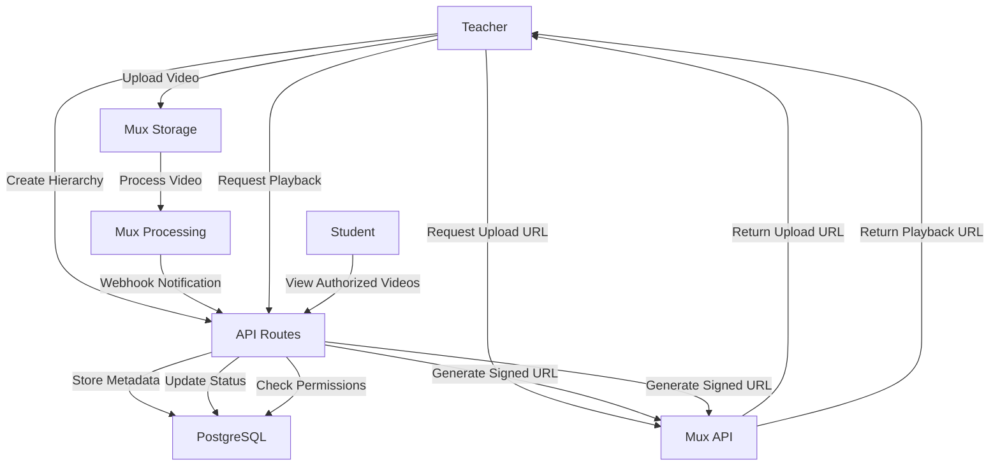
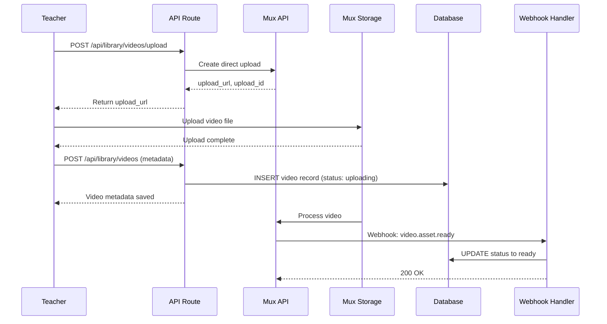
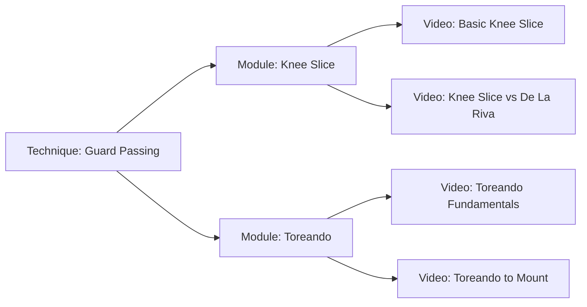

# Design Document: Technique Library (Biblioteca de Técnicas)

## Overview

The Technique Library module enables teachers to organize their instructional content in a hierarchical structure of Techniques → Modules → Videos. This module serves as the central content repository for the entire platform, allowing teachers to build a structured knowledge base that can be efficiently referenced and shared with students. Videos are hosted externally on Mux with only metadata stored in the database, enabling scalable video delivery without storage infrastructure burden.

### Goals

- Enable teachers to organize instructional content in a three-tier hierarchy (Technique → Module → Video)
- Provide seamless video upload integration with Mux for professional video hosting
- Support video reusability across multiple lessons and monthly plans without duplication
- Maintain strict data isolation between teachers at the database level
- Allow flexible content organization through sorting and archiving
- Handle video processing lifecycle from upload through ready state
- Enable efficient content discovery through search and hierarchical navigation

### Non-Goals

- Video editing or transcoding configuration (Mux handles automatically)
- Video analytics or viewing statistics
- Video comments or annotations
- Collaborative library sharing between teachers
- Video playlists or collections outside the hierarchy
- Live streaming or real-time video
- Video subtitles or captions management (future enhancement)
- Direct student video uploads

### Key Design Decisions

1. **Three-Tier Hierarchy**: Techniques contain Modules, Modules contain Videos. This structure mirrors how Jiu-Jitsu instruction is naturally organized, from broad techniques (e.g., "Guard Passing") to learning modules (e.g., "Knee Slice Variations") to specific demonstrations.

2. **Mux for Video Hosting**: External video hosting eliminates storage infrastructure complexity and provides professional features like adaptive bitrate streaming, automatic transcoding, and global CDN delivery. Only metadata is stored in our database.

3. **Direct Upload Pattern**: Teachers upload videos directly to Mux via pre-signed upload URLs, avoiding proxying video data through our API servers. This improves performance and reduces bandwidth costs.

4. **Webhook-Driven Status Updates**: Mux notifies our system when videos finish processing via webhooks. This asynchronous pattern prevents polling and ensures accurate status tracking.

5. **Archive Instead of Delete**: Videos and modules referenced by lessons or plans cannot be deleted, only archived. This preserves historical data integrity and prevents broken references.

6. **RLS-Based Isolation**: All library content is isolated by teacher_id through Row Level Security policies. The database enforces that teachers can only access their own content, regardless of API logic.

7. **Reusable by Design**: A single video can be referenced by multiple plan days and lessons without duplication. The schema uses reference relationships rather than copying video records.

## Architecture

### High-Level Flow



### Component Layers

1. **Presentation Layer (Client Components)**
   - Hierarchical technique tree view
   - Module list with drag-drop reordering
   - Video list with status indicators
   - Video upload component with progress
   - Video player with Mux integration
   - Search interface

2. **API Layer (Next.js API Routes)**
   - `/api/library/techniques` - Technique CRUD and listing
   - `/api/library/techniques/[id]/reorder` - Technique reordering
   - `/api/library/modules` - Module CRUD and listing
   - `/api/library/modules/[id]/move` - Move module to different technique
   - `/api/library/videos` - Video metadata CRUD
   - `/api/library/videos/upload` - Get Mux upload URL
   - `/api/library/videos/[id]/playback` - Generate signed playback URL
   - `/api/library/videos/webhook` - Mux webhook handler
   - `/api/library/search` - Cross-library video search

3. **Service Layer (lib/services)**
   - `library.service.ts` - Library hierarchy business logic
   - `video.service.ts` - Video metadata and lifecycle management
   - `mux.service.ts` - Mux API integration
   - `video-validation.service.ts` - Validation rules

4. **Data Layer (PostgreSQL + RLS)**
   - `techniques` table with RLS policies
   - `modules` table with RLS policies
   - `videos` table with RLS policies
   - Foreign key constraints for referential integrity
   - Indexes for performance

5. **External Services**
   - Mux - Video hosting, processing, and delivery
   - Webhook handling for processing notifications

### Video Upload Flow



### Hierarchical Organization Flow



## Components and Interfaces

### API Endpoints

#### POST /api/library/techniques

Creates a new technique for the authenticated teacher.

**Request:**
```typescript
{
  name: string;              // Required, min 2 characters, max 200
  description?: string;      // Optional, max 2000 characters
  sort_order?: number;       // Optional, positive integer (auto-assigned if not provided)
}
```

**Response:**
```typescript
{
  data: {
    id: string;
    teacher_id: string;
    name: string;
    description: string | null;
    sort_order: number;
    status: 'active';
    created_at: string;      // ISO 8601
    updated_at: string;      // ISO 8601
  };
  error: null;
}
```

**Error Responses:**
- 400: Validation failure (name empty, description too long)
- 401: Not authenticated
- 500: Server error

#### GET /api/library/techniques

Returns list of techniques for the authenticated teacher.

**Query Parameters:**
```typescript
{
  include_archived?: boolean;  // Default: false
}
```

**Response:**
```typescript
{
  data: {
    techniques: [
      {
        id: string;
        name: string;
        description: string | null;
        sort_order: number;
        status: 'active' | 'archived';
        module_count: number;
        created_at: string;
        updated_at: string;
      }
    ];
  };
  error: null;
}
```

**Default Behavior:**
- Returns only active techniques unless include_archived=true
- Sorted by sort_order ascending
- Empty array if no techniques

#### PATCH /api/library/techniques/[id]

Updates technique information.

**Request:**
```typescript
{
  name?: string;             // Min 2 characters, max 200
  description?: string | null;  // Max 2000 characters
  sort_order?: number;       // Positive integer
}
```

**Response:**
```typescript
{
  data: {
    // Updated technique object
  };
  error: null;
}
```

**Error Responses:**
- 400: Validation failure
- 403: Technique belongs to different teacher
- 404: Technique not found

#### POST /api/library/techniques/reorder

Updates sort_order for multiple techniques in a single transaction.

**Request:**
```typescript
{
  reorders: [
    {
      technique_id: string;
      sort_order: number;    // Positive integer
    }
  ];
}
```

**Response:**
```typescript
{
  data: {
    updated_count: number;
  };
  error: null;
}
```

**Error Responses:**
- 400: Invalid sort_order values
- 403: One or more techniques belong to different teacher

#### POST /api/library/techniques/[id]/archive

Archives a technique and all its modules and videos.

**Request:** None

**Response:**
```typescript
{
  data: {
    // Updated technique with status: 'archived'
  };
  error: null;
}
```

**Behavior:**
- Sets technique status to archived
- Sets all child modules to archived
- Sets all videos in child modules to archived
- Preserves historical associations with lessons/plans

#### POST /api/library/techniques/[id]/unarchive

Reactivates an archived technique (does not automatically unarchive children).

**Request:** None

**Response:**
```typescript
{
  data: {
    // Updated technique with status: 'active'
  };
  error: null;
}
```

**Error Responses:**
- 409: Technique already active

#### POST /api/library/modules

Creates a new module within a technique.

**Request:**
```typescript
{
  technique_id: string;      // Required, must exist and belong to teacher
  name: string;              // Required, min 2 characters, max 200
  description?: string;      // Optional, max 2000 characters
  sort_order?: number;       // Optional, positive integer (auto-assigned if not provided)
}
```

**Response:**
```typescript
{
  data: {
    id: string;
    technique_id: string;
    name: string;
    description: string | null;
    sort_order: number;
    status: 'active';
    created_at: string;
    updated_at: string;
  };
  error: null;
}
```

**Error Responses:**
- 400: Validation failure
- 403: Technique belongs to different teacher
- 404: Technique not found

#### GET /api/library/techniques/[techniqueId]/modules

Returns modules for a specific technique.

**Query Parameters:**
```typescript
{
  include_archived?: boolean;  // Default: false
}
```

**Response:**
```typescript
{
  data: {
    modules: [
      {
        id: string;
        technique_id: string;
        name: string;
        description: string | null;
        sort_order: number;
        status: 'active' | 'archived';
        video_count: number;
        created_at: string;
        updated_at: string;
      }
    ];
  };
  error: null;
}
```

**Default Behavior:**
- Returns only active modules unless include_archived=true
- Sorted by sort_order ascending
- Empty array if no modules

#### PATCH /api/library/modules/[id]

Updates module information.

**Request:**
```typescript
{
  name?: string;             // Min 2 characters, max 200
  description?: string | null;  // Max 2000 characters
  sort_order?: number;       // Positive integer
}
```

**Response:**
```typescript
{
  data: {
    // Updated module object
  };
  error: null;
}
```

#### POST /api/library/modules/reorder

Updates sort_order for multiple modules in a single transaction.

**Request:**
```typescript
{
  reorders: [
    {
      module_id: string;
      sort_order: number;
    }
  ];
}
```

**Response:**
```typescript
{
  data: {
    updated_count: number;
  };
  error: null;
}
```

#### POST /api/library/modules/[id]/move

Moves a module to a different technique.

**Request:**
```typescript
{
  target_technique_id: string;  // Must exist and belong to teacher
}
```

**Response:**
```typescript
{
  data: {
    // Updated module with new technique_id
  };
  error: null;
}
```

**Error Responses:**
- 403: Module or target technique belongs to different teacher
- 404: Module or target technique not found

#### POST /api/library/modules/[id]/archive

Archives a module and all its videos.

**Request:** None

**Response:**
```typescript
{
  data: {
    // Updated module with status: 'archived'
  };
  error: null;
}
```

#### POST /api/library/videos/upload

Requests a Mux direct upload URL for video upload.

**Request:** None

**Response:**
```typescript
{
  data: {
    upload_url: string;      // Temporary URL for direct upload (24hr expiration)
    upload_id: string;       // Mux upload identifier
  };
  error: null;
}
```

**Error Responses:**
- 401: Not authenticated
- 500: Mux API error
- 503: Mux service unavailable

#### POST /api/library/videos

Creates video metadata record after upload initiation.

**Request:**
```typescript
{
  module_id: string;          // Required, must exist and belong to teacher
  title: string;              // Required, min 2 characters, max 200
  description?: string;       // Optional, max 2000 characters
  provider_video_id: string;  // Required, from Mux upload response
}
```

**Response:**
```typescript
{
  data: {
    id: string;
    teacher_id: string;
    module_id: string;
    title: string;
    description: string | null;
    provider: 'mux';
    provider_video_id: string;
    thumbnail_url: string | null;
    duration_seconds: number | null;
    status: 'uploading';
    created_at: string;
    updated_at: string;
  };
  error: null;
}
```

**Error Responses:**
- 400: Validation failure
- 403: Module belongs to different teacher
- 404: Module not found

#### GET /api/library/modules/[moduleId]/videos

Returns videos for a specific module.

**Query Parameters:**
```typescript
{
  include_archived?: boolean;  // Default: false
}
```

**Response:**
```typescript
{
  data: {
    videos: [
      {
        id: string;
        title: string;
        description: string | null;
        thumbnail_url: string | null;
        duration_seconds: number | null;
        status: 'uploading' | 'processing' | 'ready' | 'error' | 'archived';
        created_at: string;
      }
    ];
  };
  error: null;
}
```

#### PATCH /api/library/videos/[id]

Updates video metadata (title and description only).

**Request:**
```typescript
{
  title?: string;            // Min 2 characters, max 200
  description?: string | null;  // Max 2000 characters
}
```

**Response:**
```typescript
{
  data: {
    // Updated video object
  };
  error: null;
}
```

**Note:** Cannot update provider, provider_video_id, or status through this endpoint.

#### GET /api/library/videos/[id]/playback

Generates a signed playback URL for a video.

**Request:** None

**Response:**
```typescript
{
  data: {
    playback_url: string;    // Mux signed URL (24hr expiration)
    expires_at: string;      // ISO 8601 timestamp
  };
  error: null;
}
```

**Error Responses:**
- 403: Video belongs to different teacher (or student without permission)
- 404: Video not found
- 409: Video status not ready

#### POST /api/library/videos/webhook

Mux webhook handler for processing status updates.

**Request:**
```typescript
{
  type: string;              // 'video.asset.ready' | 'video.asset.errored'
  data: {
    id: string;              // provider_video_id
    playback_ids: [{
      id: string;
      policy: string;
    }];
    duration: number;        // seconds
    // ... other Mux fields
  };
}
```

**Response:**
```typescript
{
  data: {
    success: true;
  };
  error: null;
}
```

**Behavior:**
- Verifies webhook signature
- Updates video status based on event type
- Stores thumbnail_url and duration_seconds when available
- Returns 200 even on processing errors to prevent retries

#### POST /api/library/videos/[id]/archive

Archives a video (preserves historical associations).

**Request:** None

**Response:**
```typescript
{
  data: {
    // Updated video with status: 'archived'
  };
  error: null;
}
```

#### DELETE /api/library/videos/[id]

Deletes a video (only if no lesson or plan references exist).

**Request:** None

**Response:**
```typescript
{
  data: {
    success: true;
  };
  error: null;
}
```

**Error Responses:**
- 409: Video has references in lessons or plans (must archive instead)

#### GET /api/library/search

Searches for videos across all modules by title.

**Query Parameters:**
```typescript
{
  q: string;                 // Search query (partial match, case-insensitive)
  page?: number;             // Default: 1
  pageSize?: number;         // Default: 20, max: 100
}
```

**Response:**
```typescript
{
  data: {
    videos: [
      {
        id: string;
        title: string;
        description: string | null;
        thumbnail_url: string | null;
        duration_seconds: number | null;
        status: string;
        module_name: string;
        technique_name: string;
      }
    ];
  };
  meta: {
    total: number;
    page: number;
    pageSize: number;
    totalPages: number;
  };
  error: null;
}
```

### Frontend Components

#### TechniqueTree Component

Located: `components/library/TechniqueTree.tsx`

**Props:**
```typescript
interface TechniqueTreeProps {
  techniques: Technique[];
  selectedTechniqueId?: string;
  onSelectTechnique: (techniqueId: string) => void;
  onCreateTechnique: () => void;
  onEditTechnique: (technique: Technique) => void;
  onArchiveTechnique: (techniqueId: string) => void;
}
```

**Features:**
- Collapsible tree view of techniques
- Drag-and-drop reordering
- Module count badge for each technique
- Context menu (edit, archive, add module)
- Empty state with create button
- Loading skeleton

#### ModuleList Component

Located: `components/library/ModuleList.tsx`

**Props:**
```typescript
interface ModuleListProps {
  modules: Module[];
  techniqueId: string;
  onCreateModule: () => void;
  onEditModule: (module: Module) => void;
  onMoveModule: (moduleId: string) => void;
  onArchiveModule: (moduleId: string) => void;
}
```

**Features:**
- Grid or list view toggle
- Drag-and-drop reordering
- Video count badge for each module
- Action menu (edit, move, archive)
- Empty state when no modules

#### VideoList Component

Located: `components/library/VideoList.tsx`

**Props:**
```typescript
interface VideoListProps {
  videos: Video[];
  moduleId: string;
  onUploadVideo: () => void;
  onEditVideo: (video: Video) => void;
  onPlayVideo: (videoId: string) => void;
  onArchiveVideo: (videoId: string) => void;
}
```

**Features:**
- Grid view with thumbnails
- Status indicators (uploading, processing, ready, error)
- Duration display
- Action menu (edit, play, archive)
- Empty state with upload button
- Processing progress indicators

#### VideoUploader Component

Located: `components/library/VideoUploader.tsx`

**Props:**
```typescript
interface VideoUploaderProps {
  moduleId: string;
  onUploadComplete: (video: Video) => void;
  onCancel: () => void;
}
```

**Features:**
- File selection with drag-and-drop
- Upload progress bar
- File size validation
- Format validation (MP4, MOV, AVI)
- Title and description form
- Cancel upload option
- Error handling and retry

#### VideoPlayer Component

Located: `components/library/VideoPlayer.tsx`

**Props:**
```typescript
interface VideoPlayerProps {
  videoId: string;
  autoplay?: boolean;
  onClose?: () => void;
}
```

**Features:**
- Mux player integration
- Responsive video sizing
- Playback controls
- Full-screen support
- Loading state
- Error state for unavailable videos

#### LibrarySearch Component

Located: `components/library/LibrarySearch.tsx`

**Props:**
```typescript
interface LibrarySearchProps {
  onSearch: (query: string) => void;
  onSelectVideo: (videoId: string) => void;
}
```

**Features:**
- Search input with debounce
- Result list with thumbnails
- Hierarchy breadcrumb (Technique > Module)
- Pagination
- Empty state for no results
- Loading state

### Custom Hooks

#### useLibrary Hook

Located: `hooks/useLibrary.ts`

**API:**
```typescript
interface UseLibraryReturn {
  techniques: Technique[];
  loading: boolean;
  error: Error | null;
  createTechnique: (data: CreateTechniqueData) => Promise<Technique>;
  updateTechnique: (id: string, data: UpdateTechniqueData) => Promise<Technique>;
  reorderTechniques: (reorders: ReorderItem[]) => Promise<void>;
  archiveTechnique: (id: string) => Promise<void>;
  unarchiveTechnique: (id: string) => Promise<void>;
  refresh: () => Promise<void>;
}
```

#### useModules Hook

Located: `hooks/useModules.ts`

**API:**
```typescript
interface UseModulesReturn {
  modules: Module[];
  loading: boolean;
  error: Error | null;
  createModule: (data: CreateModuleData) => Promise<Module>;
  updateModule: (id: string, data: UpdateModuleData) => Promise<Module>;
  moveModule: (id: string, targetTechniqueId: string) => Promise<Module>;
  reorderModules: (reorders: ReorderItem[]) => Promise<void>;
  archiveModule: (id: string) => Promise<void>;
  refresh: () => Promise<void>;
}
```

#### useVideos Hook

Located: `hooks/useVideos.ts`

**API:**
```typescript
interface UseVideosReturn {
  videos: Video[];
  loading: boolean;
  error: Error | null;
  uploadVideo: (file: File, metadata: VideoMetadata) => Promise<Video>;
  updateVideo: (id: string, data: UpdateVideoData) => Promise<Video>;
  getPlaybackUrl: (id: string) => Promise<string>;
  archiveVideo: (id: string) => Promise<void>;
  deleteVideo: (id: string) => Promise<void>;
  refresh: () => Promise<void>;
}
```

#### useVideoSearch Hook

Located: `hooks/useVideoSearch.ts`

**API:**
```typescript
interface UseVideoSearchReturn {
  results: VideoSearchResult[];
  loading: boolean;
  error: Error | null;
  search: (query: string) => Promise<void>;
  pagination: PaginationMeta;
  goToPage: (page: number) => void;
}
```

### Service Functions

#### library.service.ts

Located: `lib/services/library.service.ts`

**Key Functions:**
```typescript
// Technique operations
async function createTechnique(
  teacherId: string,
  data: CreateTechniqueData
): Promise<Technique>

async function getTechniques(
  teacherId: string,
  includeArchived: boolean = false
): Promise<Technique[]>

async function updateTechnique(
  techniqueId: string,
  teacherId: string,
  data: UpdateTechniqueData
): Promise<Technique>

async function reorderTechniques(
  teacherId: string,
  reorders: ReorderItem[]
): Promise<number>

async function archiveTechnique(
  techniqueId: string,
  teacherId: string
): Promise<Technique>

async function unarchiveTechnique(
  techniqueId: string,
  teacherId: string
): Promise<Technique>

// Module operations
async function createModule(
  teacherId: string,
  data: CreateModuleData
): Promise<Module>

async function getModulesForTechnique(
  techniqueId: string,
  teacherId: string,
  includeArchived: boolean = false
): Promise<Module[]>

async function updateModule(
  moduleId: string,
  teacherId: string,
  data: UpdateModuleData
): Promise<Module>

async function moveModule(
  moduleId: string,
  targetTechniqueId: string,
  teacherId: string
): Promise<Module>

async function archiveModule(
  moduleId: string,
  teacherId: string
): Promise<Module>

// Validation helpers
async function verifyTechniqueOwnership(
  techniqueId: string,
  teacherId: string
): Promise<boolean>

async function verifyModuleOwnership(
  moduleId: string,
  teacherId: string
): Promise<boolean>
```

#### video.service.ts

Located: `lib/services/video.service.ts`

**Key Functions:**
```typescript
// Video metadata operations
async function createVideo(
  teacherId: string,
  data: CreateVideoData
): Promise<Video>

async function getVideosForModule(
  moduleId: string,
  teacherId: string,
  includeArchived: boolean = false
): Promise<Video[]>

async function updateVideo(
  videoId: string,
  teacherId: string,
  data: UpdateVideoData
): Promise<Video>

async function archiveVideo(
  videoId: string,
  teacherId: string
): Promise<Video>

async function deleteVideo(
  videoId: string,
  teacherId: string
): Promise<void>

// Search
async function searchVideos(
  teacherId: string,
  query: string,
  page: number = 1,
  pageSize: number = 20
): Promise<{ videos: VideoSearchResult[]; total: number }>

// Reference checking
async function hasLessonReferences(
  videoId: string
): Promise<boolean>

async function hasPlanReferences(
  videoId: string
): Promise<boolean>

async function canDeleteVideo(
  videoId: string
): Promise<boolean>
```

#### mux.service.ts

Located: `lib/services/mux.service.ts`

**Key Functions:**
```typescript
// Upload management
async function createDirectUpload(): Promise<{
  upload_url: string;
  upload_id: string;
}>

// Playback URL generation
async function generateSignedPlaybackUrl(
  playbackId: string,
  expirationSeconds: number = 86400
): Promise<string>

// Webhook handling
async function verifyWebhookSignature(
  body: string,
  signature: string
): Promise<boolean>

async function processWebhookEvent(
  event: MuxWebhookEvent
): Promise<void>

// Asset management
async function getAssetDetails(
  assetId: string
): Promise<MuxAsset>
```

## Data Models

### techniques Table

Stores top-level organizational units for the library hierarchy.

**Schema:**
```sql
CREATE TABLE techniques (
  id UUID PRIMARY KEY DEFAULT gen_random_uuid(),
  teacher_id UUID NOT NULL REFERENCES teachers(id) ON DELETE CASCADE,
  name TEXT NOT NULL CHECK (LENGTH(name) >= 2 AND LENGTH(name) <= 200),
  description TEXT CHECK (LENGTH(description) <= 2000),
  sort_order INTEGER NOT NULL DEFAULT 0 CHECK (sort_order >= 0),
  status TEXT NOT NULL DEFAULT 'active' 
    CHECK (status IN ('active', 'archived')),
  created_at TIMESTAMPTZ NOT NULL DEFAULT NOW(),
  updated_at TIMESTAMPTZ NOT NULL DEFAULT NOW()
);

-- Indexes
CREATE INDEX idx_techniques_teacher_id ON techniques(teacher_id);
CREATE INDEX idx_techniques_status ON techniques(status);
CREATE INDEX idx_techniques_sort_order ON techniques(teacher_id, sort_order);

-- Trigger to update updated_at
CREATE TRIGGER update_techniques_updated_at
  BEFORE UPDATE ON techniques
  FOR EACH ROW
  EXECUTE FUNCTION update_updated_at_column();
```

**Columns:**
- `id` (UUID): Primary key
- `teacher_id` (UUID): References teachers.id, required
- `name` (TEXT): Technique name, 2-200 characters
- `description` (TEXT): Optional description, max 2000 characters
- `sort_order` (INTEGER): Display order, non-negative integer, default 0
- `status` (TEXT): 'active' or 'archived'
- `created_at` (TIMESTAMPTZ): Creation timestamp (UTC)
- `updated_at` (TIMESTAMPTZ): Last update timestamp (UTC)

**Row Level Security Policies:**

```sql
-- Enable RLS
ALTER TABLE techniques ENABLE ROW LEVEL SECURITY;

-- Teachers can view their own techniques
CREATE POLICY "Teachers can view own techniques"
  ON techniques FOR SELECT
  USING (teacher_id = auth.uid());

-- Teachers can create techniques for themselves
CREATE POLICY "Teachers can create own techniques"
  ON techniques FOR INSERT
  WITH CHECK (teacher_id = auth.uid());

-- Teachers can update their own techniques
CREATE POLICY "Teachers can update own techniques"
  ON techniques FOR UPDATE
  USING (teacher_id = auth.uid())
  WITH CHECK (teacher_id = auth.uid());

-- Teachers can delete their own techniques
CREATE POLICY "Teachers can delete own techniques"
  ON techniques FOR DELETE
  USING (teacher_id = auth.uid());
```

### modules Table

Stores mid-level organizational units within techniques.

**Schema:**
```sql
CREATE TABLE modules (
  id UUID PRIMARY KEY DEFAULT gen_random_uuid(),
  technique_id UUID NOT NULL REFERENCES techniques(id) ON DELETE CASCADE,
  name TEXT NOT NULL CHECK (LENGTH(name) >= 2 AND LENGTH(name) <= 200),
  description TEXT CHECK (LENGTH(description) <= 2000),
  sort_order INTEGER NOT NULL DEFAULT 0 CHECK (sort_order >= 0),
  status TEXT NOT NULL DEFAULT 'active' 
    CHECK (status IN ('active', 'archived')),
  created_at TIMESTAMPTZ NOT NULL DEFAULT NOW(),
  updated_at TIMESTAMPTZ NOT NULL DEFAULT NOW()
);

-- Indexes
CREATE INDEX idx_modules_technique_id ON modules(technique_id);
CREATE INDEX idx_modules_status ON modules(status);
CREATE INDEX idx_modules_sort_order ON modules(technique_id, sort_order);

-- Trigger to update updated_at
CREATE TRIGGER update_modules_updated_at
  BEFORE UPDATE ON modules
  FOR EACH ROW
  EXECUTE FUNCTION update_updated_at_column();
```

**Columns:**
- `id` (UUID): Primary key
- `technique_id` (UUID): References techniques.id, required
- `name` (TEXT): Module name, 2-200 characters
- `description` (TEXT): Optional description, max 2000 characters
- `sort_order` (INTEGER): Display order within technique, non-negative integer, default 0
- `status` (TEXT): 'active' or 'archived'
- `created_at` (TIMESTAMPTZ): Creation timestamp (UTC)
- `updated_at` (TIMESTAMPTZ): Last update timestamp (UTC)

**Row Level Security Policies:**

```sql
-- Enable RLS
ALTER TABLE modules ENABLE ROW LEVEL SECURITY;

-- Teachers can view modules from their own techniques
CREATE POLICY "Teachers can view own modules"
  ON modules FOR SELECT
  USING (
    EXISTS (
      SELECT 1 FROM techniques
      WHERE techniques.id = modules.technique_id
        AND techniques.teacher_id = auth.uid()
    )
  );

-- Teachers can create modules in their own techniques
CREATE POLICY "Teachers can create own modules"
  ON modules FOR INSERT
  WITH CHECK (
    EXISTS (
      SELECT 1 FROM techniques
      WHERE techniques.id = modules.technique_id
        AND techniques.teacher_id = auth.uid()
    )
  );

-- Teachers can update modules in their own techniques
CREATE POLICY "Teachers can update own modules"
  ON modules FOR UPDATE
  USING (
    EXISTS (
      SELECT 1 FROM techniques
      WHERE techniques.id = modules.technique_id
        AND techniques.teacher_id = auth.uid()
    )
  )
  WITH CHECK (
    EXISTS (
      SELECT 1 FROM techniques
      WHERE techniques.id = modules.technique_id
        AND techniques.teacher_id = auth.uid()
    )
  );

-- Teachers can delete modules from their own techniques
CREATE POLICY "Teachers can delete own modules"
  ON modules FOR DELETE
  USING (
    EXISTS (
      SELECT 1 FROM techniques
      WHERE techniques.id = modules.technique_id
        AND techniques.teacher_id = auth.uid()
    )
  );
```

### videos Table

Stores video metadata with references to external Mux hosting.

**Schema:**
```sql
CREATE TABLE videos (
  id UUID PRIMARY KEY DEFAULT gen_random_uuid(),
  teacher_id UUID NOT NULL REFERENCES teachers(id) ON DELETE CASCADE,
  module_id UUID NOT NULL REFERENCES modules(id) ON DELETE CASCADE,
  title TEXT NOT NULL CHECK (LENGTH(title) >= 2 AND LENGTH(title) <= 200),
  description TEXT CHECK (LENGTH(description) <= 2000),
  provider TEXT NOT NULL DEFAULT 'mux' CHECK (provider = 'mux'),
  provider_video_id TEXT NOT NULL,
  thumbnail_url TEXT,
  duration_seconds INTEGER CHECK (duration_seconds >= 0),
  status TEXT NOT NULL DEFAULT 'uploading'
    CHECK (status IN ('uploading', 'processing', 'ready', 'error', 'archived')),
  created_at TIMESTAMPTZ NOT NULL DEFAULT NOW(),
  updated_at TIMESTAMPTZ NOT NULL DEFAULT NOW(),
  
  -- Unique constraint on provider video ID
  CONSTRAINT unique_provider_video_id UNIQUE (provider, provider_video_id)
);

-- Indexes
CREATE INDEX idx_videos_teacher_id ON videos(teacher_id);
CREATE INDEX idx_videos_module_id ON videos(module_id);
CREATE INDEX idx_videos_status ON videos(status);
CREATE INDEX idx_videos_provider_video_id ON videos(provider_video_id);
CREATE INDEX idx_videos_title_search ON videos USING gin(to_tsvector('simple', title));

-- Trigger to update updated_at
CREATE TRIGGER update_videos_updated_at
  BEFORE UPDATE ON videos
  FOR EACH ROW
  EXECUTE FUNCTION update_updated_at_column();
```

**Columns:**
- `id` (UUID): Primary key
- `teacher_id` (UUID): References teachers.id, required (for direct ownership queries)
- `module_id` (UUID): References modules.id, required
- `title` (TEXT): Video title, 2-200 characters
- `description` (TEXT): Optional description, max 2000 characters
- `provider` (TEXT): Video hosting provider, currently only 'mux'
- `provider_video_id` (TEXT): Mux asset ID or upload ID
- `thumbnail_url` (TEXT): Mux thumbnail URL (populated by webhook)
- `duration_seconds` (INTEGER): Video duration (populated by webhook)
- `status` (TEXT): Processing lifecycle state
- `created_at` (TIMESTAMPTZ): Creation timestamp (UTC)
- `updated_at` (TIMESTAMPTZ): Last update timestamp (UTC)

**Row Level Security Policies:**

```sql
-- Enable RLS
ALTER TABLE videos ENABLE ROW LEVEL SECURITY;

-- Teachers can view videos from their own modules
CREATE POLICY "Teachers can view own videos"
  ON videos FOR SELECT
  USING (teacher_id = auth.uid());

-- Teachers can create videos in their own modules
CREATE POLICY "Teachers can create own videos"
  ON videos FOR INSERT
  WITH CHECK (teacher_id = auth.uid());

-- Teachers can update their own videos
CREATE POLICY "Teachers can update own videos"
  ON videos FOR UPDATE
  USING (teacher_id = auth.uid())
  WITH CHECK (teacher_id = auth.uid());

-- Teachers can delete their own videos
CREATE POLICY "Teachers can delete own videos"
  ON videos FOR DELETE
  USING (teacher_id = auth.uid());

-- Students can view videos they have permission to access
-- (Permission checking handled in access_control table - separate spec)
CREATE POLICY "Students can view authorized videos"
  ON videos FOR SELECT
  USING (
    EXISTS (
      SELECT 1 FROM video_access_control
      WHERE video_access_control.video_id = videos.id
        AND video_access_control.student_profile_id = auth.uid()
        AND video_access_control.granted = true
    )
  );
```

### TypeScript Interfaces

Located: `types/library.ts`

```typescript
export type TechniqueStatus = 'active' | 'archived';
export type ModuleStatus = 'active' | 'archived';
export type VideoStatus = 'uploading' | 'processing' | 'ready' | 'error' | 'archived';
export type VideoProvider = 'mux';

export interface Technique {
  id: string;
  teacher_id: string;
  name: string;
  description: string | null;
  sort_order: number;
  status: TechniqueStatus;
  created_at: string;
  updated_at: string;
}

export interface TechniqueWithCount extends Technique {
  module_count: number;
}

export interface Module {
  id: string;
  technique_id: string;
  name: string;
  description: string | null;
  sort_order: number;
  status: ModuleStatus;
  created_at: string;
  updated_at: string;
}

export interface ModuleWithCount extends Module {
  video_count: number;
}

export interface Video {
  id: string;
  teacher_id: string;
  module_id: string;
  title: string;
  description: string | null;
  provider: VideoProvider;
  provider_video_id: string;
  thumbnail_url: string | null;
  duration_seconds: number | null;
  status: VideoStatus;
  created_at: string;
  updated_at: string;
}

export interface VideoSearchResult extends Video {
  module_name: string;
  technique_name: string;
}

export interface CreateTechniqueData {
  name: string;
  description?: string;
  sort_order?: number;
}

export interface UpdateTechniqueData {
  name?: string;
  description?: string | null;
  sort_order?: number;
}

export interface CreateModuleData {
  technique_id: string;
  name: string;
  description?: string;
  sort_order?: number;
}

export interface UpdateModuleData {
  name?: string;
  description?: string | null;
  sort_order?: number;
}

export interface CreateVideoData {
  module_id: string;
  title: string;
  description?: string;
  provider_video_id: string;
}

export interface UpdateVideoData {
  title?: string;
  description?: string | null;
}

export interface VideoMetadata {
  title: string;
  description?: string;
}

export interface ReorderItem {
  id: string;
  sort_order: number;
}

export interface MuxUploadResponse {
  upload_url: string;
  upload_id: string;
}

export interface MuxWebhookEvent {
  type: string;
  data: {
    id: string;
    playback_ids?: Array<{
      id: string;
      policy: string;
    }>;
    duration?: number;
    // ... other Mux fields
  };
}

export interface MuxAsset {
  id: string;
  playback_ids: Array<{
    id: string;
    policy: string;
  }>;
  duration: number;
  status: string;
  // ... other Mux fields
}

export interface PlaybackUrlResponse {
  playback_url: string;
  expires_at: string;
}
```


## Correctness Properties

*A property is a characteristic or behavior that should hold true across all valid executions of a system—essentially, a formal statement about what the system should do. Properties serve as the bridge between human-readable specifications and machine-verifiable correctness guarantees.*

After analyzing all 210 acceptance criteria across 30 requirements, I identified potentially testable properties and performed property reflection to eliminate redundancy. The following properties represent the non-redundant set that provides comprehensive validation coverage:

**Property Reflection Notes:**
- Criteria 2.5 duplicates 1.6 (technique isolation)
- Criteria 3.2 duplicates 1.2 (name validation)
- Criteria 4.5 duplicates 4.3 (batch ownership verification)
- Criteria 4.7 is subsumed by 4.6 (transaction atomicity)
- Criteria 6.6 duplicates 6.4 (unarchive status check)
- Criteria 8.6, 17.6, and 20.7 are examples of empty result behavior
- Criteria 10.5 duplicates 10.3 (module batch ownership)
- Criteria 10.7 is subsumed by 10.6 (transaction atomicity)
- Criteria 12.6 duplicates 12.2 (move ownership verification)
- Criteria 15.2 duplicates 14.4 (title validation)
- Criteria 18.4 duplicates 18.1 (playback ownership check)
- Criteria 20.2 duplicates 20.1 (search matching)
- Criteria 21.5 duplicates 18.3 (ready status for playback)
- Criteria 21.7 duplicates 15.7 (status immutability)
- Criteria 22.5 duplicates 19.5 (archive preserves references)
- Criteria 22.7 duplicates 19.7 (historical records preserved)
- Criteria 24.1 duplicates 1.6 (technique RLS)
- Criteria 24.2 duplicates 8.4 (module RLS)
- Criteria 24.3 duplicates 17.3 (video RLS)
- Criteria 24.7 duplicates 24.5 (RLS enforcement)
- Criteria 25.1 duplicates 13.4 (authentication required)
- Criteria 25.4 duplicates 16.4 (webhook matching)
- Criteria 25.7 duplicates 25.6 (referential integrity)
- Criteria 26.2 duplicates 25.6 (video-module FK)
- Criteria 27.5 and 27.7 are covered by 27.2 (updated_at behavior)
- Multiple timestamp update criteria consolidated into single properties
- Validation criteria across create/update consolidated where behavior is identical

### Property 1: Valid Technique Creation

*For any* teacher and valid technique data (name 2-200 characters, optional description ≤2000 characters), creating a technique should result in a technique record in the database owned by that teacher with status 'active' and auto-generated timestamps.

**Validates: Requirements 1.1, 1.3, 1.4, 1.5, 1.7**

### Property 2: Technique Name Validation

*For any* string that is empty, whitespace-only, or exceeds 200 characters, attempting to create or update a technique should be rejected with a 400 validation error.

**Validates: Requirements 1.2, 3.2, 29.1, 29.2**

### Property 3: Technique Isolation

*For any* two different teachers, querying techniques should return only the techniques where teacher_id matches the authenticated teacher's ID, with zero results for other teachers' techniques.

**Validates: Requirements 1.6, 2.1, 2.5, 24.1**

### Property 4: Active Technique Filtering

*For any* teacher with both active and archived techniques, the default GET request should return only techniques with status 'active', excluding archived techniques unless explicitly requested with include_archived parameter.

**Validates: Requirements 2.2, 2.4**

### Property 5: Technique Sort Order

*For any* list of techniques belonging to a teacher, the API response should be ordered by sort_order in ascending order.

**Validates: Requirements 2.3**

### Property 6: Technique Response Schema

*For any* technique in a list response, the response object should contain id, name, description, sort_order, status, module_count, created_at, and updated_at fields.

**Validates: Requirements 2.7**

### Property 7: Technique Update Authorization

*For any* technique update attempt, if the technique belongs to a different teacher than the authenticated user, the API should return a 403 Forbidden error.

**Validates: Requirements 3.3, 3.6**

### Property 8: Timestamp Update on Modification

*For any* technique, module, or video record, when it is updated, the updated_at timestamp should be greater than its previous value and created_at should remain unchanged.

**Validates: Requirements 3.4, 9.4, 12.4, 15.4, 27.1, 27.2, 27.6**

### Property 9: Status Field Immutability

*For any* technique, module, or video, attempting to modify the status field through the update (PATCH) endpoint should either ignore the field or return an error, but never change the status.

**Validates: Requirements 3.7, 9.7, 15.7, 21.7**

### Property 10: Batch Reorder Atomicity

*For any* batch of technique or module reorder operations, if any individual update fails, all sort_order values should remain at their original values (transaction rollback).

**Validates: Requirements 4.6, 4.7, 10.6, 10.7**

### Property 11: Reorder Sort Order Validation

*For any* reorder request, if any sort_order value is negative, zero, or not an integer, the API should return a 400 validation error.

**Validates: Requirements 4.4, 10.4**

### Property 12: Reorder Ownership Verification

*For any* batch reorder operation, if any item in the batch belongs to a different teacher, the API should return a 403 error and no records should be updated.

**Validates: Requirements 4.3, 4.5, 10.3, 10.5**

### Property 13: Archive Cascades to Children

*For any* technique with modules and videos, archiving the technique should set status to 'archived' for the technique, all its modules, and all videos within those modules.

**Validates: Requirements 5.1, 5.2, 5.3**

### Property 14: Archived Content Filtering

*For any* archived technique, module, or video, it should not appear in default list queries unless the include_archived parameter is explicitly set to true.

**Validates: Requirements 2.2, 5.6, 8.2, 11.5, 17.2, 19.4, 20.4**

### Property 15: Archive Preserves References

*For any* technique, module, or video that has been archived, all historical associations with lessons and plans should remain intact and queryable.

**Validates: Requirements 5.7, 11.6, 19.5, 19.7, 22.5, 22.7**

### Property 16: Unarchive Status Change

*For any* archived technique, unarchiving should change its status to 'active' but leave child modules and videos in archived status.

**Validates: Requirements 6.1, 6.2, 6.7**

### Property 17: Unarchive Status Validation

*For any* technique with status 'active', attempting to unarchive should return a 409 Conflict error.

**Validates: Requirements 6.4, 6.6**

### Property 18: Module Creation Requires Technique Ownership

*For any* module creation request, if the specified technique_id does not exist or belongs to a different teacher, the API should return a 403 or 404 error and no module should be created.

**Validates: Requirements 7.2, 7.6**

### Property 19: Module Schema Completeness

*For any* created module, the database record should contain technique_id, name, description (nullable), sort_order, status (default 'active'), created_at, and updated_at fields.

**Validates: Requirements 7.3, 7.4, 7.5, 7.7**

### Property 20: Module List Ownership Verification

*For any* module list query for a technique, the API should verify the technique belongs to the authenticated teacher and return a 403 error if it belongs to a different teacher.

**Validates: Requirements 8.4, 9.3**

### Property 21: Module Response Schema

*For any* module in a list response, the response object should contain id, technique_id, name, description, sort_order, status, video_count, created_at, and updated_at fields.

**Validates: Requirements 8.7**

### Property 22: Module Sort Order

*For any* list of modules within a technique, the API response should be ordered by sort_order in ascending order.

**Validates: Requirements 8.3**

### Property 23: Archive Module Cascades to Videos

*For any* module with videos, archiving the module should set status to 'archived' for both the module and all its videos.

**Validates: Requirements 11.1, 11.2**

### Property 24: Archive Module Independent of Technique Status

*For any* module, archiving should succeed regardless of whether its parent technique is active or archived.

**Validates: Requirements 11.7**

### Property 25: Move Module Updates Parent Reference

*For any* module move operation to a different technique, the module's technique_id should be updated to the target technique_id while preserving all other fields including status, videos, sort_order, and timestamps (except updated_at).

**Validates: Requirements 12.1, 12.5, 12.7**

### Property 26: Move Module Ownership Verification

*For any* module move operation, if either the source module or target technique belongs to a different teacher, the API should return a 403 error and the module should remain unchanged.

**Validates: Requirements 12.2, 12.6**

### Property 27: Upload URL Generation

*For any* authenticated teacher requesting an upload URL, the API should return an upload_url and upload_id from Mux without creating a video record in the database.

**Validates: Requirements 13.1, 13.2, 13.3, 13.6, 25.1**

### Property 28: Video Creation Schema

*For any* valid video creation request, the database record should contain teacher_id, module_id, title, description (nullable), provider ('mux'), provider_video_id, status ('uploading'), and auto-generated timestamps.

**Validates: Requirements 14.1, 14.2, 14.5, 14.6, 14.7, 25.3**

### Property 29: Video Creation Module Ownership

*For any* video creation request, if the specified module_id does not exist or belongs to a different teacher (via technique ownership), the API should return a 403 or 404 error.

**Validates: Requirements 14.3**

### Property 30: Video Title Validation

*For any* video creation or update, if the title is empty, whitespace-only, less than 2 characters, or exceeds 200 characters, the API should return a 400 validation error.

**Validates: Requirements 14.4, 15.2, 29.1, 29.2**

### Property 31: Video Description Validation

*For any* video creation or update, if the description exceeds 2000 characters, the API should return a 400 validation error.

**Validates: Requirements 29.3**

### Property 32: Video Field Immutability

*For any* video update operation, the provider, provider_video_id, and status fields should not be modifiable and any attempt to change them should be ignored or return an error.

**Validates: Requirements 15.7**

### Property 33: Webhook Signature Validation

*For any* incoming Mux webhook, if the signature is invalid, the API should return a 401 Unauthorized error without processing the webhook.

**Validates: Requirements 16.1, 16.7**

### Property 34: Webhook Status Update

*For any* valid Mux webhook with event type "video.asset.ready", the video record matching the provider_video_id should have its status updated to "ready" and thumbnail_url and duration_seconds populated if provided.

**Validates: Requirements 16.2, 16.4, 16.5, 16.6**

### Property 35: Webhook Error Status Update

*For any* valid Mux webhook with event type "video.asset.errored", the video record matching the provider_video_id should have its status updated to "error".

**Validates: Requirements 16.3**

### Property 36: Video List Ownership Verification

*For any* video list query for a module, the API should verify the module's parent technique belongs to the authenticated teacher and return a 403 error if it belongs to a different teacher.

**Validates: Requirements 17.3**

### Property 37: Video List Response Schema

*For any* video in a list response, the response object should contain id, title, description, thumbnail_url, duration_seconds, status, and created_at fields.

**Validates: Requirements 17.4**

### Property 38: Video List Includes All Processing States

*For any* module with videos in various processing states (uploading, processing, ready, error), querying videos should return all non-archived videos regardless of their processing status.

**Validates: Requirements 17.7**

### Property 39: Playback URL Requires Ready Status

*For any* video with status other than "ready", attempting to generate a playback URL should return a 409 Conflict error.

**Validates: Requirements 18.3, 18.5, 21.5**

### Property 40: Playback URL Ownership Verification

*For any* playback URL generation request, if the video belongs to a different teacher than the authenticated user, the API should return a 403 error.

**Validates: Requirements 18.1, 18.4**

### Property 41: Playback URL Generation

*For any* video with status "ready" belonging to the authenticated teacher, generating a playback URL should return a signed Mux URL with expiration timestamp.

**Validates: Requirements 18.2**

### Property 42: Video Archive Status Change

*For any* video, archiving should update its status to 'archived' and update the updated_at timestamp, and this should succeed regardless of the video's current processing status.

**Validates: Requirements 19.1, 19.3, 19.6**

### Property 43: Video Search Case-Insensitive Partial Match

*For any* search query string and teacher's video library, the search should return videos where the title contains the query as a case-insensitive substring match, excluding archived videos by default.

**Validates: Requirements 20.1, 20.2, 20.3, 20.4**

### Property 44: Video Search Whitespace Handling

*For any* search query, leading and trailing whitespace should be trimmed before matching, and an empty or whitespace-only query should return all non-archived videos.

**Validates: Requirements 20.5, 20.6**

### Property 45: Video Status Enumeration

*For any* video record, the status field should contain exactly one of these values: 'uploading', 'processing', 'ready', 'error', or 'archived'.

**Validates: Requirements 21.1, 21.2**

### Property 46: Video Reusability

*For any* video, it should be possible to create multiple references to the same video in different plan_day records and lesson records without creating copies of the video record.

**Validates: Requirements 22.1, 22.2, 22.3, 22.4**

### Property 47: Video Deletion Reference Check

*For any* video delete attempt, if the video has any references in lesson records or plan_day records, the API should return a 409 Conflict error and the video should not be deleted.

**Validates: Requirements 23.1, 23.2, 23.3, 23.5**

### Property 48: Video Deletion Without References

*For any* video with no lesson or plan_day references, deletion should succeed and remove the video record from the database.

**Validates: Requirements 23.4**

### Property 49: RLS Authorization Enforcement

*For any* unauthorized database query attempt (directly or via API), the RLS policies should return zero rows rather than raising an error or returning unauthorized data.

**Validates: Requirements 24.5, 24.7**

### Property 50: Referential Integrity Enforcement

*For any* video, it must reference a valid module_id, and the module must reference a valid technique_id, enforced by foreign key constraints.

**Validates: Requirements 25.6, 25.7, 26.1, 26.2, 26.3**

### Property 51: Deletion Prevented by Active Children

*For any* technique with active modules or module with active videos, deletion should be prevented by the database and return an error, while archived children should not prevent deletion.

**Validates: Requirements 26.4, 26.5, 26.6**

### Property 52: Timestamp Format Consistency

*For any* API response containing timestamps, all timestamp fields should be formatted as ISO 8601 strings with UTC timezone indicator.

**Validates: Requirements 27.3**

### Property 53: Webhook Error Resilience

*For any* webhook processing failure, the webhook handler should return 200 status to prevent Mux retries, and the video status should remain unchanged.

**Validates: Requirements 28.3, 28.6**

### Property 54: Secrets Not Exposed

*For any* API response (success or error), Mux API keys, tokens, or secrets should never be included in the response body.

**Validates: Requirements 28.7**

### Property 55: Input Trimming Before Validation

*For any* video or module creation/update with title or description fields, leading and trailing whitespace should be trimmed before validation and storage.

**Validates: Requirements 29.5**

### Property 56: Validation Error Response Format

*For any* validation failure, the API should return a 400 status code with an error response containing field-specific error messages.

**Validates: Requirements 29.6**

### Property 57: Pagination Support

*For any* technique list or video search query, pagination parameters (page number and page size) should be supported with default page size of 20 and maximum page size of 100.

**Validates: Requirements 30.1, 30.2, 30.3, 30.7**

### Property 58: Pagination Metadata Completeness

*For any* paginated response, the metadata should include total count, current page, total pages, has_next, and has_previous fields.

**Validates: Requirements 30.4, 30.5**

### Property 59: Pagination Out of Range Handling

*For any* pagination request where the page number exceeds the total number of pages, the API should return an empty array in the data field with accurate metadata.

**Validates: Requirements 30.6**

## Error Handling

### Error Response Format

All API errors follow a consistent format:

```typescript
{
  data: null;
  error: {
    code: string;        // Machine-readable error code
    message: string;     // Human-readable error message
    details?: {          // Optional field-specific errors
      [field: string]: string;
    };
  };
  meta?: {
    timestamp: string;
    request_id: string;
  };
}
```

### Error Categories

#### Validation Errors (400 Bad Request)

**Triggered when:**
- Technique/module/video name is empty or exceeds character limits
- Description exceeds character limits
- Sort order is negative or not an integer
- UUID format is invalid for IDs
- Required fields are missing

**Example:**
```typescript
{
  error: {
    code: "VALIDATION_ERROR",
    message: "Invalid input data",
    details: {
      name: "Name must be between 2 and 200 characters",
      description: "Description cannot exceed 2000 characters"
    }
  }
}
```

#### Authentication Errors (401 Unauthorized)

**Triggered when:**
- User is not authenticated
- Session token is expired or invalid
- Mux webhook signature verification fails

**Example:**
```typescript
{
  error: {
    code: "UNAUTHORIZED",
    message: "Authentication required"
  }
}
```

#### Authorization Errors (403 Forbidden)

**Triggered when:**
- User attempts to access resources owned by another teacher
- User attempts to modify resources they don't own
- Technique/module/video belongs to different teacher

**Example:**
```typescript
{
  error: {
    code: "FORBIDDEN",
    message: "You do not have permission to access this resource"
  }
}
```

#### Not Found Errors (404 Not Found)

**Triggered when:**
- Technique ID does not exist
- Module ID does not exist
- Video ID does not exist
- Invalid video playback request for non-existent video

**Example:**
```typescript
{
  error: {
    code: "NOT_FOUND",
    message: "Technique not found"
  }
}
```

#### Conflict Errors (409 Conflict)

**Triggered when:**
- Attempting to unarchive a technique that is already active
- Attempting to generate playback URL for video not in "ready" status
- Attempting to delete video with lesson or plan references
- Attempting to delete technique with active modules
- Attempting to delete module with active videos

**Example:**
```typescript
{
  error: {
    code: "CONFLICT",
    message: "Cannot delete video with existing lesson or plan references. Archive instead.",
    details: {
      lesson_count: 3,
      plan_day_count: 5
    }
  }
}
```

#### Server Errors (500 Internal Server Error)

**Triggered when:**
- Database query fails unexpectedly
- Mux API call fails
- Unexpected application error

**Example:**
```typescript
{
  error: {
    code: "INTERNAL_ERROR",
    message: "An unexpected error occurred. Please try again later."
  }
}
```

#### Service Unavailable Errors (503 Service Unavailable)

**Triggered when:**
- Mux service is down or unreachable
- External service dependency is unavailable

**Example:**
```typescript
{
  error: {
    code: "SERVICE_UNAVAILABLE",
    message: "Video service temporarily unavailable. Please try again later."
  }
}
```

### Error Handling Strategies

**Client-Side:**
- Display user-friendly error messages from the `error.message` field
- Show field-specific errors inline with form fields using `error.details`
- Implement retry logic for 503 errors with exponential backoff
- Redirect to login for 401 errors
- Show appropriate UI feedback for different error types

**Server-Side:**
- Validate input before database operations
- Use transactions for multi-step operations (batch reordering, archiving cascades)
- Log all 500 errors with stack traces for debugging
- Return consistent error structure across all endpoints
- Never expose sensitive data (stack traces, DB errors, API keys) in error responses

**Mux Integration Errors:**
- Retry failed Mux API calls up to 3 times with exponential backoff
- Timeout Mux requests after 30 seconds
- Return 503 if Mux is unavailable
- Log webhook processing failures but return 200 to Mux
- Handle gracefully when webhook arrives for unknown provider_video_id

## Testing Strategy

### Dual Testing Approach

The Technique Library module requires both unit testing and property-based testing to ensure comprehensive correctness coverage:

**Unit Tests:**
- Specific examples of technique/module/video creation
- Edge cases (empty lists, single-item hierarchies, maximum nesting)
- Error conditions (invalid UUIDs, missing references, authorization failures)
- Webhook payload handling with specific Mux event structures
- Integration points between library and other modules (lessons, plans)

**Property-Based Tests:**
- Universal properties that hold for all inputs (see Correctness Properties section)
- Input generation covering wide range of valid and invalid data
- Randomized hierarchy structures (varying numbers of techniques, modules, videos)
- Concurrent operations (batch reordering, simultaneous archiving)
- Authorization verification across all ownership scenarios

### Property-Based Testing Configuration

**Library:** fast-check (TypeScript/JavaScript property-based testing)

**Configuration:**
- Minimum 100 iterations per property test
- Each property test must reference its design document property
- Tag format: `Feature: technique-library, Property {number}: {property_text}`

**Example Property Test:**

```typescript
import fc from 'fast-check';

// Feature: technique-library, Property 1: Valid Technique Creation
test('Property 1: Valid technique creation', async () => {
  await fc.assert(
    fc.asyncProperty(
      fc.uuid(), // teacher_id
      fc.string({ minLength: 2, maxLength: 200 }), // name
      fc.option(fc.string({ maxLength: 2000 })), // description
      async (teacherId, name, description) => {
        const data = { name, description };
        const technique = await createTechnique(teacherId, data);
        
        expect(technique.teacher_id).toBe(teacherId);
        expect(technique.name).toBe(name);
        expect(technique.description).toBe(description);
        expect(technique.status).toBe('active');
        expect(technique.created_at).toBeDefined();
        expect(technique.updated_at).toBeDefined();
      }
    ),
    { numRuns: 100 }
  );
});
```

### Test Organization

```
tests/
├── unit/
│   ├── library.service.test.ts
│   ├── video.service.test.ts
│   ├── mux.service.test.ts
│   └── webhook.handler.test.ts
├── integration/
│   ├── technique-crud.test.ts
│   ├── module-crud.test.ts
│   ├── video-crud.test.ts
│   ├── hierarchy-operations.test.ts
│   ├── archive-cascade.test.ts
│   └── video-upload-flow.test.ts
└── properties/
    ├── technique-properties.test.ts
    ├── module-properties.test.ts
    ├── video-properties.test.ts
    ├── authorization-properties.test.ts
    ├── hierarchy-properties.test.ts
    └── pagination-properties.test.ts
```

### Testing Focus Areas

**Hierarchy Operations:**
- Creating nested structures (techniques → modules → videos)
- Moving modules between techniques
- Archiving at different levels and verifying cascade
- Reordering items within levels

**Authorization:**
- Teacher isolation (cannot access other teachers' content)
- RLS policy enforcement at database level
- Student access to authorized videos only

**Video Lifecycle:**
- Upload URL generation
- Video record creation with metadata
- Webhook processing and status updates
- Playback URL generation for ready videos
- Error handling for failed processing

**Reusability:**
- Single video referenced by multiple lessons
- Single video referenced by multiple plan days
- Archive preserving references
- Deletion blocked by references

**Edge Cases:**
- Empty technique (no modules)
- Empty module (no videos)
- Maximum character limits (names, descriptions)
- Batch operations with mixed valid/invalid items
- Concurrent modifications to same resource
- Webhook arriving before video record created
- Webhook for unknown provider_video_id

### Mock and Test Data Strategy

**Mux Service Mocking:**
- Mock Mux API calls for upload URL generation
- Mock webhook signature verification
- Mock playback URL generation
- Test with various Mux event types

**Database Test Data:**
- Use test database with RLS policies enabled
- Create isolated test teachers for each test suite
- Clean up test data after each test
- Generate realistic hierarchies with fast-check

**Generators for Property Tests:**
```typescript
// Custom generators for library entities
const techniqueArbitrary = fc.record({
  name: fc.string({ minLength: 2, maxLength: 200 }),
  description: fc.option(fc.string({ maxLength: 2000 })),
  sort_order: fc.nat()
});

const moduleArbitrary = fc.record({
  name: fc.string({ minLength: 2, maxLength: 200 }),
  description: fc.option(fc.string({ maxLength: 2000 })),
  sort_order: fc.nat()
});

const videoArbitrary = fc.record({
  title: fc.string({ minLength: 2, maxLength: 200 }),
  description: fc.option(fc.string({ maxLength: 2000 })),
  provider_video_id: fc.uuid()
});
```

### Performance Testing

**Key Metrics:**
- Technique list query time (with 100+ techniques)
- Video search response time (across 1000+ videos)
- Batch reorder transaction time (20+ items)
- Archive cascade operation time (technique with 50+ modules, 500+ videos)
- Webhook processing latency

**Performance Targets:**
- List queries: < 200ms for up to 100 items
- Search queries: < 500ms for up to 1000 videos
- Batch operations: < 1s for up to 50 items
- Archive cascades: < 2s for hierarchies up to 500 total items
- Webhook processing: < 100ms per event
